# EDA raw dự án — dữ liệu thiếu mã khách và phân phối cần được nhóm xem xét

## Kết quả chính

Raw hiện tại có **541,909 dòng**, 8 cột, 25,900 chứng từ và 4,372 mã khách; thời gian 2010-12-01 08:26:00–2011-12-09 12:50:00.

CustomerID thiếu ở **135,080 dòng (24.93%)**. Có 5,268 dòng trùng dư trên 8 cột; đây là vấn đề cần xác minh nghiệp vụ, chưa tự bỏ trùng.

Phạm vi mua tạm có 397,884 dòng / 4,338 khách. **34.42%** khách chỉ có một hóa đơn và chưa xác định khoảng cách mua. Tháng cuối kết thúc ngày 2011-12-09, nên không so trực tiếp với tháng đầy đủ.

## 0. Bối cảnh, mục tiêu và phạm vi

Bài toán phân cụm khách hàng không giám sát cần hiểu chất lượng và hành vi trước khi chốt xử lý. Một dòng raw là một dòng hàng/chứng từ; InvoiceNo nhóm nhiều dòng, CustomerID có thể nhóm nhiều chứng từ. Mã chứng từ không phải mã giao dịch duy nhất trên mỗi dòng. Không dùng mã định danh như biến số liên tục.

Câu hỏi: dữ liệu thiếu/trùng/bất thường ở đâu; giao dịch thay đổi theo thời gian, giá, lượng ra sao; hành vi giữa khách khác nhau thế nào; quan hệ nào có ích và phương án xử lý nào cần nhóm so sánh?

Mọi tổng hợp chỉ khảo sát trong bộ nhớ. Không tạo dữ liệu sạch/feature chính thức, không fit encoding/scaler hay mô hình.

## 1. Nguồn và kiểm kê

Nguồn mô tả: [UCI Online Retail](https://archive.ics.uci.edu/dataset/352/online+retail), đối chiếu ngày 05/11/2026. Nguồn raw duy nhất của dự án là `data/raw/Online Retail.xlsx`; các số liệu bên dưới được tính trực tiếp từ file này. Sự khớp schema/kích thước không chứng minh đầy đủ chuỗi tải file. Đơn giá GBP theo mô tả UCI; workbook không tự cung cấp tiền tệ hay múi giờ.

| item | value |
| --- | --- |
| raw_file | data/raw/Online Retail.xlsx |
| sha256 | 43465a06f2ccf7c8b5bd2892bc7defb52f97487934fe93b16ae4c3936424676d |
| size_bytes | 23715344 |
| format | XLSX |
| sheet | Online Retail |
| rows | 541909 |
| columns | 8 |
| date_min | 2010-12-01 08:26:00 |
| date_max | 2011-12-09 12:50:00 |
| source_timezone | Không được cung cấp; không chuyển múi giờ |
| invoices_including_C | 25900 |
| known_customer_ids | 4372 |
| stock_codes | 4070 |
| countries | 38 |
| schema_note | Một sheet; schema raw InvoiceNo/UnitPrice/CustomerID chưa tương thích trực tiếp với API tiền xử lý hiện có |

### Từng sheet

| sheet | rows | columns | column_names | all_blank_rows | repeated_header_rows |
| --- | --- | --- | --- | --- | --- |
| Online Retail | 541909 | 8 | InvoiceNo / StockCode / Description / Quantity / InvoiceDate / UnitPrice / CustomerID / Country | 0 | 0 |

### Từ điển và đối chiếu cột

| column | raw_dtype | eda_dtype | meaning | role | unit |
| --- | --- | --- | --- | --- | --- |
| InvoiceNo | object | string | Mã chứng từ; C là dấu hiệu hủy theo UCI | identifier | mã |
| StockCode | object | string | Mã hàng; có thể gồm mã dịch vụ/điều chỉnh | identifier/category | mã |
| Description | object | string | Mô tả hàng | text | văn bản |
| Quantity | int64 | int64 | Số lượng trên dòng, có dấu | measure | đơn vị hàng |
| InvoiceDate | datetime64[us] | datetime64[us] | Thời điểm chứng từ, chưa biết múi giờ | datetime | thời gian nguồn |
| UnitPrice | float64 | float64 | Đơn giá theo mô tả UCI | measure | GBP/đơn vị |
| CustomerID | float64 | string | Mã khách; không phải biến số liên tục | identifier | mã |
| Country | str | string | Quốc gia của khách theo UCI | category | nhãn |

| ten_trong_api_chua_tuong_thich | current_raw_column | eda_column | action |
| --- | --- | --- | --- |
| Invoice | InvoiceNo | InvoiceNo | Đối chiếu API hiện có; chỉ có một raw, không đổi Excel gốc |
| StockCode | StockCode | StockCode | Đối chiếu API hiện có; chỉ có một raw, không đổi Excel gốc |
| Description | Description | Description | Đối chiếu API hiện có; chỉ có một raw, không đổi Excel gốc |
| Quantity | Quantity | Quantity | Đối chiếu API hiện có; chỉ có một raw, không đổi Excel gốc |
| InvoiceDate | InvoiceDate | InvoiceDate | Đối chiếu API hiện có; chỉ có một raw, không đổi Excel gốc |
| Price | UnitPrice | UnitPrice | Đối chiếu API hiện có; chỉ có một raw, không đổi Excel gốc |
| Customer ID | CustomerID | CustomerID | Đối chiếu API hiện có; chỉ có một raw, không đổi Excel gốc |
| Country | Country | Country | Đối chiếu API hiện có; chỉ có một raw, không đổi Excel gốc |

### Đầu/cuối workbook

| zero_based_row | InvoiceNo | StockCode | Description | Quantity | InvoiceDate | UnitPrice | CustomerID | Country | sample |
| --- | --- | --- | --- | --- | --- | --- | --- | --- | --- |
| 0 | 536365 | 85123A | WHITE HANGING HEART T-LIGHT HOLDER | 6 | 2010-12-01 08:26:00 | 2.55 | 17,850 | United Kingdom | head |
| 1 | 536365 | 71053 | WHITE METAL LANTERN | 6 | 2010-12-01 08:26:00 | 3.39 | 17,850 | United Kingdom | head |
| 2 | 536365 | 84406B | CREAM CUPID HEARTS COAT HANGER | 8 | 2010-12-01 08:26:00 | 2.75 | 17,850 | United Kingdom | head |
| 3 | 536365 | 84029G | KNITTED UNION FLAG HOT WATER BOTTLE | 6 | 2010-12-01 08:26:00 | 3.39 | 17,850 | United Kingdom | head |
| 4 | 536365 | 84029E | RED WOOLLY HOTTIE WHITE HEART. | 6 | 2010-12-01 08:26:00 | 3.39 | 17,850 | United Kingdom | head |
| 541904 | 581587 | 22613 | PACK OF 20 SPACEBOY NAPKINS | 12 | 2011-12-09 12:50:00 | 0.85 | 12,680 | France | tail |
| 541905 | 581587 | 22899 | CHILDREN'S APRON DOLLY GIRL  | 6 | 2011-12-09 12:50:00 | 2.1 | 12,680 | France | tail |
| 541906 | 581587 | 23254 | CHILDRENS CUTLERY DOLLY GIRL  | 4 | 2011-12-09 12:50:00 | 4.15 | 12,680 | France | tail |
| 541907 | 581587 | 23255 | CHILDRENS CUTLERY CIRCUS PARADE | 4 | 2011-12-09 12:50:00 | 4.15 | 12,680 | France | tail |
| 541908 | 581587 | 22138 | BAKING SET 9 PIECE RETROSPOT  | 3 | 2011-12-09 12:50:00 | 4.95 | 12,680 | France | tail |

### Phạm vi và công thức khảo sát

InvoiceNo và CustomerID có mã, InvoiceDate hợp lệ; không có tiền tố C; Quantity > 0 và UnitPrice > 0, cả hai hữu hạn. Giữ nguyên dòng trùng và mã dịch vụ; chỉ là phạm vi khảo sát, chưa phải quy tắc clean.

| scope | observations | invoices | customers | filter |
| --- | --- | --- | --- | --- |
| raw | 541909 | 25,900 | 4372 | Toàn bộ dòng raw, không bỏ trùng |
| temporary_purchase | 397884 | 18,532 | 4338 | InvoiceNo và CustomerID có mã, InvoiceDate hợp lệ; không có tiền tố C; Quantity > 0 và UnitPrice > 0, cả hai hữu hạn. Giữ nguyên dòng trùng và mã dịch vụ; chỉ là phạm vi khảo sát, chưa phải quy tắc clean. |
| customer | 4338 | 18,532 | 4338 | Tổng hợp tạm; không xuất bộ feature khách |
| gap_defined | 2845 | NA | 2845 | Khách có >=2 hóa đơn; không điền 0 cho khách một đơn |

| variable | grain | formula | unit |
| --- | --- | --- | --- |
| SignedLineValue | raw | Quantity * UnitPrice, không làm tròn | GBP có dấu |
| n_invoices | customer | nunique(InvoiceNo) trong tập mua tạm | hóa đơn/khách |
| monetary | customer | sum(Quantity * UnitPrice) trong tập mua tạm | GBP/khách |
| avg_order_value | customer | monetary / n_invoices | GBP/hóa đơn |
| n_stock_codes | customer | nunique(StockCode), gồm mã dịch vụ | mã/khách |
| total_quantity | customer | sum(Quantity) | đơn vị hàng/khách |
| active_days | customer | nunique(InvoiceDate.normalize()) | ngày có mua/khách |
| observed_span_days | customer | (max(date)-min(date)).total_seconds()/86400 | ngày quan sát |
| avg_purchase_gap_days | customer | mean(diff(min date mỗi InvoiceNo)), sắp theo thời gian; một đơn = NaN | ngày/hai hóa đơn |
| recency_days | customer | (2011-12-10T00:00:00 - max(date)).total_seconds()/86400 | ngày |

Ngày tham chiếu recency là nửa đêm kế tiếp ngày lớn nhất của raw; không dùng ngày chạy. Mỗi hóa đơn dùng min timestamp cho gap. Một khách có nhiều quốc gia được giữ nguyên theo dòng; chưa gán quốc gia chính thức cho khách.

## 2. Chất lượng dữ liệu

| issue | rows | pct_rows | invoices | known_customers | signed_value | absolute_value | rows_missing_customer | rows_zero_price | note |
| --- | --- | --- | --- | --- | --- | --- | --- | --- | --- |
| missing_customer | 135080 | 24.9267 | 3710 | 0 | 1,447,682.12 | 2,062,871.16 | 135080 | 2475 | Các nhóm chồng lấn; không cộng |
| missing_description | 1454 | 0.2683 | 1454 | 0 | 0 | 0 | 1454 | 1454 | Các nhóm chồng lấn; không cộng |
| exact_duplicate_extra | 5268 | 0.9721 | 1933 | 960 | 21,740.98 | 27,406.5 | 43 | 5 | Các nhóm chồng lấn; không cộng |
| all_rows_in_duplicate_groups | 10147 | 1.8725 | 1933 | 960 | 41,755.54 | 53,021.78 | 85 | 10 | Các nhóm chồng lấn; không cộng |
| C_prefix | 9288 | 1.7139 | 3836 | 1589 | -896,812.49 | 896,812.49 | 383 | 0 | Các nhóm chồng lấn; không cộng |
| quantity_negative | 10624 | 1.9605 | 5172 | 1589 | -896,812.49 | 896,812.49 | 1719 | 1336 | Các nhóm chồng lấn; không cộng |
| quantity_zero | 0 | 0 | 0 | 0 | 0 | 0 | 0 | 0 | Các nhóm chồng lấn; không cộng |
| price_negative | 2 | 0.0004 | 2 | 0 | -22,124.12 | 22,124.12 | 2 | 0 | Các nhóm chồng lấn; không cộng |
| price_zero | 2515 | 0.4641 | 2155 | 31 | 0 | 0 | 2475 | 2515 | Các nhóm chồng lấn; không cộng |
| missing_invoice | 0 | 0 | 0 | 0 | 0 | 0 | 0 | 0 | Các nhóm chồng lấn; không cộng |
| invalid_or_missing_date | 0 | 0 | 0 | 0 | 0 | 0 | 0 | 0 | Các nhóm chồng lấn; không cộng |
| invalid_or_nonfinite_quantity | 0 | 0 | 0 | 0 | 0 | 0 | 0 | 0 | Các nhóm chồng lấn; không cộng |
| invalid_or_nonfinite_price | 0 | 0 | 0 | 0 | 0 | 0 | 0 | 0 | Các nhóm chồng lấn; không cộng |
| union_any_issue_not_sum | 154026 | 28.4229 | 9281 | 2209 | 882,980.88 | 2,720,854.1 | 135080 | 2515 | Các nhóm chồng lấn; không cộng |

Các nhóm chồng lấn; dòng union là hợp, không phải tổng. Số chứng từ và số khách trong mỗi nhóm cũng không cộng được.

| criterion | rows | interpretation |
| --- | --- | --- |
| 8 cột raw, dòng dư sau lần đầu | 5268 | Không tự xóa |
| 8 cột raw, mọi dòng thuộc nhóm trùng | 10147 | Chồng lấn với dòng dư |
| InvoiceNo + StockCode, dòng dư | 10684 | Không phải khóa dòng; có thể nhiều lần thêm hàng/giá khác nhau |

| key | attribute | keys_with_value | keys_multiple_values | maximum_values | note |
| --- | --- | --- | --- | --- | --- |
| InvoiceNo | CustomerID | 25900 | 0 | 1 | Dấu hiệu cần xem xét; không mặc định là lỗi |
| InvoiceNo | Country | 25900 | 0 | 1 | Dấu hiệu cần xem xét; không mặc định là lỗi |
| InvoiceNo | InvoiceDate | 25900 | 43 | 2 | Dấu hiệu cần xem xét; không mặc định là lỗi |
| CustomerID | Country | 4372 | 8 | 2 | Dấu hiệu cần xem xét; không mặc định là lỗi |
| StockCode | Description | 4070 | 650 | 8 | Dấu hiệu cần xem xét; không mặc định là lỗi |
| Description | StockCode | 4223 | 172 | 146 | Dấu hiệu cần xem xét; không mặc định là lỗi |

Các bảng duplicate_samples, negative_price_samples, invoice_conflict_samples và stock_description_audit nằm trong [workbook kết quả](../experiments/eda_raw_moi/ket_qua_eda.xlsx). Nhiều mô tả hoặc nhiều nước không tự chứng minh lỗi.

ID và Country chỉ strip khoảng trắng trong bản sao; Description giữ nguyên chuỗi để kiểm tra quan hệ mã–mô tả. Các loại và ánh xạ cột được ghi trong data_dictionary/column_mapping.

### Giá trị thiếu theo cột

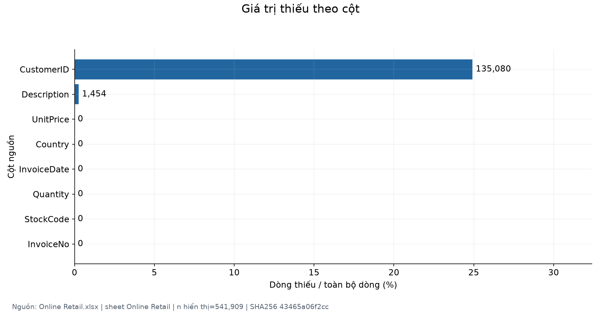

**Phạm vi:** Toàn bộ raw

**Quan sát:** Thiếu mã khách làm giảm phạm vi có thể tổng hợp hành vi theo khách.

**Bằng chứng:** CustomerID thiếu 135,080/541,909 dòng (24.93%); giá trị có dấu của nhóm này 1,447,682.12 GBP.

**Ý nghĩa:** Cần giữ thống kê giao dịch vô danh riêng với phân tích khách có mã.

**Giới hạn / câu hỏi tiếp:** Không suy ra danh tính khách thiếu, không coi mọi dòng vô danh là một khách; giá trị có dấu chưa là doanh thu thuần.

Bảng bằng chứng trong [workbook](../experiments/eda_raw_moi/ket_qua_eda.xlsx): missing_values (T06), customer_coverage (T40).

### Chứng từ C, dấu số lượng và đơn giá

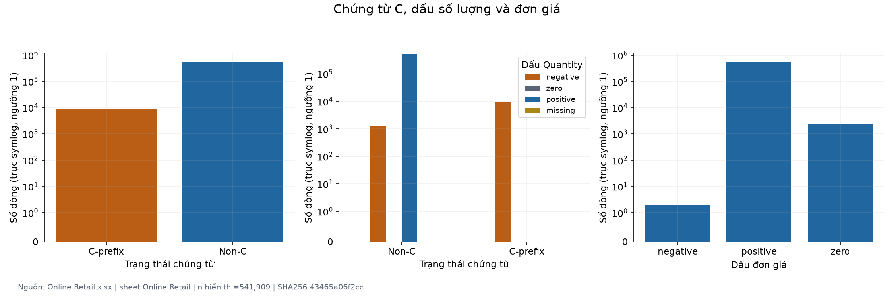

**Phạm vi:** Toàn bộ raw

**Quan sát:** Cần phân biệt dấu số lượng với dấu hiệu chứng từ hủy.

**Bằng chứng:** C: 9,288 dòng/3,836 chứng từ; Q âm không C: 1,336; giá âm 2, giá 0 2,515 dòng.

**Ý nghĩa:** Một quy tắc chỉ dựa vào tiền tố C có thể bỏ sót điều chỉnh khác.

**Giới hạn / câu hỏi tiếp:** Những nhóm này chồng lấn; C chưa được ghép với đơn gốc. Không tự kết luận giá 0 là quà tặng hay lỗi.

Bảng bằng chứng trong [workbook](../experiments/eda_raw_moi/ket_qua_eda.xlsx): document_status (T11), document_quantity_counts (T10), price_sign_counts (T13), negative_price_samples (T15).

## 3. Thống kê mô tả

| population | variable | count | missing_or_nonfinite | minimum | maximum | mean | median | std | q1 | q3 | iqr | p95 | p99 | skewness | iqr_lower | iqr_upper | outside_iqr |
| --- | --- | --- | --- | --- | --- | --- | --- | --- | --- | --- | --- | --- | --- | --- | --- | --- | --- |
| raw lines | Quantity | 541909 | 0 | -80,995 | 80,995 | 9.5522 | 3 | 218.0812 | 1 | 10 | 9 | 29 | 100 | -0.2641 | -12.5 | 23.5 | 58619 |
| raw lines | UnitPrice | 541909 | 0 | -11,062.06 | 38,970 | 4.6111 | 2.08 | 96.7599 | 1.25 | 4.13 | 2.88 | 9.95 | 18 | 186.507 | -3.07 | 8.45 | 39627 |
| raw lines | SignedLineValue | 541909 | 0 | -168,469.6 | 168,469.6 | 17.9878 | 9.75 | 378.8108 | 3.4 | 17.4 | 14 | 59.4 | 180 | -0.9644 | -17.6 | 38.4 | 44997 |

| variable | unique_nonmissing | missing | singleton_categories | categories_under_100_lines |
| --- | --- | --- | --- | --- |
| InvoiceNo | 25900 | 0 | 5841 | 25223 |
| CustomerID | 4372 | 135080 | 79 | 3257 |
| StockCode | 4070 | 0 | 233 | 2489 |
| Description | 4223 | 1454 | 308 | 2635 |
| Country | 38 | 0 | 0 | 9 |

Bảng số có count, min/max, mean/median, std mẫu, q1/q3, IQR, p95/p99 và skew. Không tính trung bình mã định danh. Tần suất đầy đủ và nhóm hiếm trong các bảng country/stock/description_counts và categorical_summary.

## 4. Phân tích đơn biến

### Phân phối toàn miền; giữ số âm, 0 và cực trị

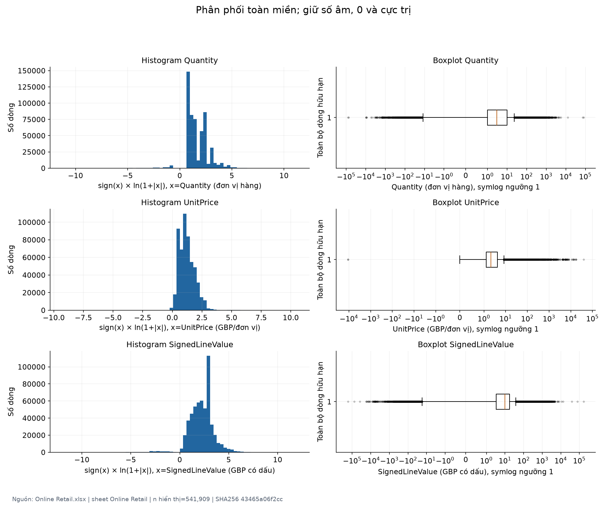

**Phạm vi:** Toàn bộ raw

**Quan sát:** Trung vị và cực trị cách xa nhau; cần xem phân vị trước khi chọn cách biến đổi.

**Bằng chứng:** Quantity: median=3.00, p99=100.00, min=-80,995.00, max=80,995.00; UnitPrice: median=2.08, p99=18.00, min=-11,062.06, max=38,970.00; SignedLineValue: median=9.75, p99=180.00, min=-168,469.60, max=168,469.60

**Ý nghĩa:** Độ nhạy của tổng giá trị và khoảng cách phân cụm với khách mua lớn cần được khảo sát.

**Giới hạn / câu hỏi tiếp:** Đổi tọa độ chỉ để hiển thị, không scale dữ liệu hay cắt quan sát. Ngoại lệ IQR là cờ kiểm tra; Q×P có phụ thuộc công thức và chưa là doanh thu thuần.

Bảng bằng chứng trong [workbook](../experiments/eda_raw_moi/ket_qua_eda.xlsx): numeric_summary (T20), extreme_samples (T22).

### Top 12 Country theo số dòng

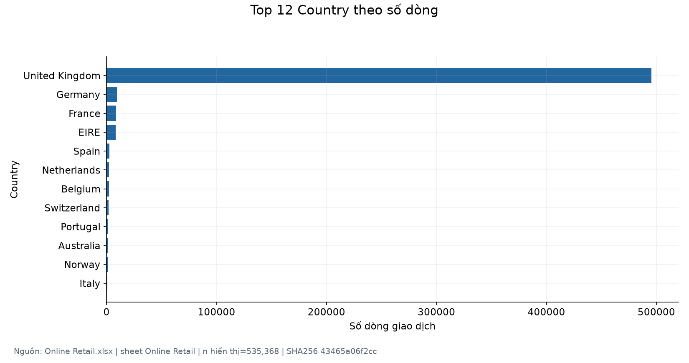

**Phạm vi:** Toàn bộ raw; hiển thị top 12 Country; phần còn lại 6,541 dòng

**Quan sát:** Nhóm nhiều dòng nhất là United Kingdom.

**Bằng chứng:** Nhóm đầu có 495,478 dòng (91.43% toàn raw); top 12 có 535,368/541,909 dòng; 38 giá trị khác nhau.

**Ý nghĩa:** Cần đánh giá mức tập trung khi đề xuất nhóm danh mục và tỷ lệ hành vi.

**Giới hạn / câu hỏi tiếp:** Xếp hạng số dòng không đồng nghĩa số sản phẩm bán, doanh số hay số khách. Nhãn quốc gia/mã hàng chưa được chuẩn hóa nghiệp vụ.

Bảng bằng chứng trong [workbook](../experiments/eda_raw_moi/ket_qua_eda.xlsx): country_counts (T23), categorical_summary (T26).

### Top 12 StockCode theo số dòng

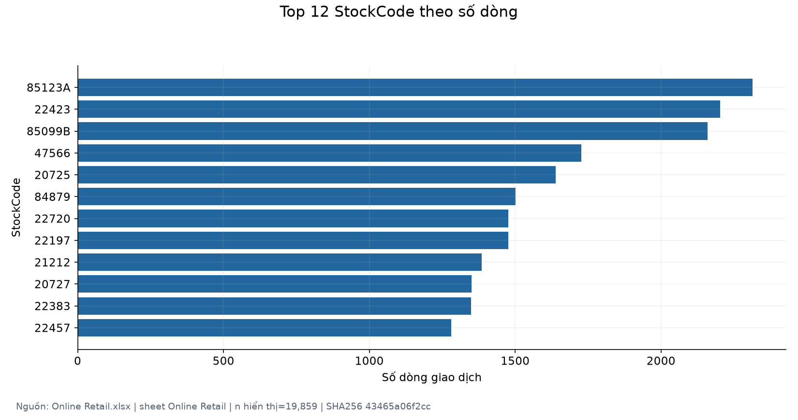

**Phạm vi:** Toàn bộ raw; hiển thị top 12 StockCode; phần còn lại 522,050 dòng

**Quan sát:** Nhóm nhiều dòng nhất là 85123A.

**Bằng chứng:** Nhóm đầu có 2,313 dòng (0.43% toàn raw); top 12 có 19,859/541,909 dòng; 4,070 giá trị khác nhau.

**Ý nghĩa:** Cần đánh giá mức tập trung khi đề xuất nhóm danh mục và tỷ lệ hành vi.

**Giới hạn / câu hỏi tiếp:** Xếp hạng số dòng không đồng nghĩa số sản phẩm bán, doanh số hay số khách. Nhãn quốc gia/mã hàng chưa được chuẩn hóa nghiệp vụ.

Bảng bằng chứng trong [workbook](../experiments/eda_raw_moi/ket_qua_eda.xlsx): stock_code_counts (T24), categorical_summary (T26).

## 5. Thời gian và khách hàng

| month | rows | invoices | signed_line_value | first_timestamp | last_timestamp | temporary_purchase_value | boundary_month | note |
| --- | --- | --- | --- | --- | --- | --- | --- | --- |
| 2010-12 | 42481 | 2025 | 748,957.02 | 2010-12-01 08:26:00 | 2010-12-23 17:41:00 | 572,713.89 | True | Tháng biên; đối chiếu thời điểm đầu/cuối |
| 2011-01 | 35147 | 1476 | 560,000.26 | 2011-01-04 10:00:00 | 2011-01-31 16:59:00 | 569,445.04 | False | Trong cửa sổ quan sát |
| 2011-02 | 27707 | 1393 | 498,062.65 | 2011-02-01 08:23:00 | 2011-02-28 17:04:00 | 447,137.35 | False | Trong cửa sổ quan sát |
| 2011-03 | 36748 | 1983 | 683,267.08 | 2011-03-01 08:30:00 | 2011-03-31 19:55:00 | 595,500.76 | False | Trong cửa sổ quan sát |
| 2011-04 | 29916 | 1744 | 493,207.121 | 2011-04-01 08:22:00 | 2011-04-28 19:53:00 | 469,200.361 | False | Trong cửa sổ quan sát |
| 2011-05 | 37030 | 2162 | 723,333.51 | 2011-05-01 10:51:00 | 2011-05-31 15:53:00 | 678,594.56 | False | Trong cửa sổ quan sát |
| 2011-06 | 36874 | 2012 | 691,123.12 | 2011-06-01 07:37:00 | 2011-06-30 20:08:00 | 661,213.69 | False | Trong cửa sổ quan sát |
| 2011-07 | 39518 | 1927 | 681,300.111 | 2011-07-01 08:16:00 | 2011-07-31 16:04:00 | 600,091.011 | False | Trong cửa sổ quan sát |
| 2011-08 | 35284 | 1737 | 682,680.51 | 2011-08-01 08:30:00 | 2011-08-31 17:45:00 | 645,343.9 | False | Trong cửa sổ quan sát |
| 2011-09 | 50226 | 2327 | 1,019,687.622 | 2011-09-01 08:25:00 | 2011-09-30 17:22:00 | 952,838.382 | False | Trong cửa sổ quan sát |
| 2011-10 | 60742 | 2637 | 1,070,704.67 | 2011-10-02 10:32:00 | 2011-10-31 17:19:00 | 1,039,318.79 | False | Trong cửa sổ quan sát |
| 2011-11 | 84711 | 3462 | 1,461,756.25 | 2011-11-01 08:16:00 | 2011-11-30 17:42:00 | 1,161,817.38 | False | Trong cửa sổ quan sát |
| 2011-12 | 25525 | 1015 | 433,668.01 | 2011-12-01 08:12:00 | 2011-12-09 12:50:00 | 518,192.79 | True | Tháng biên; đối chiếu thời điểm đầu/cuối |

| population | variable | count | missing_or_nonfinite | minimum | maximum | mean | median | std | q1 | q3 | iqr | p95 | p99 | skewness | iqr_lower | iqr_upper | outside_iqr |
| --- | --- | --- | --- | --- | --- | --- | --- | --- | --- | --- | --- | --- | --- | --- | --- | --- | --- |
| temporary known-ID purchases | n_invoices | 4338 | 0 | 1 | 209 | 4.272 | 2 | 7.698 | 1 | 5 | 4 | 13 | 30 | 12.067 | -5 | 11 | 285 |
| temporary known-ID purchases | monetary | 4338 | 0 | 3.75 | 280,206.02 | 2,054.2665 | 674.485 | 8,989.2304 | 307.415 | 1,661.74 | 1,354.325 | 5,841.843 | 19,880.9957 | 19.325 | -1,724.0725 | 3,693.2275 | 427 |
| temporary known-ID purchases | avg_order_value | 4338 | 0 | 3.45 | 84,236.25 | 419.1663 | 293.9 | 1,796.5379 | 178.625 | 430.1137 | 251.4887 | 937.2118 | 2,031.1612 | 41.6881 | -198.6081 | 807.3469 | 290 |
| temporary known-ID purchases | n_stock_codes | 4338 | 0 | 1 | 1,787 | 61.5012 | 35 | 85.3668 | 16 | 77 | 61 | 205 | 354 | 6.9194 | -75.5 | 168.5 | 309 |
| temporary known-ID purchases | total_quantity | 4338 | 0 | 1 | 196,915 | 1,191.2891 | 379 | 5,046.0815 | 160 | 992.75 | 832.75 | 3,570.9 | 11,046.58 | 20.3596 | -1,089.125 | 2,241.875 | 400 |
| temporary known-ID purchases | active_days | 4338 | 0 | 1 | 132 | 3.8642 | 2 | 5.949 | 1 | 4 | 3 | 12 | 25 | 8.8261 | -3.5 | 8.5 | 397 |
| temporary known-ID purchases | observed_span_days | 4338 | 0 | 0 | 373.0965 | 130.7723 | 92.9497 | 132.2115 | 0 | 252.0141 | 252.0141 | 356.9969 | 367.8717 | 0.4529 | -378.0211 | 630.0352 | 0 |
| temporary known-ID purchases | avg_purchase_gap_days | 2845 | 1493 | 0 | 365.9819 | 72.6531 | 53.4573 | 65.5589 | 29.4858 | 91.9083 | 62.4225 | 210.925 | 330.5982 | 1.9127 | -64.1479 | 185.5421 | 195 |
| temporary known-ID purchases | recency_days | 4338 | 0 | 0.4653 | 373.5882 | 92.5146 | 50.5552 | 100.0133 | 17.5377 | 142.1958 | 124.6582 | 311.5052 | 369.1353 | 1.2458 | -169.4496 | 329.1831 | 155 |

| metric | value |
| --- | --- |
| raw_known_ids | 4,372 |
| temporary_purchase_customers | 4,338 |
| raw_ids_without_eligible_purchase | 34 |
| customers_one_invoice | 1,493 |
| pct_customers_one_invoice | 34.4168 |
| gap_defined_customers | 2,845 |
| signed_value_missing_id | 1,447,682.12 |
| raw_signed_value | 9,747,747.934 |
| temporary_purchase_value | 8,911,407.904 |

### Số dòng và số chứng từ theo tháng

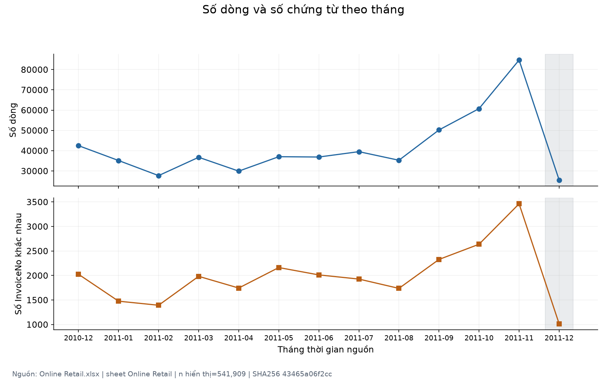

**Phạm vi:** Toàn bộ raw

**Quan sát:** Tháng có nhiều dòng nhất trong cửa sổ là 2011-11.

**Bằng chứng:** Đỉnh 84,711 dòng; tháng cuối 2011-12 có 25,525 dòng và chỉ đến 2011-12-09 12:50:00.

**Ý nghĩa:** Cửa sổ dữ liệu và mùa vụ có thể ảnh hưởng tần suất/giá trị quan sát của khách.

**Giới hạn / câu hỏi tiếp:** Tháng cuối thiếu ngày; không diễn giải giảm tháng cuối như suy giảm kinh doanh. Dữ liệu từ 2010-12-01 08:26:00 đến 2011-12-09 12:50:00, chưa rõ múi giờ; các tổng chưa xác định là doanh thu thuần.

Bảng bằng chứng trong [workbook](../experiments/eda_raw_moi/ket_qua_eda.xlsx): monthly_activity (T27), analysis_scopes (T39).

### Giá trị có dấu của raw và giá trị tập mua tạm

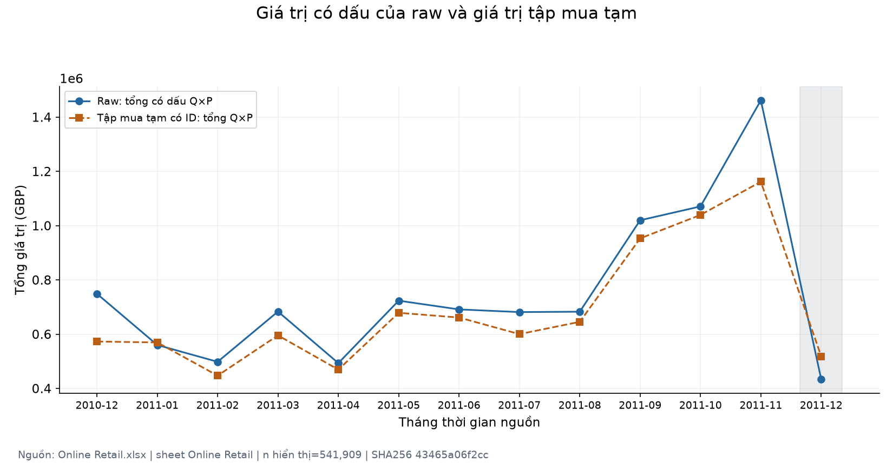

**Phạm vi:** Toàn bộ raw

**Quan sát:** Hai tổng thuộc hai phạm vi; chênh lệch phản ánh cả điều kiện lọc và dòng vô danh.

**Bằng chứng:** Raw có dấu 9,747,747.93 GBP; tập mua tạm 8,911,407.90 GBP.

**Ý nghĩa:** Cửa sổ dữ liệu và mùa vụ có thể ảnh hưởng tần suất/giá trị quan sát của khách.

**Giới hạn / câu hỏi tiếp:** Tháng cuối thiếu ngày; không diễn giải giảm tháng cuối như suy giảm kinh doanh. Dữ liệu từ 2010-12-01 08:26:00 đến 2011-12-09 12:50:00, chưa rõ múi giờ; các tổng chưa xác định là doanh thu thuần.

Bảng bằng chứng trong [workbook](../experiments/eda_raw_moi/ket_qua_eda.xlsx): monthly_activity (T27), analysis_scopes (T39).

### Tần suất theo thứ và giờ nguồn

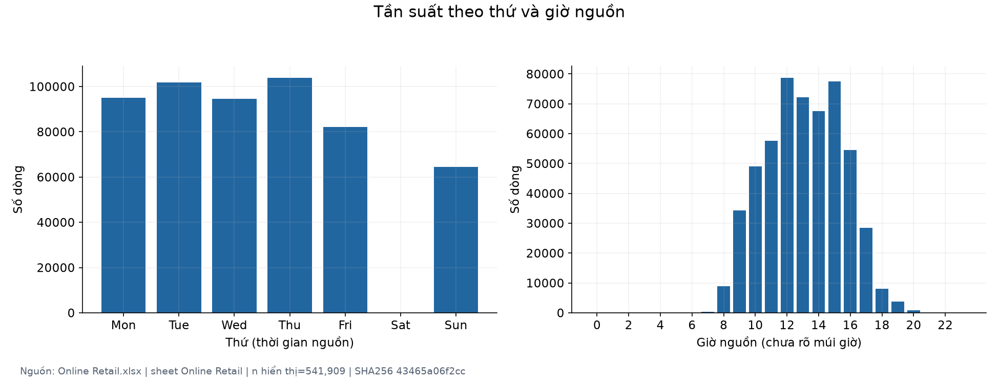

**Phạm vi:** Toàn bộ raw

**Quan sát:** Nhiều dòng nhất tại giờ 12.

**Bằng chứng:** Giờ 12: 78,709 dòng; thứ Bảy: 0 dòng.

**Ý nghĩa:** Có thể đề xuất đặc trưng tỷ lệ giao dịch theo thời điểm sau khi hiểu quy trình ghi nhận.

**Giới hạn / câu hỏi tiếp:** Tần suất gộp phụ thuộc số ngày được ghi nhận và lượng dòng mỗi đơn; không chứng minh giờ đặt hàng thực hay lịch mở cửa.

Bảng bằng chứng trong [workbook](../experiments/eda_raw_moi/ket_qua_eda.xlsx): weekday_counts (T28), hour_counts (T29).

### Phân phối hành vi khách trong tập mua tạm

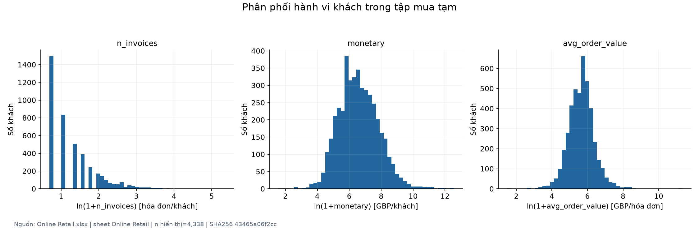

**Phạm vi:** InvoiceNo và CustomerID có mã, InvoiceDate hợp lệ; không có tiền tố C; Quantity > 0 và UnitPrice > 0, cả hai hữu hạn. Giữ nguyên dòng trùng và mã dịch vụ; chỉ là phạm vi khảo sát, chưa phải quy tắc clean.

**Quan sát:** Tần suất và giá trị quan sát khác nhau giữa khách.

**Bằng chứng:** n_invoices: median 2.00, p99 30.00, max 209.00; monetary: median 674.49, p99 19,881.00, max 280,206.02; avg_order_value: median 293.90, p99 2,031.16, max 84,236.25

**Ý nghĩa:** Phân vị hỗ trợ so sánh RobustScaler/log1p với các cách giữ nguyên thang ở bước sau.

**Giới hạn / câu hỏi tiếp:** Chỉ biến đổi tọa độ hiển thị; chưa fit scaler. Giữ trùng và mã dịch vụ có thể ảnh hưởng tổng; không phải bộ đặc trưng chính thức.

Bảng bằng chứng trong [workbook](../experiments/eda_raw_moi/ket_qua_eda.xlsx): customer_summary (T21), customer_coverage (T40), aggregation_formulas (T38).

### Khoảng cách mua; giữ thiếu cho khách một đơn

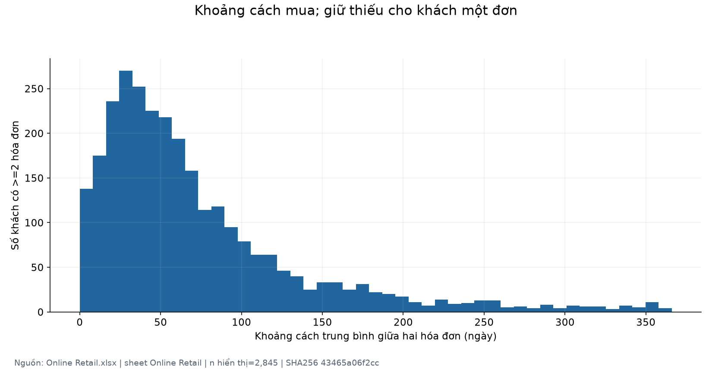

**Phạm vi:** Khách có >=2 hóa đơn trong tập mua tạm; min timestamp mỗi hóa đơn

**Quan sát:** Khoảng cách chỉ xác định khi quan sát ít nhất hai hóa đơn.

**Bằng chứng:** 1,493/4,338 khách có một hóa đơn (34.42%), giữ NaN; 2,845 khách có gap, median 53.46 ngày.

**Ý nghĩa:** Thiếu gap là thiếu do cấu trúc hành vi, không phải mặc định khoảng cách bằng 0.

**Giới hạn / câu hỏi tiếp:** Hóa đơn khác nhau có thể cùng thời điểm (gap 0 hợp lệ); chưa xác nhận hóa đơn trùng nghiệp vụ và không quan sát trước/sau cửa sổ raw.

Bảng bằng chứng trong [workbook](../experiments/eda_raw_moi/ket_qua_eda.xlsx): customer_summary (T21), customer_coverage (T40), aggregation_formulas (T38).

## 6. Hai biến và đa biến

### Số lượng và đơn giá trên toàn raw hữu hạn

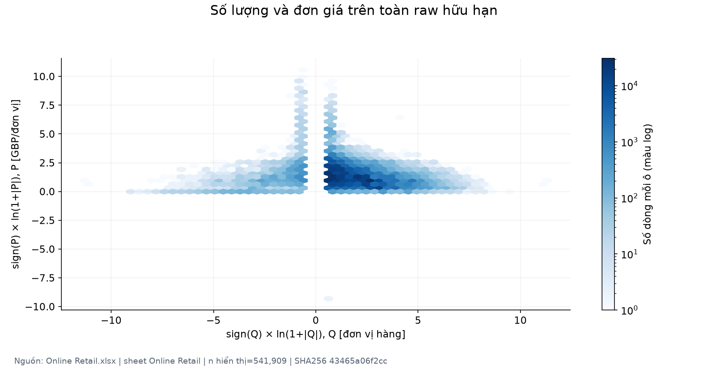

**Phạm vi:** Toàn bộ raw

**Quan sát:** Mật độ tập trung theo miền giá/số lượng; hai hệ số có thể khác nhau do đuôi và thứ hạng.

**Bằng chứng:** Quantity–UnitPrice: n=541,909, Pearson=-0.0012, Spearman=-0.3854.

**Ý nghĩa:** Kiểm tra dạng quan hệ trước khi cân nhắc đặc trưng số lượng/giá.

**Giới hạn / câu hỏi tiếp:** Hexbin dùng toàn bộ cặp hữu hạn, không lấy mẫu; đổi tọa độ chỉ để nhìn. Không diễn giải tương quan là nhân quả hay cầu theo giá.

Bảng bằng chứng trong [workbook](../experiments/eda_raw_moi/ket_qua_eda.xlsx): correlations_line_pearson (T32), correlations_line_spearman (T33), correlations_line_pairwise_counts (T34), numeric_summary (T20).

### Số hóa đơn và tổng giá trị theo khách

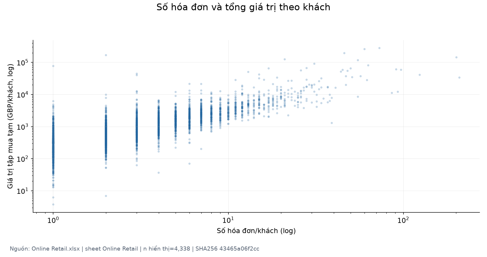

**Phạm vi:** InvoiceNo và CustomerID có mã, InvoiceDate hợp lệ; không có tiền tố C; Quantity > 0 và UnitPrice > 0, cả hai hữu hạn. Giữ nguyên dòng trùng và mã dịch vụ; chỉ là phạm vi khảo sát, chưa phải quy tắc clean.

**Quan sát:** Các điểm trải rộng về giá trị ngay tại cùng số hóa đơn.

**Bằng chứng:** n_invoices–monetary: n=4,338, Pearson=0.5536, Spearman=0.8075.

**Ý nghĩa:** Cần đánh giá tần suất cùng giá trị đơn, thay vì chọn một hệ số duy nhất.

**Giới hạn / câu hỏi tiếp:** Toàn bộ khách, không mẫu/cắt; tổng giá trị phụ thuộc số đơn và giá trị đơn; tương quan không chứng minh nhân quả.

Bảng bằng chứng trong [workbook](../experiments/eda_raw_moi/ket_qua_eda.xlsx): correlations_customer_pearson (T35), correlations_customer_spearman (T36), correlations_customer_pairwise_counts (T37).

### Giá trị dòng mua theo quốc gia

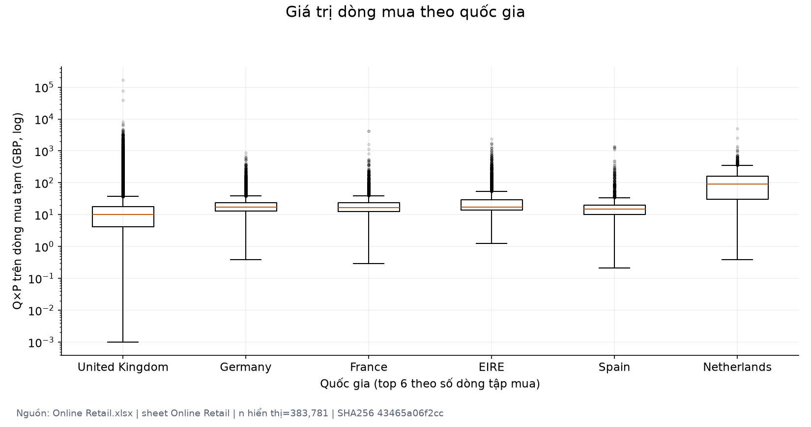

**Phạm vi:** InvoiceNo và CustomerID có mã, InvoiceDate hợp lệ; không có tiền tố C; Quantity > 0 và UnitPrice > 0, cả hai hữu hạn. Giữ nguyên dòng trùng và mã dịch vụ; chỉ là phạm vi khảo sát, chưa phải quy tắc clean. Top 6 quốc gia theo số dòng; không cắt cực trị.

**Quan sát:** Phân phối giá trị trên dòng cần đọc cùng cỡ mẫu khác nhau của quốc gia.

**Bằng chứng:** United Kingdom: n=354,321, median=10.20 GBP; Germany: n=9,040, median=17.00 GBP; France: n=8,341, median=16.60 GBP; EIRE: n=7,236, median=17.40 GBP; Spain: n=2,484, median=15.00 GBP; Netherlands: n=2,359, median=91.80 GBP

**Ý nghĩa:** Đánh giá đặc trưng quốc gia cùng hành vi, tránh để nhóm có nhiều dòng chi phối kết luận.

**Giới hạn / câu hỏi tiếp:** Không phải giá trị mỗi khách; 14,103 dòng ngoài top 6 không hiện. Không kiểm định khác biệt hay khẳng định quốc gia gây ra giá trị mua.

Bảng bằng chứng trong [workbook](../experiments/eda_raw_moi/ket_qua_eda.xlsx): country_value_summary (T31), analysis_scopes (T39).

### Quốc gia và trạng thái chứng từ

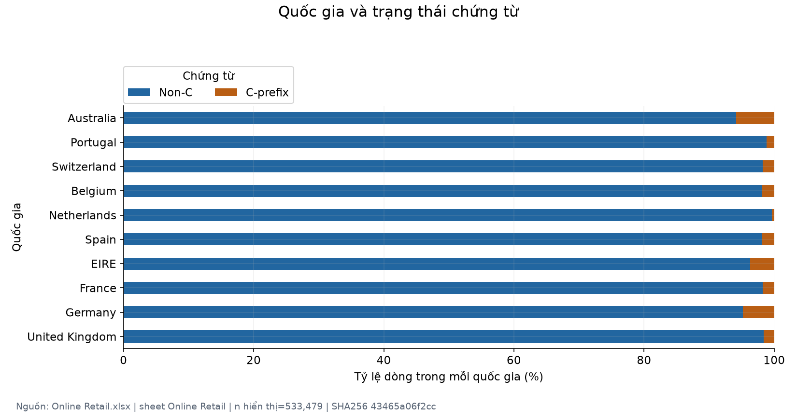

**Phạm vi:** Raw, top 10 quốc gia theo số dòng; tỷ lệ theo tổng dòng mỗi quốc gia

**Quan sát:** Thành phần chứng từ C được so sánh theo mẫu số riêng từng quốc gia.

**Bằng chứng:** United Kingdom: C 7,856/495,478 dòng (1.59%); Germany: C 453/9,495 dòng (4.77%); France: C 149/8,557 dòng (1.74%); EIRE: C 302/8,196 dòng (3.68%)

**Ý nghĩa:** Cần làm rõ cách nhận diện trả hàng trước khi thêm tỷ lệ hoàn trả theo khách/nhóm.

**Giới hạn / câu hỏi tiếp:** 8,430 dòng ngoài top 10 không hiện; tỷ lệ chứng từ C không phải tỷ lệ hàng trả và không ghép đơn mua gốc.

Bảng bằng chứng trong [workbook](../experiments/eda_raw_moi/ket_qua_eda.xlsx): country_document_counts (T30), country_counts (T23).

### Đa biến: tần suất, giá trị đơn, độ đa dạng mã và recency

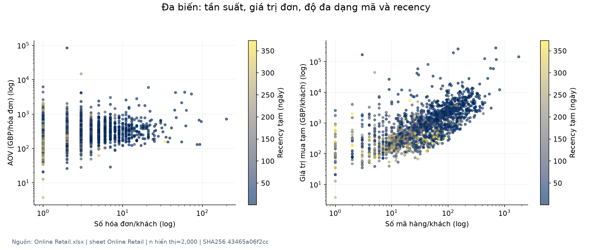

**Phạm vi:** Mẫu 2,000/4,338 khách của tập mua tạm, random_state=1505

**Quan sát:** Các cặp kiểm tra sự bổ sung giữa cường độ mua, giá trị mỗi đơn và số mã mua.

**Bằng chứng:** n_invoices–avg_order_value: n=4,338, Pearson=0.0191, Spearman=0.1553. n_stock_codes–monetary: n=4,338, Pearson=0.3870, Spearman=0.7264.

**Ý nghĩa:** Cân nhắc thông tin trùng lặp giữa RFM và biến hành vi trước khi chọn tập biến.

**Giới hạn / câu hỏi tiếp:** Hệ số tính trên toàn bộ khách đủ điều kiện theo cặp; scatter chỉ mẫu. Màu recency là mô tả, không là nhãn hay dự báo; mã hàng chưa phân loại sản phẩm.

Bảng bằng chứng trong [workbook](../experiments/eda_raw_moi/ket_qua_eda.xlsx): correlations_customer_pearson (T35), correlations_customer_spearman (T36), customer_summary (T21), aggregation_formulas (T38).

## 7. Tương quan

### pearson — cấp dòng raw

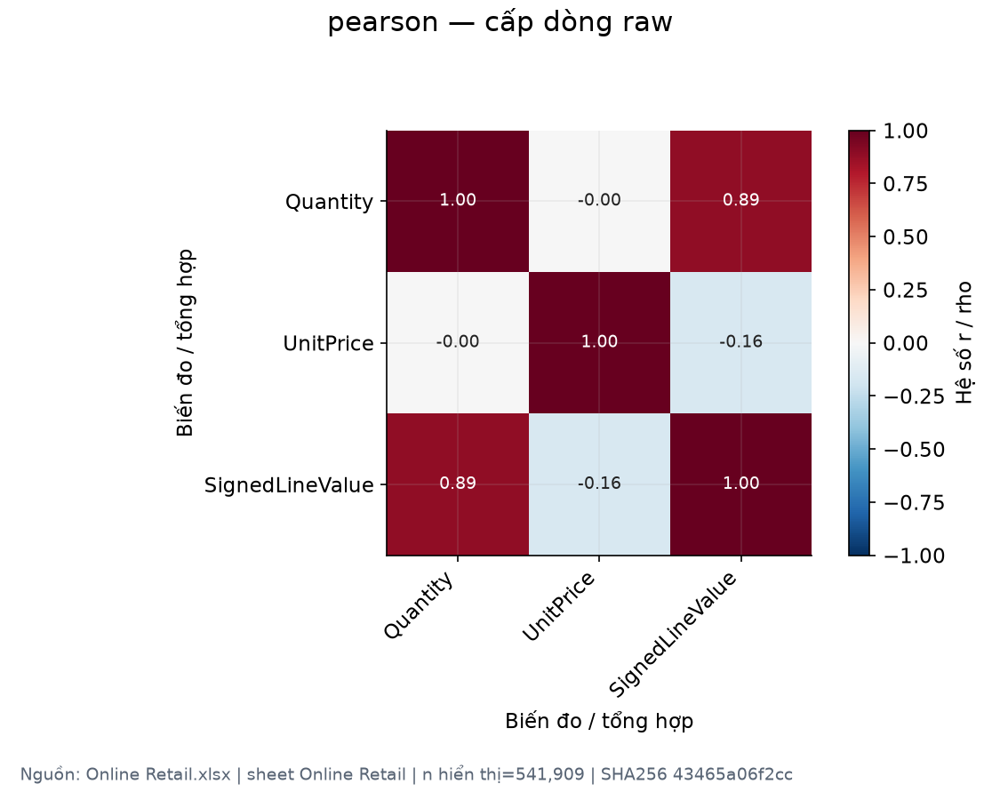

**Phạm vi:** Toàn bộ dòng raw hữu hạn theo cặp

**Quan sát:** Pearson mô tả tuyến tính; Spearman mô tả đơn điệu theo hạng, nhạy khác nhau với cực trị.

**Bằng chứng:** Quantity–UnitPrice: n=541,909, Pearson=-0.0012, Spearman=-0.3854.

**Ý nghĩa:** Chọn biến theo ý nghĩa và độ trùng thông tin, không tự loại chỉ vì hệ số cao.

**Giới hạn / câu hỏi tiếp:** Pairwise finite deletion, min_periods=3; không impute và không lấy mẫu ma trận. IDs bị loại. SignedLineValue=Q×P và AOV=M/F có phụ thuộc công thức; tương quan không chứng minh nhân quả.

Bảng bằng chứng trong [workbook](../experiments/eda_raw_moi/ket_qua_eda.xlsx): correlations_line_pearson (T32), correlation_variable_audit (T41), aggregation_formulas (T38).

### spearman — cấp dòng raw

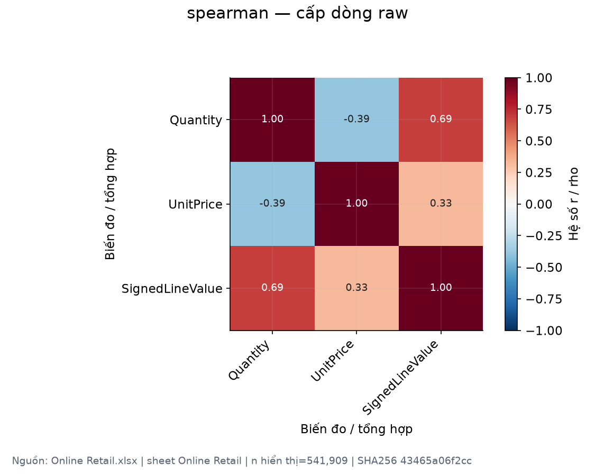

**Phạm vi:** Toàn bộ dòng raw hữu hạn theo cặp

**Quan sát:** Pearson mô tả tuyến tính; Spearman mô tả đơn điệu theo hạng, nhạy khác nhau với cực trị.

**Bằng chứng:** Quantity–UnitPrice: n=541,909, Pearson=-0.0012, Spearman=-0.3854.

**Ý nghĩa:** Chọn biến theo ý nghĩa và độ trùng thông tin, không tự loại chỉ vì hệ số cao.

**Giới hạn / câu hỏi tiếp:** Pairwise finite deletion, min_periods=3; không impute và không lấy mẫu ma trận. IDs bị loại. SignedLineValue=Q×P và AOV=M/F có phụ thuộc công thức; tương quan không chứng minh nhân quả.

Bảng bằng chứng trong [workbook](../experiments/eda_raw_moi/ket_qua_eda.xlsx): correlations_line_spearman (T33), correlation_variable_audit (T41), aggregation_formulas (T38).

### pairwise_counts — cấp dòng raw

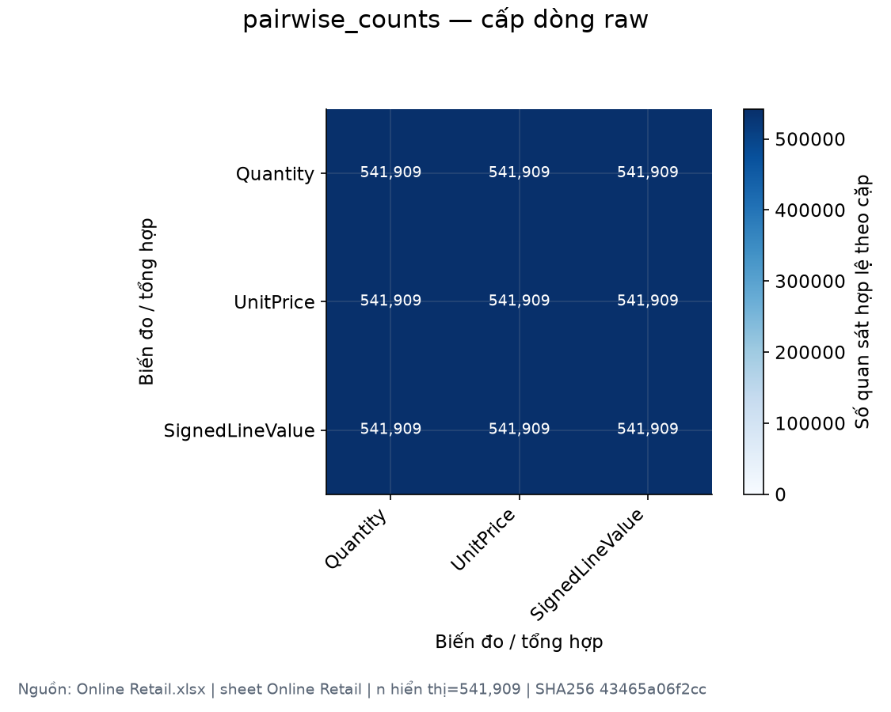

**Phạm vi:** Toàn bộ dòng raw hữu hạn theo cặp

**Quan sát:** Số cặp hợp lệ có thể khác nhau; không điền 0 cho dữ liệu chưa xác định.

**Bằng chứng:** n theo cặp từ 541,909 đến 541,909.

**Ý nghĩa:** Chọn biến theo ý nghĩa và độ trùng thông tin, không tự loại chỉ vì hệ số cao.

**Giới hạn / câu hỏi tiếp:** Pairwise finite deletion, min_periods=3; không impute và không lấy mẫu ma trận. IDs bị loại. SignedLineValue=Q×P và AOV=M/F có phụ thuộc công thức; tương quan không chứng minh nhân quả.

Bảng bằng chứng trong [workbook](../experiments/eda_raw_moi/ket_qua_eda.xlsx): correlations_line_pairwise_counts (T34), correlation_variable_audit (T41), aggregation_formulas (T38).

### pearson — cấp khách tạm

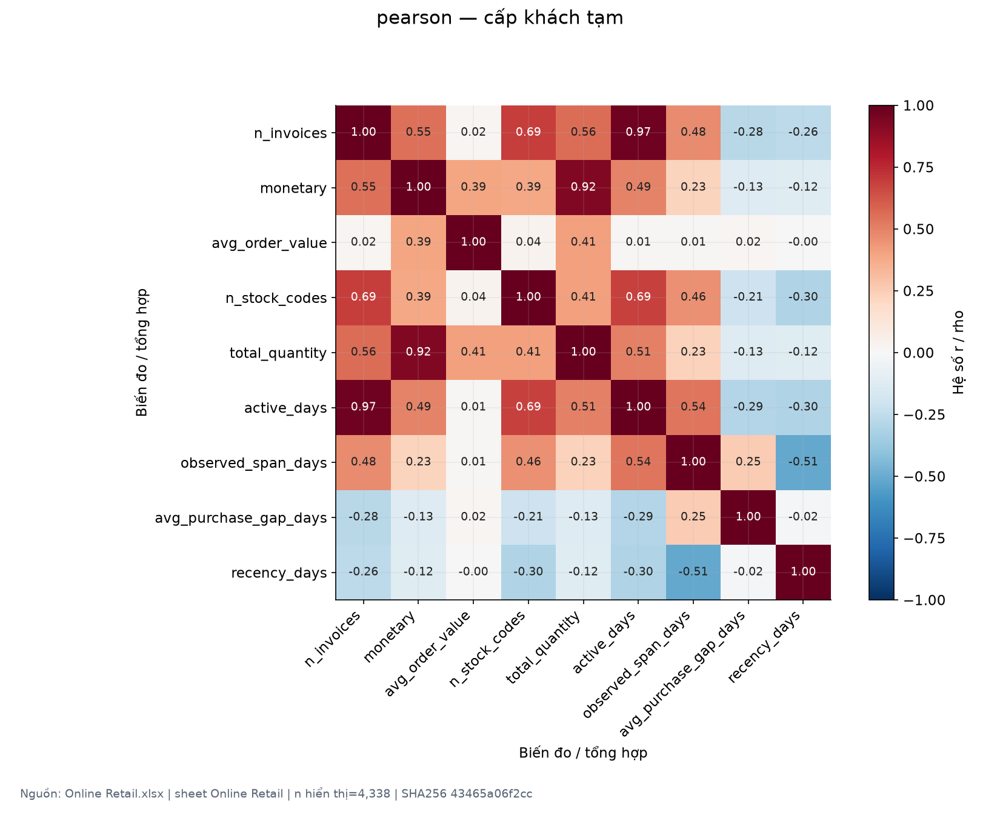

**Phạm vi:** InvoiceNo và CustomerID có mã, InvoiceDate hợp lệ; không có tiền tố C; Quantity > 0 và UnitPrice > 0, cả hai hữu hạn. Giữ nguyên dòng trùng và mã dịch vụ; chỉ là phạm vi khảo sát, chưa phải quy tắc clean. Toàn bộ khách, hữu hạn theo cặp.

**Quan sát:** Pearson mô tả tuyến tính; Spearman mô tả đơn điệu theo hạng, nhạy khác nhau với cực trị.

**Bằng chứng:** n_invoices–monetary: n=4,338, Pearson=0.5536, Spearman=0.8075.

**Ý nghĩa:** Chọn biến theo ý nghĩa và độ trùng thông tin, không tự loại chỉ vì hệ số cao.

**Giới hạn / câu hỏi tiếp:** Pairwise finite deletion, min_periods=3; không impute và không lấy mẫu ma trận. IDs bị loại. SignedLineValue=Q×P và AOV=M/F có phụ thuộc công thức; tương quan không chứng minh nhân quả.

Bảng bằng chứng trong [workbook](../experiments/eda_raw_moi/ket_qua_eda.xlsx): correlations_customer_pearson (T35), correlation_variable_audit (T41), aggregation_formulas (T38).

### spearman — cấp khách tạm

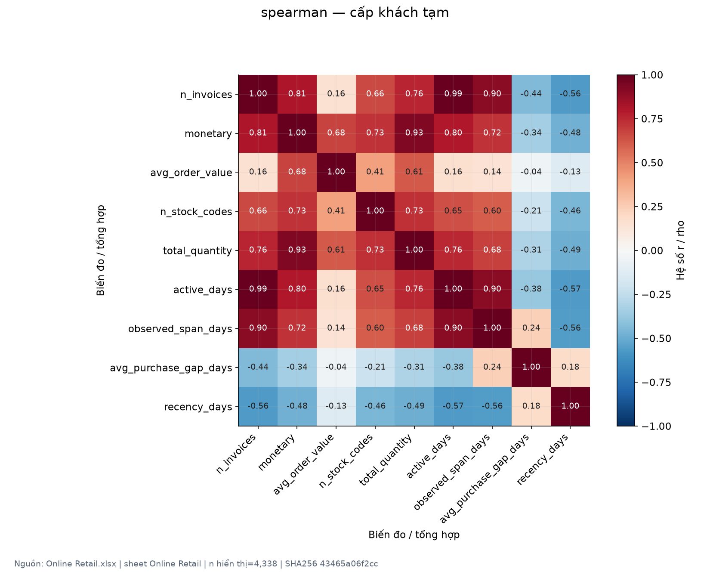

**Phạm vi:** InvoiceNo và CustomerID có mã, InvoiceDate hợp lệ; không có tiền tố C; Quantity > 0 và UnitPrice > 0, cả hai hữu hạn. Giữ nguyên dòng trùng và mã dịch vụ; chỉ là phạm vi khảo sát, chưa phải quy tắc clean. Toàn bộ khách, hữu hạn theo cặp.

**Quan sát:** Pearson mô tả tuyến tính; Spearman mô tả đơn điệu theo hạng, nhạy khác nhau với cực trị.

**Bằng chứng:** n_invoices–monetary: n=4,338, Pearson=0.5536, Spearman=0.8075.

**Ý nghĩa:** Chọn biến theo ý nghĩa và độ trùng thông tin, không tự loại chỉ vì hệ số cao.

**Giới hạn / câu hỏi tiếp:** Pairwise finite deletion, min_periods=3; không impute và không lấy mẫu ma trận. IDs bị loại. SignedLineValue=Q×P và AOV=M/F có phụ thuộc công thức; tương quan không chứng minh nhân quả.

Bảng bằng chứng trong [workbook](../experiments/eda_raw_moi/ket_qua_eda.xlsx): correlations_customer_spearman (T36), correlation_variable_audit (T41), aggregation_formulas (T38).

### pairwise_counts — cấp khách tạm

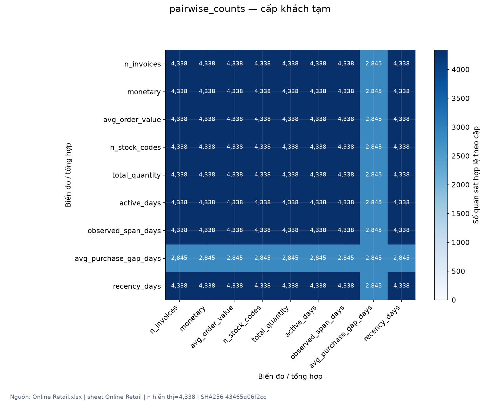

**Phạm vi:** InvoiceNo và CustomerID có mã, InvoiceDate hợp lệ; không có tiền tố C; Quantity > 0 và UnitPrice > 0, cả hai hữu hạn. Giữ nguyên dòng trùng và mã dịch vụ; chỉ là phạm vi khảo sát, chưa phải quy tắc clean. Toàn bộ khách, hữu hạn theo cặp.

**Quan sát:** Số cặp hợp lệ có thể khác nhau; không điền 0 cho dữ liệu chưa xác định.

**Bằng chứng:** n theo cặp từ 2,845 đến 4,338; gap thiếu ở 1,493 khách một đơn.

**Ý nghĩa:** Chọn biến theo ý nghĩa và độ trùng thông tin, không tự loại chỉ vì hệ số cao.

**Giới hạn / câu hỏi tiếp:** Pairwise finite deletion, min_periods=3; không impute và không lấy mẫu ma trận. IDs bị loại. SignedLineValue=Q×P và AOV=M/F có phụ thuộc công thức; tương quan không chứng minh nhân quả.

Bảng bằng chứng trong [workbook](../experiments/eda_raw_moi/ket_qua_eda.xlsx): correlations_customer_pairwise_counts (T37), correlation_variable_audit (T41), aggregation_formulas (T38).

## 8. Đề xuất và quyết định chờ nhóm

Xem [đề xuất sau EDA](de_xuat_sau_eda.md): so sánh nhiều lựa chọn về clean, encoding, scaling và feature. Đặc trưng thủ công, RFM và kết hợp đều là đề xuất chưa chốt.

Cần thống nhất: xử lý khách thiếu mã; định nghĩa trùng; nhận diện/ghép hủy-trả; giá 0/âm; mã dịch vụ; ngoại lệ và khách mua sỉ; cửa sổ lịch sử; công thức giá trị/gap; dùng danh mục hay chỉ hành vi; cách scaling và tập biến.

## 9. Tái lập và kiểm tra

Mở [notebook](../notebooks/01_eda/eda_raw_moi.ipynb), Restart Kernel → Run All. [README EDA](../notebooks/01_eda/README.md) có lệnh chạy. [Kiểm kê nguồn](kiem_ke_eda_raw_moi.md) mô tả raw duy nhất và các hạn chế cần lưu ý.

SHA-256 raw: `43465a06f2ccf7c8b5bd2892bc7defb52f97487934fe93b16ae4c3936424676d`. [Workbook kết quả](../experiments/eda_raw_moi/ket_qua_eda.xlsx) chứa metadata, danh mục hình và bảng thống kê. Notebook và báo cáo dùng cùng bảng/nhận xét tạo trong một lần chạy.

Các kiểm tra tự động đối chiếu tổng dòng theo tháng/quốc gia, tổng giá trị theo khách, AOV, gap một đơn, cặp tương quan với scipy và checksum vùng bảo vệ; kết quả nằm trong sheet Metadata của workbook.

Giới hạn: một nhà bán lẻ và cửa sổ lịch sử hữu hạn; không đại diện toàn thị trường, không biết lịch sử ngoài cửa sổ, chưa ghép chứng từ trả với mua, chưa có nhãn mục tiêu. Không suy ra quan hệ nhân quả hay dự báo từ EDA này.
