# Báo cáo quá trình phân tích khám phá dữ liệu

## 0. Giới thiệu quá trình EDA

Dự án **Phân khúc khách hàng bằng RFM và hành vi mua hàng trên Online Retail II** giải quyết bài toán phân cụm không giám sát từ lịch sử giao dịch. Một dòng nguồn là dòng hàng/bút toán; một Invoice gồm nhiều dòng; một khách có nhiều Invoice. Bảng đặc trưng dự kiến có đúng một dòng/Customer ID. Không tạo nhãn dự đoán hoặc metric mô hình chưa chạy.

Câu hỏi EDA: quy mô và chất lượng nguồn ra sao; lượng/giá/giá trị phân phối thế nào; hoạt động theo thời gian/quốc gia; đặc trưng hành vi liên hệ hay trùng thông tin gì; cần xử lý thiếu/ngoại lệ/scaling thế nào trước phân cụm?

**Phạm vi chính sách.** Báo cáo trước dùng `1c7ce32`. Lần này gọi nguyên trạng `src.preprocessing.clean_data` ở HEAD dưới đây trong bộ nhớ và tách Guest khỏi khảo sát khách hàng sau pipeline. Chưa tìm thấy bằng chứng nhóm phê duyệt chính sách chính thức trong các tài liệu/mã đã kiểm tra; mọi bảng hành vi, RFM và scaling dưới đây là **thử nghiệm theo mã hiện tại, cần nhóm xác nhận**. Không thay đổi quy tắc tiền xử lý của Thuận.

**Khảo sát trước sửa (05/11/2026).** Nền mã `df066ee`, trạng thái Git sạch; EDA v1 có 56 cell, EDA v2 có 25 cell và đang tái hiện chính sách cũ. Đã có chất lượng, thời gian/quốc gia, phân phối, một scatter số đơn–giá trị và RFM/scaling; chưa có bộ phân tích hai/đa biến và ma trận tương quan đầy đủ như bản này. Mười sáu PNG cũ đã được đối chiếu với đường dẫn trong notebook/báo cáo trước khi thay thế.

| raw_rows | raw_invoices | raw_known_customers | pipeline_rows | pipeline_guest_rows | survey_rows | survey_invoices | survey_customers |
| --- | --- | --- | --- | --- | --- | --- | --- |
| 1,067,371 | 53,628 | 5,942 | 1,002,995 | 226,757 | 776,238 | 36,547 | 5,849 |

**Đọc nhanh kết quả.** 1,622/5,849 khách (27.73%) chỉ một Invoice; 4,227 khách còn lại có gap, trung vị 72.89 ngày. Gap nhỏ nhất 0.00 ngày. Cặp không chứa gap có 5,849 quan sát; các cặp chứa gap có 4,227. Chênh 1,622 chính là khách một Invoice; đường chéo gap cũng 4,227.

## 1. Giới thiệu bộ dữ liệu

Nguồn: Daqing Chen (2012), [Online Retail II — UCI](https://archive.ics.uci.edu/dataset/502/online+retail+ii), DOI [10.24432/C5CG6D](https://doi.org/10.24432/C5CG6D). UCI mô tả giao dịch bán lẻ tại Anh, đơn giá GBP và tiền tố C là hủy; tệp cục bộ là `data/raw/online_retail_II.xlsx`. Nguồn không có nhãn cụm, thời điểm gia nhập thật hoặc liên kết hoàn trả đã xác minh.

| sheet | rows | columns | date_min | date_max | invoices | customers | duplicate_excess |
| --- | --- | --- | --- | --- | --- | --- | --- |
| Year 2009-2010 | 525,461 | 8 | 2009-12-01 07:45:00 | 2010-12-09 20:01:00 | 28,816 | 4,383 | 6,865 |
| Year 2010-2011 | 541,910 | 8 | 2010-12-01 08:26:00 | 2011-12-09 12:50:00 | 25,900 | 4,372 | 5,268 |

**Nhận xét.** Hai sheet không phải hai khoảng rời nhau. Khoảng chồng lấn bên dưới được tính từ min/max thời điểm; chỉ kiểm tra tám cột mới xác định trùng nội dung.

| start | end | rows |
| --- | --- | --- |
| 2010-12-01 08:26:00 | 2010-12-09 20:01:00 | 45,046 |

### Kiểu dữ liệu và dòng mẫu

| sheet | column | dtype | non_null |
| --- | --- | --- | --- |
| Year 2009-2010 | Invoice | object | 525,461 |
| Year 2009-2010 | StockCode | object | 525,461 |
| Year 2009-2010 | Description | object | 522,533 |
| Year 2009-2010 | Quantity | int64 | 525,461 |
| Year 2009-2010 | InvoiceDate | datetime64[us] | 525,461 |
| Year 2009-2010 | Price | float64 | 525,461 |
| Year 2009-2010 | Customer ID | float64 | 417,534 |
| Year 2009-2010 | Country | str | 525,461 |
| Year 2010-2011 | Invoice | object | 541,910 |
| Year 2010-2011 | StockCode | object | 541,910 |
| Year 2010-2011 | Description | object | 540,456 |
| Year 2010-2011 | Quantity | int64 | 541,910 |
| Year 2010-2011 | InvoiceDate | datetime64[us] | 541,910 |
| Year 2010-2011 | Price | float64 | 541,910 |
| Year 2010-2011 | Customer ID | float64 | 406,830 |
| Year 2010-2011 | Country | str | 541,910 |


| Invoice | StockCode | Description | Quantity | InvoiceDate | Price | Customer ID | Country | sheet |
| --- | --- | --- | --- | --- | --- | --- | --- | --- |
| 489,434 | 85,048 | 15CM CHRISTMAS GLASS BALL 20 LIGHTS | 12 | 2009-12-01 07:45:00 | 6.95 | 13,085 | United Kingdom | Year 2009-2010 |
| 489,434 | 79323P | PINK CHERRY LIGHTS | 12 | 2009-12-01 07:45:00 | 6.75 | 13,085 | United Kingdom | Year 2009-2010 |
| 536,365 | 85123A | WHITE HANGING HEART T-LIGHT HOLDER | 6 | 2010-12-01 08:26:00 | 2.55 | 17,850 | United Kingdom | Year 2010-2011 |
| 536,365 | 71,053 | WHITE METAL LANTERN | 6 | 2010-12-01 08:26:00 | 3.39 | 17,850 | United Kingdom | Year 2010-2011 |

### Từ điển dữ liệu và đơn vị quan sát

| Cột | Ý nghĩa |
| --- | --- |
| Invoice | Định danh chứng từ, không phải số đo; có C/hủy/điều chỉnh |
| StockCode | Định danh mã hàng/bút toán, chưa mặc định toàn bộ là sản phẩm |
| Description | Mô tả có thể thiếu/thay đổi, không dùng làm khóa |
| Quantity | Lượng trên dòng; có âm/điều chỉnh |
| InvoiceDate | Thời điểm nguồn, không có múi giờ |
| Price | Đơn giá GBP/đơn vị |
| Customer ID | Định danh khách có thể thiếu; không tính trung bình mã |
| Country | Quốc gia theo bản ghi, có nhãn Unspecified và khách nhiều quốc gia |

Số dòng ≠ số Invoice ≠ số khách. Invoice được đếm duy nhất trong góc nhìn tương ứng; khách chỉ đếm ID thật. `LineValue = Quantity × Price` (GBP/dòng) là biến dẫn xuất; `Revenue` của pipeline được làm tròn từng dòng nên giữ riêng. Toàn bộ nguồn được dùng cho chất lượng/thời gian/quốc gia; chỉ tập mua có ID được dùng cho đặc trưng.

## 2. Kiểm tra chất lượng dữ liệu

| column | missing_rows | missing_pct | denominator_rows |
| --- | --- | --- | --- |
| Invoice | 0 | 0 | 1,067,371 |
| StockCode | 0 | 0 | 1,067,371 |
| Description | 4,382 | 0.410541 | 1,067,371 |
| Quantity | 0 | 0 | 1,067,371 |
| InvoiceDate | 0 | 0 | 1,067,371 |
| Price | 0 | 0 | 1,067,371 |
| Customer ID | 243,007 | 22.766873 | 1,067,371 |
| Country | 0 | 0 | 1,067,371 |


| sheet | column | missing_rows | denominator_rows | missing_pct |
| --- | --- | --- | --- | --- |
| Year 2009-2010 | Customer ID | 107,927 | 525,461 | 20.539488 |
| Year 2009-2010 | Description | 2,928 | 525,461 | 0.557225 |
| Year 2010-2011 | Customer ID | 135,080 | 541,910 | 24.926648 |
| Year 2010-2011 | Description | 1,454 | 541,910 | 0.26831 |


### Dữ liệu thiếu theo cột

**Câu hỏi phân tích.** Cột nào thiếu và ảnh hưởng thế nào đến quan sát khách hàng?

**Dữ liệu và phạm vi.** 1,067,371 dòng thô của hai sheet, giữ C, âm, trùng và ID thiếu.


**Nhận xét.** Customer ID thiếu 243,007/1,067,371 dòng (22.77%); Description thiếu 4,382 dòng. Các cột còn lại không thiếu.

**Ý nghĩa đối với dự án.** Phân tích khách có ID chỉ đại diện phần định danh được; Guest không đại diện một cá nhân.

**Giới hạn / bước tiếp theo.** Không suy ra phân bố hành vi của dòng vô danh từ nhóm có ID; Description được pipeline điền nhưng không tạo thông tin sản phẩm mới.

### Trùng nội dung

Đếm trên tám cột nguồn, không thêm Sheet vào khóa. `keep=first` đếm bản dư; `keep=False` đếm mọi dòng thuộc nhóm trùng. Số mẫu chung khác số dòng sheet sau khớp mẫu chung.

| definition | count | denominator_rows |
| --- | --- | --- |
| Dòng trùng dư toàn bộ (keep=first) | 34,335 | 1,067,371 |
| Mọi dòng thuộc nhóm trùng (keep=False) | 67,242 | 1,067,371 |
| Tổng dòng trùng dư trong từng sheet | 12,133 | 1,067,371 |
| Mẫu nội dung 8 cột chung giữa hai sheet | 22,202 | 1,067,371 |
| Dòng sheet sau khớp mẫu sheet trước | 22,523 | 541,910 |

**Nhận xét / ý nghĩa.** Dòng dư toàn bộ = tổng dòng dư từng sheet + số mẫu chung. Trùng có thể làm tăng giá trị/lượng, trong khi số Invoice duy nhất ít nhạy hơn. Giống nội dung chưa tự chứng minh lỗi kỹ thuật; chính sách giữ/bỏ cần nhóm xác nhận.

### Giá trị đặc biệt, mã hàng và tính nhất quán

| condition | rows | denominator_rows | pct | invoices |
| --- | --- | --- | --- | --- |
| Invoice có tiền tố C | 19,494 | 1,067,371 | 1.826357 | 8,292 |
| Quantity < 0 | 22,950 | 1,067,371 | 2.150143 | 11,684 |
| Quantity = 0 | 0 | 1,067,371 | 0 | 0 |
| Price < 0 | 5 | 1,067,371 | 0.000468 | 5 |
| Price = 0 | 6,202 | 1,067,371 | 0.581054 | 5,379 |
| Quantity âm không C | 3,457 | 1,067,371 | 0.32388 | 3,393 |
| C có Quantity >= 0 | 1 | 1,067,371 | 0.000094 | 1 |


### Loại chứng từ C/không C

**Câu hỏi phân tích.** Chứng từ C chiếm bao nhiêu mã hóa đơn và dòng?

**Dữ liệu và phạm vi.** 1,067,371 dòng thô của hai sheet, giữ C, âm, trùng và ID thiếu.


**Nhận xét.** Có 8,292/53,628 mã C (15.46%), tương ứng 19,494 dòng; mẫu số mã khác mẫu số dòng.

**Ý nghĩa đối với dự án.** Cần giữ chứng từ C để kiểm kê riêng trước khi tạo giá trị mua.

**Giới hạn / bước tiếp theo.** C là chỉ báo hủy theo UCI; chưa xác minh được trả hàng hay ghép đơn gốc. Không coi tỷ lệ mã C là return_rate.

Các điều kiện trong bảng giao nhau; không cộng các tỷ lệ. Lượng âm không C, giá 0/âm và C có lượng không âm cần đối chiếu nghiệp vụ.

| StockCode | rows | example_description | listed_special | pattern_candidate |
| --- | --- | --- | --- | --- |
| POST | 2122 | POSTAGE | Có | False |
| DOT | 1446 | DOTCOM POSTAGE | Có | False |
| M | 1421 | Manual | Có | False |
| C2 | 282 | CARRIAGE | Có | False |
| D | 177 | Discount | Có | False |
| S | 104 | SAMPLES | Có | False |
| BANK CHARGES | 102 |  Bank Charges / Bank Charges | Có | False |
| ADJUST | 67 | Adjustment by john on 26/01/2010 16 / Adjustment by john on 26/01/2010 17 | Có | False |
| AMAZONFEE | 43 | AMAZON FEE | Có | False |
| DCGS0058 | 31 | MISO PRETTY  GUM | Không | False |
| gift_0001_20 | 29 | Dotcomgiftshop Gift Voucher £20.00 / to push order througha s stock was  | Không | False |
| gift_0001_30 | 29 | Dotcomgiftshop Gift Voucher £30.00 | Không | False |
| DCGSSGIRL | 25 | update / GIRLS PARTY BAG | Không | False |
| DCGSSBOY | 23 | update / BOYS PARTY BAG | Không | False |
| PADS | 19 | PADS TO MATCH ALL CUSHIONS | Không | False |

Bảng trên chỉ 15 mã nhiều dòng nhất trong nhóm đặc biệt/khác mẫu; toàn bộ ở `tables['stock_audit']`. Loại phí hữu hạn chưa tạo danh mục sản phẩm đầy đủ; giữ chỉ số sản phẩm chính thức NaN.

| check | affected | denominator | pct |
| --- | --- | --- | --- |
| Invoice có nhiều Customer ID | 0 | 53,628 | 0 |
| Invoice có nhiều thời điểm | 83 | 53,628 | 0.15477 |
| Khách có nhiều Country | 13 | 5,942 | 0.218782 |
| StockCode có nhiều Description | 1,232 | 5,304 | 23.227753 |

**Ảnh hưởng / xử lý.** Invoice nhiều thời điểm dùng earliest công khai trong khảo sát, cần nhóm xác nhận; khách nhiều quốc gia giữ nhóm Multi-country; nhiều Description có thể chỉ là sửa mô tả. Không gộp tùy ý khóa hoặc quốc gia.

| Vấn đề | Số lượng / bằng chứng | Ảnh hưởng | Hướng xử lý / xác nhận |
| --- | --- | --- | --- |
| Thiếu Customer ID | 243007 | Không gán được hành vi cá nhân | Pipeline dùng Guest; EDA tách khỏi bảng khách |
| Trùng tám cột | 34335 | Có thể tăng lượng/giá trị | Đối chiếu drop_duplicates sau chuẩn hóa; cần nhóm xác nhận |
| C / lượng âm / giá không dương | Xem bảng anomalies; nhóm giao nhau | Có nhiều ý nghĩa nghiệp vụ | Kiểm kê riêng; chưa có verified return_rate |
| Mã đặc biệt | 5812 | Phí/điều chỉnh có thể ảnh hưởng AOV | Đối chiếu SPECIAL_CODES, chưa xác minh danh mục |
| Khóa nhiều thời điểm / quốc gia | Xem consistency | Ảnh hưởng R/gap/diễn giải quốc gia | Earliest và Multi-country là lựa chọn EDA cần xác nhận |

## 3. Phân tích đơn biến

### Biến số giao dịch

Count, mean/median, min/max, Q1/Q3/IQR, P95/P99 và skew được tính trên toàn miền hữu hạn; không đưa ID vào thống kê số học.

| variable | count | missing | mean | median | minimum | maximum | q1 | q3 | iqr | p95 | p99 | skewness |
| --- | --- | --- | --- | --- | --- | --- | --- | --- | --- | --- | --- | --- |
| Quantity | 1,067,371 | 0 | 9.938898 | 3 | -80,995 | 80,995 | 1 | 10 | 9 | 30 | 100 | 3.996145 |
| Price | 1,067,371 | 0 | 4.649388 | 2.1 | -53,594.36 | 38,970 | 1.25 | 4.15 | 2.9 | 9.95 | 18 | -69.164734 |
| LineValue | 1,067,371 | 0 | 18.069866 | 9.9 | -168,469.6 | 168,469.6 | 3.75 | 17.7 | 13.95 | 59.5 | 180 | -12.441961 |


### Phân phối giao dịch thô

**Câu hỏi phân tích.** Quantity, Price, LineValue lệch và có đuôi thế nào?

**Dữ liệu và phạm vi.** 1,067,371 dòng thô của hai sheet, giữ C, âm, trùng và ID thiếu.


**Nhận xét.** Quantity: median=3.00, P99=100.00, min=-80,995.00, max=80,995.00, skew=4.00; Price: median=2.10, P99=18.00, min=-53,594.36, max=38,970.00, skew=-69.16; LineValue: median=9.90, P99=180.00, min=-168,469.60, max=168,469.60, skew=-12.44.

**Ý nghĩa đối với dự án.** Miền âm/dương và cực trị khiến mean đơn lẻ khó diễn giải; cần chọn góc nhìn mua trước log/scaling.

**Giới hạn / bước tiếp theo.** Histogram có bin symlog; boxplot giữ toàn miền symlog, ngưỡng IQR tính trên thang gốc. Skew có dấu của giá/giá trị thô chịu tác động cực trị âm; không tự gọi mọi biến là lệch phải. Không cắt dữ liệu.

### Phân phối biến phân loại

**Câu hỏi phân tích.** Các nhóm StockCode tập trung ở đâu?

**Dữ liệu và phạm vi.** 1,067,371 dòng thô của hai sheet, giữ C, âm, trùng và ID thiếu.

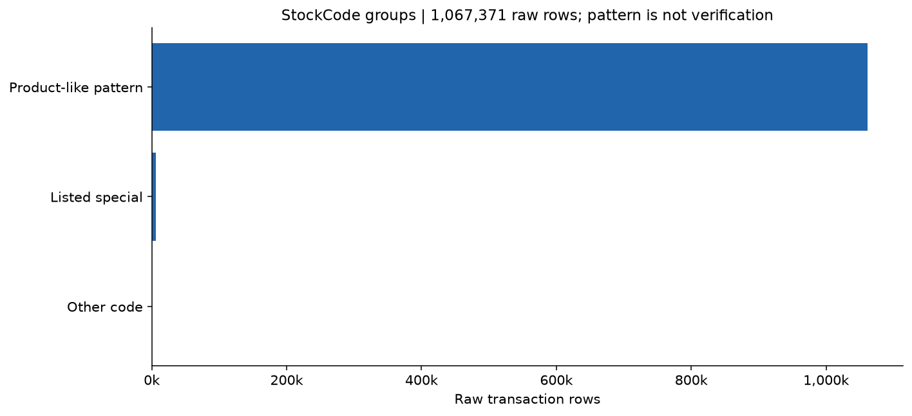

**Nhận xét.** Product-like pattern: 1,061,278 dòng (99.43%); Listed special: 5,812 dòng (0.54%); Other code: 281 dòng (0.03%). Nhãn nhóm mã chỉ dựa danh sách pipeline và hình thức mã.

**Ý nghĩa đối với dự án.** Không đồng nhất số StockCode ứng viên với số sản phẩm đã xác minh.

**Giới hạn / bước tiếp theo.** SPECIAL_CODES chỉ là danh sách loại hiện tại; regex không xác nhận sản phẩm. Mỗi dòng thuộc đúng một nhóm trong hình.

### Biến số khách hàng và RFM riêng lẻ

| variable | count | missing | mean | median | q1 | q3 | iqr | p95 | p99 | maximum | skewness |
| --- | --- | --- | --- | --- | --- | --- | --- | --- | --- | --- | --- |
| Recency | 5,849 | 0 | 200.394109 | 95.407639 | 25.467361 | 379.388889 | 353.921528 | 623.457222 | 726.347889 | 738.549306 | 0.892528 |
| Frequency | 5,849 | 0 | 6.248419 | 3 | 1 | 7 | 6 | 20 | 46 | 373 | 12.049266 |
| Monetary | 5,849 | 0 | 2,846.698121 | 851.88 | 335.52 | 2,232.49 | 1,896.97 | 9,035.554 | 26,295.0996 | 580,987.04 | 26.295066 |
| avg_order_value | 5,849 | 0 | 359.661449 | 276.058571 | 175.2 | 409.268 | 234.068 | 857.858261 | 1,747.40256 | 14,844.766667 | 12.770034 |
| avg_purchase_gap_days | 4,227 | 1,622 | 103.312251 | 72.893056 | 39.163472 | 130.947569 | 91.784097 | 323.389583 | 487.195333 | 714.152083 | 2.166458 |
| observed_tenure_days | 5,849 | 0 | 473.98943 | 529.459722 | 311.494444 | 666.59375 | 355.099306 | 735.497083 | 738.424667 | 738.677083 | -0.616355 |
| n_stock_codes_candidate | 5,849 | 0 | 82.183279 | 45 | 19 | 103 | 84 | 281 | 503.04 | 2,542 | 6.218628 |
| total_quantity_candidate | 5,849 | 0 | 1,703.247564 | 484 | 189 | 1,351 | 1,162 | 5,342.4 | 16,383.32 | 367,066 | 24.68718 |
| avg_quantity_per_order_candidate | 5,849 | 0 | 227.748926 | 155 | 92.166667 | 259.75 | 167.583333 | 549.978022 | 1,274.08 | 37,847 | 42.549649 |


### Phân phối hành vi khách hàng

**Câu hỏi phân tích.** Hành vi từng khách có phân phối lệch đến đâu?

**Dữ liệu và phạm vi.** Thử nghiệm trên 5,849 khách có ID; một dòng/khách, sau clean_data hiện tại; cửa sổ [2009-12-01, 2011-12-10). Guest được loại khỏi khảo sát khách sau pipeline.


**Nhận xét.** Purchase invoices: median=3.00, P99=46.00, max=373.00, skew=12.05; Purchase value (GBP): median=851.88, P99=26,295.10, max=580,987.04, skew=26.30; AOV (GBP/invoice): median=276.06, P99=1,747.40, max=14,844.77, skew=12.77; Retained StockCode count*: median=45.00, P99=503.04, max=2,542.00, skew=6.22.

**Ý nghĩa đối với dự án.** Đuôi dài có thể chi phối khoảng cách Euclidean; khảo sát log1p/scaling và độ nhạy thay vì loại khách giá trị lớn.

**Giới hạn / bước tiếp theo.** Histogram và boxplot dùng thang log1p hiển thị, không xóa khách. * chỉ mã/đơn vị ứng viên; chưa xác minh danh mục sản phẩm.

### Khoảng cách mua và số đơn

**Câu hỏi phân tích.** Có bao nhiêu khách đủ lịch sử để tính khoảng cách mua?

**Dữ liệu và phạm vi.** Thử nghiệm trên 5,849 khách có ID; một dòng/khách, sau clean_data hiện tại; cửa sổ [2009-12-01, 2011-12-10). Guest được loại khỏi khảo sát khách sau pipeline.


**Nhận xét.** 1,622/5,849 khách (27.73%) chỉ một Invoice; 4,227 khách còn lại có gap, trung vị 72.89 ngày. Gap nhỏ nhất 0.00 ngày.

**Ý nghĩa đối với dự án.** Gap thiếu có ý nghĩa cấu trúc; khi phân cụm cần chính sách thiếu/cờ một đơn, giữ 0 thật nếu các hóa đơn cùng thời điểm.

**Giới hạn / bước tiếp theo.** Không điền NaN bằng 0. Invoice nhiều thời điểm dùng earliest trong các dòng giữ lại; chưa biết lịch sử trước/sau cửa sổ.

### Phân phối từng biến RFM

**Câu hỏi phân tích.** R, F, M riêng lẻ có miền và độ lệch thế nào?

**Dữ liệu và phạm vi.** Thử nghiệm trên 5,849 khách có ID; một dòng/khách, cùng cửa sổ [2009-12-01, 2011-12-10). Dùng bảng khách đã tính trong notebook; Guest không là một khách.


**Nhận xét.** Trung vị R=95.41 ngày; F=3 hóa đơn; M=851.88 GBP. R thiếu 0, F thiếu 0, M thiếu 0 khách; skew R/F/M=0.89/12.05/26.30.

**Ý nghĩa đối với dự án.** RFM thử nghiệm đủ dữ liệu cho khảo sát biến đổi; F/M có thang khác R nên cần cân nhắc trọng số và scaling.

**Giới hạn / bước tiếp theo.** R = reference − last invoice time; F = n_orders, M = total_purchase_value. Mốc tham chiếu 2011-12-10 loại trừ, không phải ngày hiện tại. Chưa chọn bộ biến mô hình chính thức.

**Kết luận đơn biến.** Đọc dấu skew cùng phân vị/cực trị thay vì gán một dạng phân phối cho mọi biến. F/M/AOV/mã ứng viên có đuôi lớn; gap thiếu ở khách một đơn; chỉ số sản phẩm và hoàn trả thiếu toàn bộ. Những khác biệt này cần được xử lý trước tính khoảng cách phân cụm.

## 4. Phân tích theo thời gian

| month | rows | invoices | signed_value_gbp | current_value_gbp | partial_boundary |
| --- | --- | --- | --- | --- | --- |
| 2009-12 | 45228 | 2,330 | 799,847.11 | 792,678.22 | Không |
| 2010-01 | 31555 | 1,633 | 624,032.892 | 605,512.672 | Không |
| 2010-02 | 29388 | 1,969 | 533,091.426 | 525,731.216 | Không |
| 2010-03 | 41511 | 2,367 | 765,848.761 | 742,511.141 | Không |
| 2010-04 | 34057 | 1,892 | 590,580.432 | 645,021.522 | Không |
| 2010-05 | 35323 | 2,418 | 615,322.83 | 636,205.94 | Không |
| 2010-06 | 39983 | 2,216 | 679,786.61 | 694,965.1 | Không |
| 2010-07 | 33383 | 2,017 | 575,236.36 | 628,008.07 | Không |
| 2010-08 | 33306 | 1,877 | 656,776.34 | 664,658.85 | Không |
| 2010-09 | 42091 | 2,375 | 853,650.431 | 858,895.451 | Không |
| 2010-10 | 59098 | 2,965 | 1,045,168.35 | 1,090,421.05 | Không |
| 2010-11 | 78015 | 3,669 | 1,422,654.642 | 1,407,526.402 | Không |
| 2010-12 | 65004 | 2,025 | 1,126,445.47 | 771,558.45 | Không |
| 2011-01 | 35147 | 1,476 | 560,000.26 | 589,224.48 | Không |
| 2011-02 | 27707 | 1,393 | 498,062.65 | 502,238.66 | Không |
| 2011-03 | 36748 | 1,983 | 683,267.08 | 685,368.86 | Không |
| 2011-04 | 29916 | 1,744 | 493,207.121 | 513,099.701 | Không |
| 2011-05 | 37030 | 2,162 | 723,333.51 | 734,620.37 | Không |
| 2011-06 | 36874 | 2,012 | 691,123.12 | 696,259.49 | Không |
| 2011-07 | 39518 | 1,927 | 681,300.111 | 687,105.311 | Không |
| 2011-08 | 35284 | 1,737 | 682,680.51 | 722,924.83 | Không |
| 2011-09 | 50226 | 2,327 | 1,019,687.622 | 1,025,820.381 | Không |
| 2011-10 | 60742 | 2,637 | 1,070,704.67 | 1,101,272.92 | Không |
| 2011-11 | 84711 | 3,462 | 1,461,756.25 | 1,449,570.98 | Không |
| 2011-12 | 25526 | 1,015 | 433,686.01 | 446,029.65 | Có |


### Hóa đơn theo tháng

**Câu hỏi phân tích.** Số Invoice duy nhất biến động theo tháng ra sao?

**Dữ liệu và phạm vi.** 1,067,371 dòng thô của hai sheet, giữ C, âm, trùng và ID thiếu.


**Nhận xét.** Có 25 tháng; tháng nhiều mã chứng từ nhất 2010-11: 3,669. Tháng cuối 2011-12 có 1,015 mã và 25,526 dòng, chỉ đến 09/12/2011.

**Ý nghĩa đối với dự án.** Mức hoạt động và độ dài quan sát có thể ảnh hưởng Frequency/tenure.

**Giới hạn / bước tiếp theo.** Bao gồm C. Tháng 12/2010 có hai sheet chồng lấn và có dòng trùng; 12/2011 chưa đủ tháng. Không suy diễn mùa vụ dài hạn hay nguyên nhân từ đường xu hướng.

### Giá trị theo tháng và phạm vi chính sách

**Câu hỏi phân tích.** Giá trị có dấu và giá trị giữ lại bởi pipeline khác nhau thế nào?

**Dữ liệu và phạm vi.** 1,067,371 dòng thô của hai sheet, giữ C, âm, trùng và ID thiếu. Đường thứ hai: 1,002,995 dòng sau clean_data, gồm Guest.


**Nhận xét.** Tổng thô có dấu 19,287,250.568 GBP; sau pipeline 19,217,229.717 GBP. Tháng cuối tương ứng 433,686.01 và 446,029.65 GBP.

**Ý nghĩa đối với dự án.** Phải giữ nhãn phạm vi khi diễn giải Monetary; loại C/âm và ngoại lệ thay đổi giá trị được quan sát.

**Giới hạn / bước tiếp theo.** Hai đường khác quần thể/chính sách, không phải tác động nhân quả hoặc doanh thu thuần đã xác minh. Giá trị dùng Q×P chính xác, không cộng Revenue đã làm tròn.

### Theo thứ và giờ

| InvoiceDate | rows |
| --- | --- |
| 0 | 189,084 |
| 1 | 196,626 |
| 2 | 185,051 |
| 3 | 203,149 |
| 4 | 153,803 |
| 5 | 402 |
| 6 | 139,256 |


| InvoiceDate | rows |
| --- | --- |
| 0 | 0 |
| 1 | 0 |
| 2 | 0 |
| 3 | 0 |
| 4 | 0 |
| 5 | 0 |
| 6 | 41 |
| 7 | 1,127 |
| 8 | 15,985 |
| 9 | 68,324 |
| 10 | 93,248 |
| 11 | 121,780 |
| 12 | 159,846 |
| 13 | 150,308 |
| 14 | 141,513 |
| 15 | 135,309 |
| 16 | 94,055 |
| 17 | 57,549 |
| 18 | 16,991 |
| 19 | 9,089 |
| 20 | 2,205 |
| 21 | 1 |
| 22 | 0 |
| 23 | 0 |


### Tần suất theo thứ và giờ

**Câu hỏi phân tích.** Dòng giao dịch tập trung vào thứ và giờ nào?

**Dữ liệu và phạm vi.** 1,067,371 dòng thô của hai sheet, giữ C, âm, trùng và ID thiếu.


**Nhận xét.** Ô cao nhất là Sunday lúc 12 giờ: 29,003 dòng; tổng các ô 1,067,371 dòng.

**Ý nghĩa đối với dự án.** Giúp mô tả thời điểm hoạt động, chưa đủ căn cứ chọn đặc trưng thói quen từng khách.

**Giới hạn / bước tiếp theo.** Đây là heatmap tần suất, không phải tương quan. Giờ nguồn không có múi giờ; không tự chuyển sang giờ Bangkok. Ô không xuất hiện được biểu diễn bằng 0 đếm.

**Tháng biên.** Ngày đầu là 01/12/2009 nên không có bằng chứng thiếu ngày lịch đầu tháng; vẫn không biết lịch sử trước nguồn. Tháng 12/2011 kết thúc 09/12, là tháng chưa đủ. Không so mức cuối tháng như suy giảm trọn tháng.

## 5. Phân tích theo quốc gia

| Country | rows | invoices | customers | signed_value_gbp |
| --- | --- | --- | --- | --- |
| United Kingdom | 981330 | 49,108 | 5,410 | 16,382,583.897 |
| EIRE | 17866 | 806 | 5 | 615,519.55 |
| Germany | 17624 | 1,095 | 107 | 417,988.561 |
| France | 14330 | 746 | 95 | 328,191.8 |
| Netherlands | 5140 | 250 | 23 | 548,524.95 |
| Spain | 3811 | 188 | 41 | 91,859.48 |
| Switzerland | 3189 | 123 | 22 | 99,728.76 |
| Belgium | 3123 | 183 | 29 | 63,574.49 |
| Portugal | 2620 | 124 | 24 | 53,136.8 |
| Australia | 1913 | 117 | 15 | 167,129.07 |
| Channel Islands | 1664 | 79 | 14 | 41,453.61 |
| Italy | 1534 | 92 | 17 | 30,679.35 |
| Norway | 1455 | 53 | 13 | 39,243.03 |
| Sweden | 1364 | 129 | 19 | 87,809.42 |
| Cyprus | 1176 | 45 | 11 | 24,162.74 |


### Hoạt động theo quốc gia

**Câu hỏi phân tích.** Quốc gia nào chiếm ưu thế theo bốn đơn vị đo?

**Dữ liệu và phạm vi.** 1,067,371 dòng thô của hai sheet, giữ C, âm, trùng và ID thiếu. Top 10 theo số dòng; bảng đầy đủ giữ trong tables['countries'].


**Nhận xét.** UK: 981,330/1,067,371 dòng (91.94%), 49,108 mã Invoice, 5,410 khách và giá trị có dấu 16,382,583.90 GBP. Ngoài UK, EIRE dẫn đầu số dòng (17,866).

**Ý nghĩa đối với dự án.** Cụm toàn bộ dữ liệu sẽ phản ánh mạnh thị trường UK; nên kiểm tra hồ sơ cụm theo quốc gia.

**Giới hạn / bước tiếp theo.** Khách hoặc Invoice có thể thuộc nhiều quốc gia nên số đếm distinct theo quốc gia không cộng thành tổng toàn nguồn. Unspecified là nhãn chưa xác định; hình ngoài UK không đại diện cơ cấu toàn bộ.

### Quốc gia ngoài UK

**Câu hỏi phân tích.** Ngoài UK, thị trường nào nổi bật?

**Dữ liệu và phạm vi.** 1,067,371 dòng thô của hai sheet, giữ C, âm, trùng và ID thiếu. Top 10 theo số dòng; bảng đầy đủ giữ trong tables['countries'].


**Nhận xét.** UK: 981,330/1,067,371 dòng (91.94%), 49,108 mã Invoice, 5,410 khách và giá trị có dấu 16,382,583.90 GBP. Ngoài UK, EIRE dẫn đầu số dòng (17,866).

**Ý nghĩa đối với dự án.** Cụm toàn bộ dữ liệu sẽ phản ánh mạnh thị trường UK; nên kiểm tra hồ sơ cụm theo quốc gia.

**Giới hạn / bước tiếp theo.** Khách hoặc Invoice có thể thuộc nhiều quốc gia nên số đếm distinct theo quốc gia không cộng thành tổng toàn nguồn. Unspecified là nhãn chưa xác định; hình ngoài UK không đại diện cơ cấu toàn bộ.

**Unspecified.** Nhãn này có 756 dòng nguồn; không gán cho một quốc gia thật. Khách có nhiều quốc gia trong tập mua hiện tại: 12; nhóm này tách riêng khi phân tích cấp khách.

## 6. Phân tích hai biến

### 6.1. Num vs Num

| x | y | spearman | pearson | n |
| --- | --- | --- | --- | --- |
| Frequency | Monetary | 0.860283 | 0.629362 | 5,849 |
| Recency | Monetary | -0.509819 | -0.124917 | 5,849 |
| Frequency | avg_order_value | 0.212846 | 0.102903 | 5,849 |
| n_stock_codes_candidate | Monetary | 0.776023 | 0.410606 | 5,849 |
| total_quantity_candidate | Monetary | 0.948603 | 0.929404 | 5,849 |
| avg_quantity_per_order_candidate | avg_order_value | 0.827242 | 0.585618 | 5,849 |


### Num vs Num: quan hệ giữa các đặc trưng

**Câu hỏi phân tích.** F–M, R–M, F–AOV, số mã–M và lượng–giá trị liên hệ thế nào?

**Dữ liệu và phạm vi.** Thử nghiệm trên 5,849 khách có ID; một dòng/khách, sau clean_data hiện tại; cửa sổ [2009-12-01, 2011-12-10). Guest được loại khỏi khảo sát khách sau pipeline.

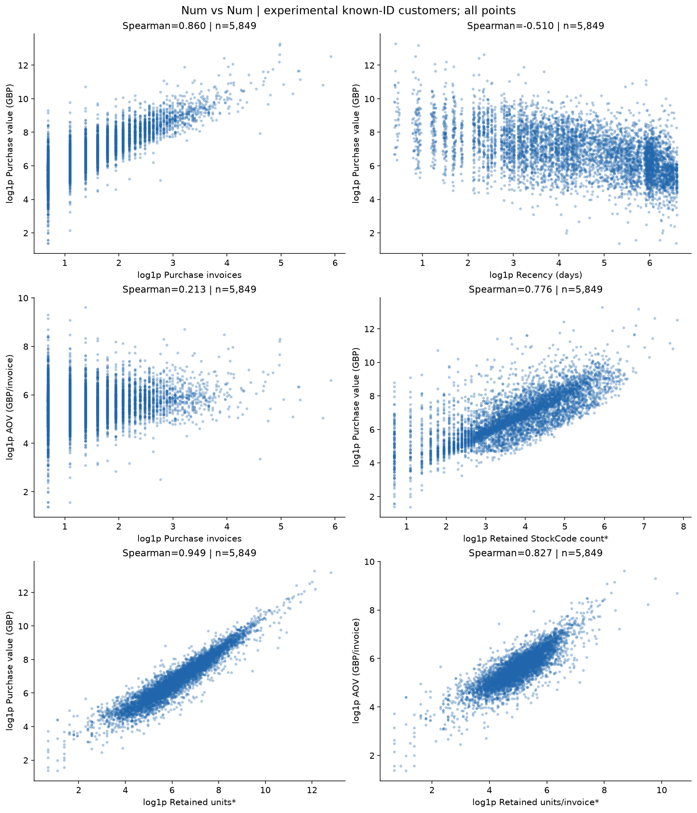

**Nhận xét.** Frequency–Monetary: Spearman=0.8603, n=5,849, xu hướng đồng biến; Recency–Monetary: Spearman=-0.5098, n=5,849, xu hướng nghịch biến; Frequency–avg_order_value: Spearman=0.2128, n=5,849, xu hướng đồng biến; n_stock_codes_candidate–Monetary: Spearman=0.7760, n=5,849, xu hướng đồng biến; total_quantity_candidate–Monetary: Spearman=0.9486, n=5,849, xu hướng đồng biến; avg_quantity_per_order_candidate–avg_order_value: Spearman=0.8272, n=5,849, xu hướng đồng biến. Scatter toàn bộ khách thể hiện cùng chiều liên hệ trên trục log1p, đồng thời còn độ phân tán lớn ở mỗi mức F.

**Ý nghĩa đối với dự án.** So sánh các quan hệ để cân nhắc thông tin bổ sung; F và số đơn là cùng một phép đo nên chỉ vẽ một lần.

**Giới hạn / bước tiếp theo.** M = F × AOV và giá trị từng dòng = Quantity × Price nên các biến liên hệ một phần do công thức. Log1p chỉ để hiển thị; hệ số tính trên dữ liệu gốc. Alpha giảm chồng điểm, không lấy mẫu hoặc cắt đuôi.

### 6.2. Num vs Cat

| country_group | n | median_Monetary | median_Frequency | median_AOV |
| --- | --- | --- | --- | --- |
| Multi-country | 12 | 3,797.955 | 7.5 | 424.8019 |
| Other-country | 506 | 1,119.95 | 3 | 392.128333 |
| UK | 5,331 | 824.92 | 3 | 268.02875 |


| order_group | n | median_Monetary | median_AOV |
| --- | --- | --- | --- |
| Multiple invoices | 4,227 | 1,356.33 | 289.332308 |
| One invoice | 1,622 | 225.885 | 225.885 |


### Num vs Cat: quốc gia và nhóm số đơn

**Câu hỏi phân tích.** Giá trị và số đơn khác nhau giữa nhóm quốc gia/khách một đơn ra sao?

**Dữ liệu và phạm vi.** Thử nghiệm trên 5,849 khách có ID; một dòng/khách, sau clean_data hiện tại; cửa sổ [2009-12-01, 2011-12-10). Guest được loại khỏi khảo sát khách sau pipeline.

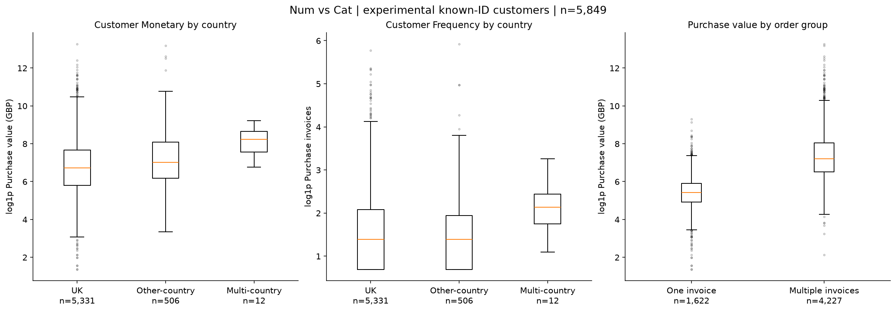

**Nhận xét.** Multi-country: n=12, median M=3,797.95 GBP, F=7.5; Other-country: n=506, median M=1,119.95 GBP, F=3.0; UK: n=5,331, median M=824.92 GBP, F=3.0; Multiple invoices: n=4,227, median M=1,356.33 GBP; One invoice: n=1,622, median M=225.88 GBP.

**Ý nghĩa đối với dự án.** Mô tả khác biệt phân phối, giúp kiểm tra diễn giải cụm và nhóm có lịch sử ngắn.

**Giới hạn / bước tiếp theo.** Country giữ nhãn nếu duy nhất; nhiều Country → Multi-country riêng, không gán theo tùy ý. Khách nhiều đơn được định nghĩa từ F nên chênh lệch M không là bằng chứng tác động. Nhóm ít khách không đủ suy rộng; boxplot log1p gồm mọi điểm.

### 6.3. Cat vs Cat

Bảng số đếm và phần trăm theo **hàng** được tách riêng, không đổi mẫu số giữa các nhóm. Quốc gia cấp dòng dùng UK/Other-country; cấp khách dùng UK/Other-country/Multi-country từ các dòng mua trong cùng cửa sổ.

| country_group | C | Non-C |
| --- | --- | --- |
| Other-country | 2,844 | 83,197 |
| UK | 16,650 | 964,680 |


| country_group | C | Non-C |
| --- | --- | --- |
| Other-country | 3.305401 | 96.694599 |
| UK | 1.696677 | 98.303323 |


### Cat vs Cat: quốc gia và chứng từ

**Câu hỏi phân tích.** Tỷ lệ dòng C thay đổi theo nhóm quốc gia không?

**Dữ liệu và phạm vi.** 1,067,371 dòng thô của hai sheet, giữ C, âm, trùng và ID thiếu.

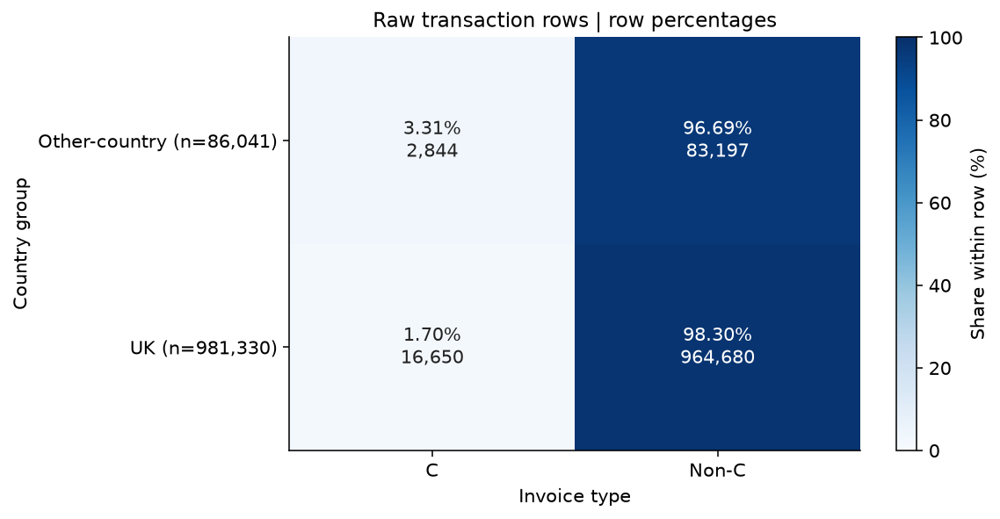

**Nhận xét.** Other-country: 2,844/86,041 = 3.31% C; UK: 16,650/981,330 = 1.70% C.

**Ý nghĩa đối với dự án.** Bảng chéo và tỷ lệ theo hàng cho phép so nhóm có quy mô khác nhau.

**Giới hạn / bước tiếp theo.** Mẫu số là tổng dòng trong hàng đối với loại chứng từ; tổng khách trong hàng đối với nhóm một/nhiều đơn. Đây là heatmap tỷ lệ/tần suất, không phải tương quan; không suy ra hoàn trả hay nhãn cụm.

| country_group | Multiple invoices | One invoice |
| --- | --- | --- |
| Multi-country | 12 | 0 |
| Other-country | 354 | 152 |
| UK | 3,861 | 1,470 |


| country_group | Multiple invoices | One invoice |
| --- | --- | --- |
| Multi-country | 100 | 0 |
| Other-country | 69.960474 | 30.039526 |
| UK | 72.425436 | 27.574564 |


### Cat vs Cat: quốc gia và nhóm khách

**Câu hỏi phân tích.** Tỷ lệ khách một/nhiều đơn khác nhau giữa nhóm quốc gia không?

**Dữ liệu và phạm vi.** Thử nghiệm trên 5,849 khách có ID; một dòng/khách, sau clean_data hiện tại; cửa sổ [2009-12-01, 2011-12-10). Guest được loại khỏi khảo sát khách sau pipeline.

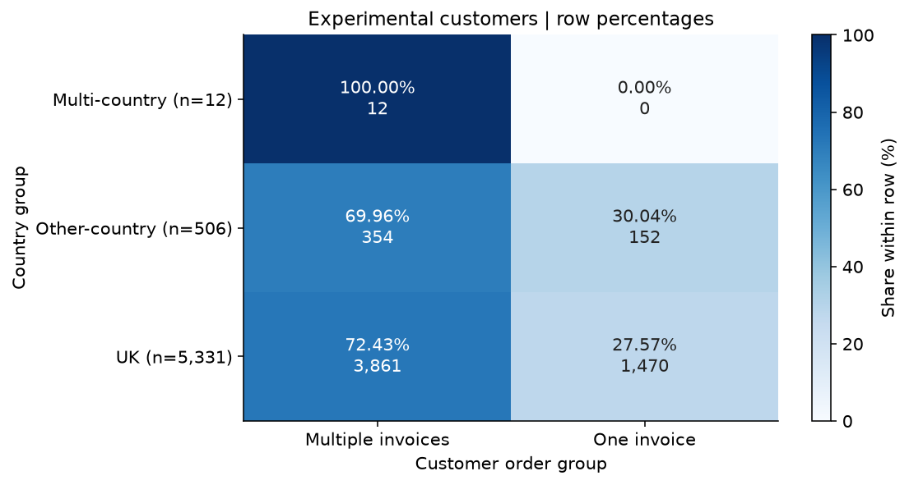

**Nhận xét.** Multi-country: 0/12 = 0.00% One invoice; Other-country: 152/506 = 30.04% One invoice; UK: 1,470/5,331 = 27.57% One invoice.

**Ý nghĩa đối với dự án.** Bảng chéo và tỷ lệ theo hàng cho phép so nhóm có quy mô khác nhau.

**Giới hạn / bước tiếp theo.** Mẫu số là tổng dòng trong hàng đối với loại chứng từ; tổng khách trong hàng đối với nhóm một/nhiều đơn. Đây là heatmap tỷ lệ/tần suất, không phải tương quan; không suy ra hoàn trả hay nhãn cụm.

## 7. Phân tích đa biến

### RFM đồng thời

**Câu hỏi phân tích.** R thay đổi thế nào đồng thời theo F và M?

**Dữ liệu và phạm vi.** Thử nghiệm trên 5,849 khách có ID; một dòng/khách, sau clean_data hiện tại; cửa sổ [2009-12-01, 2011-12-10). Guest được loại khỏi khảo sát khách sau pipeline.

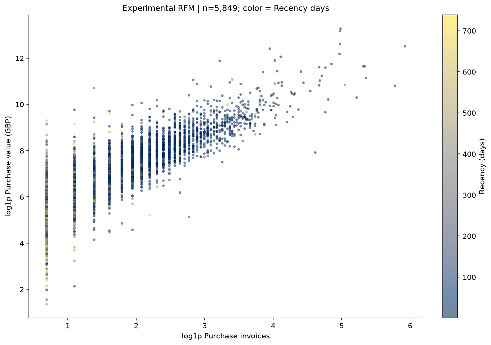

**Nhận xét.** Toàn bộ 5,849 khách được vẽ; Spearman F–M=0.8603, R–M=-0.5098, R–F=-0.5583. R từ 0.47 đến 738.55 ngày.

**Ý nghĩa đối với dự án.** Màu R bổ sung mức gần đây cho quan hệ F/M; cần mô hình và đánh giá độ ổn định để kiểm tra các kiểu hành vi.

**Giới hạn / bước tiếp theo.** X/Y dùng log1p, màu dùng ngày R gốc. Alpha và thứ tự điểm cố định để giảm chồng lấn, không lấy mẫu; vùng thị giác chưa phải cụm chính thức.

### Đặc trưng thủ công đồng thời

**Câu hỏi phân tích.** AOV/số mã và nhịp mua/tenure bổ sung gì cho Frequency?

**Dữ liệu và phạm vi.** Thử nghiệm trên 5,849 khách có ID; một dòng/khách, sau clean_data hiện tại; cửa sổ [2009-12-01, 2011-12-10). Guest được loại khỏi khảo sát khách sau pipeline.

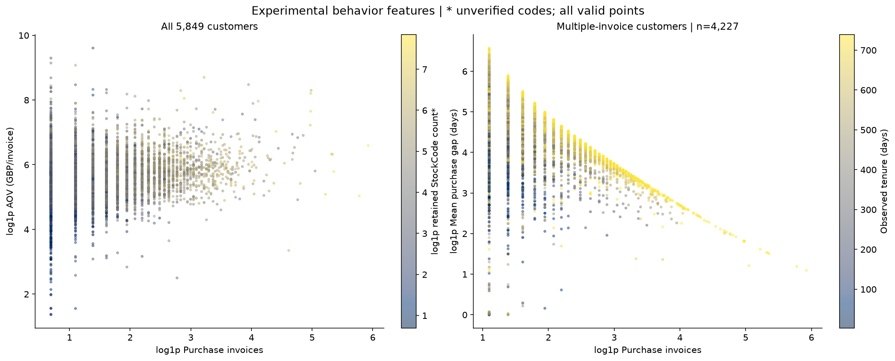

**Nhận xét.** Panel F–AOV tô màu số mã có 5,849 khách, Spearman F–AOV=0.2128; panel F–gap tô màu tenure có 4,227 khách, loại khỏi hiển thị 1,622 khách thiếu gap. Spearman F–gap=-0.4331, n=4,227.

**Ý nghĩa đối với dự án.** Các đặc trưng tóm tắt giỏ và nhịp mua có thể bổ sung RFM nhưng liên hệ công thức cần xem kỹ.

**Giới hạn / bước tiếp theo.** M=F×AOV; với F>1, gap=(tenure−R)/(F−1). Màu số mã hiển thị log1p; không coi các biến là độc lập hoặc đưa tất cả vào mô hình tự động.

### Frequency/Monetary theo quốc gia

**Câu hỏi phân tích.** Quan hệ F–M có cùng phạm vi giữa các nhóm quốc gia không?

**Dữ liệu và phạm vi.** Thử nghiệm trên 5,849 khách có ID; một dòng/khách, sau clean_data hiện tại; cửa sổ [2009-12-01, 2011-12-10). Guest được loại khỏi khảo sát khách sau pipeline.

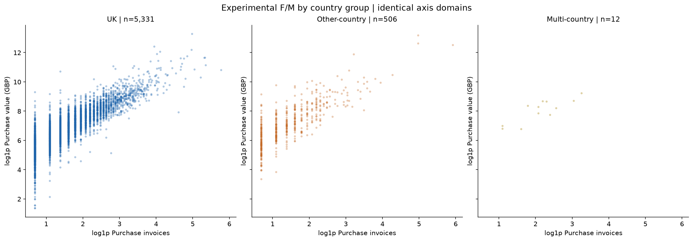

**Nhận xét.** Multi-country: n=12, median F=7.5, M=3,797.95 GBP; Other-country: n=506, median F=3.0, M=1,119.95 GBP; UK: n=5,331, median F=3.0, M=824.92 GBP. Các panel giữ chung trục log1p để so sánh miền quan sát.

**Ý nghĩa đối với dự án.** Kiểm tra liệu hồ sơ hành vi chỉ phản ánh quy mô thị trường; Country dùng diễn giải, chưa chọn là biến số đầu vào.

**Giới hạn / bước tiếp theo.** Multi-country được giữ thành nhóm riêng từ các dòng mua còn lại. Các nhóm quy mô khác nhau; không suy ra khác biệt có ý nghĩa thống kê hay cụm địa lý.

## 8. Ma trận tương quan

Tính Spearman và Pearson trên cùng bảng mỗi khách một dòng. Chỉ dùng biến số có ít nhất hai giá trị khác nhau; mỗi cặp dùng khách hữu hạn ở cả hai biến (pairwise deletion), tối thiểu 3 quan sát. Không điền thiếu hoặc biến ID thành số. Chỉ có chín biến đủ điều kiện dưới đây; các biến bị loại được kiểm kê riêng.

| Tên trong ma trận | Nhãn / đơn vị |
| --- | --- |
| Recency | Recency (days) |
| Frequency | Purchase invoices |
| Monetary | Purchase value (GBP) |
| avg_order_value | AOV (GBP/invoice) |
| avg_purchase_gap_days | Mean purchase gap (days) |
| observed_tenure_days | Observed tenure (days) |
| n_stock_codes_candidate | Retained StockCode count* |
| total_quantity_candidate | Retained units* |
| avg_quantity_per_order_candidate | Retained units/invoice* |


| variable | status | valid | missing | unique |
| --- | --- | --- | --- | --- |
| Recency | included | 5,849 | 0 | 5,699 |
| Frequency | included | 5,849 | 0 | 86 |
| Monetary | included | 5,849 | 0 | 5,750 |
| avg_order_value | included | 5,849 | 0 | 5,758 |
| avg_purchase_gap_days | included | 4,227 | 1,622 | 4,199 |
| observed_tenure_days | included | 5,849 | 0 | 5,737 |
| n_stock_codes_candidate | included | 5,849 | 0 | 458 |
| total_quantity_candidate | included | 5,849 | 0 | 2,348 |
| avg_quantity_per_order_candidate | included | 5,849 | 0 | 3,040 |
| n_distinct_products | all_missing | 0 | 5,849 | 0 |
| avg_quantity_per_order | all_missing | 0 | 5,849 | 0 |
| total_quantity | all_missing | 0 | 5,849 | 0 |
| return_rate | all_missing | 0 | 5,849 | 0 |
| Customer ID | non_numeric | 5,849 | 0 | 5,849 |

**Kiểm tra cột.** Bốn chỉ số sản phẩm/hoàn trả thiếu toàn bộ do chưa có nguồn xác nhận; Customer ID là định danh không phải số đo. Trong dữ liệu thực tế không có cột hằng trong tập đề xuất; hàm hỗ trợ nhận diện và loại cột hằng nếu xuất hiện khi chạy nguồn khác. Giá trị không hữu hạn được giữ là thiếu khi đếm cặp, không âm thầm chuyển thành 0.

### Bảng hệ số Spearman

| index | Recency | Frequency | Monetary | avg_order_value | avg_purchase_gap_days | observed_tenure_days | n_stock_codes_candidate | total_quantity_candidate | avg_quantity_per_order_candidate |
| --- | --- | --- | --- | --- | --- | --- | --- | --- | --- |
| Recency | 1 | -0.558285 | -0.509819 | -0.172035 | 0.162975 | 0.152814 | -0.466763 | -0.512342 | -0.191877 |
| Frequency | -0.558285 | 1 | 0.860283 | 0.212846 | -0.433051 | 0.500407 | 0.722244 | 0.819396 | 0.179604 |
| Monetary | -0.509819 | 0.860283 | 1 | 0.651551 | -0.353176 | 0.424206 | 0.776023 | 0.948603 | 0.546166 |
| avg_order_value | -0.172035 | 0.212846 | 0.651551 | 1 | -0.050077 | 0.095733 | 0.430317 | 0.616608 | 0.827242 |
| avg_purchase_gap_days | 0.162975 | -0.433051 | -0.353176 | -0.050077 | 1 | 0.131704 | -0.24378 | -0.335864 | -0.036555 |
| observed_tenure_days | 0.152814 | 0.500407 | 0.424206 | 0.095733 | 0.131704 | 1 | 0.346809 | 0.384393 | 0.03576 |
| n_stock_codes_candidate | -0.466763 | 0.722244 | 0.776023 | 0.430317 | -0.24378 | 0.346809 | 1 | 0.76272 | 0.406912 |
| total_quantity_candidate | -0.512342 | 0.819396 | 0.948603 | 0.616608 | -0.335864 | 0.384393 | 0.76272 | 1 | 0.681362 |
| avg_quantity_per_order_candidate | -0.191877 | 0.179604 | 0.546166 | 0.827242 | -0.036555 | 0.03576 | 0.406912 | 0.681362 | 1 |


### Ma trận tương quan Spearman

**Câu hỏi phân tích.** Spearman cho thấy cặp nào liên hệ hoặc trùng thông tin?

**Dữ liệu và phạm vi.** Thử nghiệm trên 5,849 khách có ID; một dòng/khách, sau clean_data hiện tại; cửa sổ [2009-12-01, 2011-12-10). Guest được loại khỏi khảo sát khách sau pipeline. Chỉ 9 biến số cùng phạm vi; pairwise complete observations.

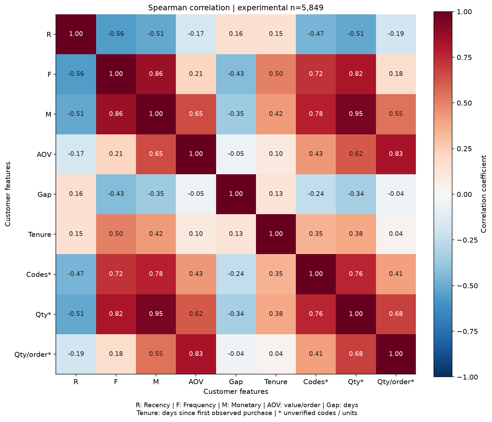

**Nhận xét.** Spearman F–M=0.8603 (n=5,849); R–M=-0.5098 (n=5,849); F–gap=-0.4331 (n=4,227). Có 4 cột thiếu toàn bộ và 1 cột không phải số bị loại trước tính; 0 cột hằng trong dữ liệu thực tế.

**Ý nghĩa đối với dự án.** Spearman xem quan hệ đơn điệu; Pearson nhạy đuôi lớn. Cân nhắc trùng thông tin với công thức M=F×AOV và Q=F×Q/đơn; không tự động loại biến chỉ vì hệ số cao.

**Giới hạn / bước tiếp theo.** Không điền NaN bằng 0. Mỗi cặp có thể dùng tập khách khác; không diễn giải tương quan như nhân quả hay bằng chứng chất lượng phân cụm. R/F/M không chứa ID, timestamp hoặc nhãn Country.

### Bảng hệ số Pearson trên thang gốc

| index | Recency | Frequency | Monetary | avg_order_value | avg_purchase_gap_days | observed_tenure_days | n_stock_codes_candidate | total_quantity_candidate | avg_quantity_per_order_candidate |
| --- | --- | --- | --- | --- | --- | --- | --- | --- | --- |
| Recency | 1 | -0.25861 | -0.124917 | -0.058346 | -0.029656 | 0.283989 | -0.322338 | -0.124838 | -0.011419 |
| Frequency | -0.25861 | 1 | 0.629362 | 0.102903 | -0.259481 | 0.27616 | 0.690943 | 0.621952 | 0.034952 |
| Monetary | -0.124917 | 0.629362 | 1 | 0.329971 | -0.12944 | 0.13337 | 0.410606 | 0.929404 | 0.134171 |
| avg_order_value | -0.058346 | 0.102903 | 0.329971 | 1 | -0.029527 | 0.018457 | 0.167084 | 0.330516 | 0.585618 |
| avg_purchase_gap_days | -0.029656 | -0.259481 | -0.12944 | -0.029527 | 1 | 0.162943 | -0.230645 | -0.131406 | -0.025489 |
| observed_tenure_days | 0.283989 | 0.27616 | 0.13337 | 0.018457 | 0.162943 | 1 | 0.275926 | 0.136203 | 0.004683 |
| n_stock_codes_candidate | -0.322338 | 0.690943 | 0.410606 | 0.167084 | -0.230645 | 0.275926 | 1 | 0.428182 | 0.064642 |
| total_quantity_candidate | -0.124838 | 0.621952 | 0.929404 | 0.330516 | -0.131406 | 0.136203 | 0.428182 | 1 | 0.234325 |
| avg_quantity_per_order_candidate | -0.011419 | 0.034952 | 0.134171 | 0.585618 | -0.025489 | 0.004683 | 0.064642 | 0.234325 | 1 |


### Ma trận tương quan Pearson

**Câu hỏi phân tích.** Pearson cho thấy cặp nào liên hệ hoặc trùng thông tin?

**Dữ liệu và phạm vi.** Thử nghiệm trên 5,849 khách có ID; một dòng/khách, sau clean_data hiện tại; cửa sổ [2009-12-01, 2011-12-10). Guest được loại khỏi khảo sát khách sau pipeline. Chỉ 9 biến số cùng phạm vi; pairwise complete observations.

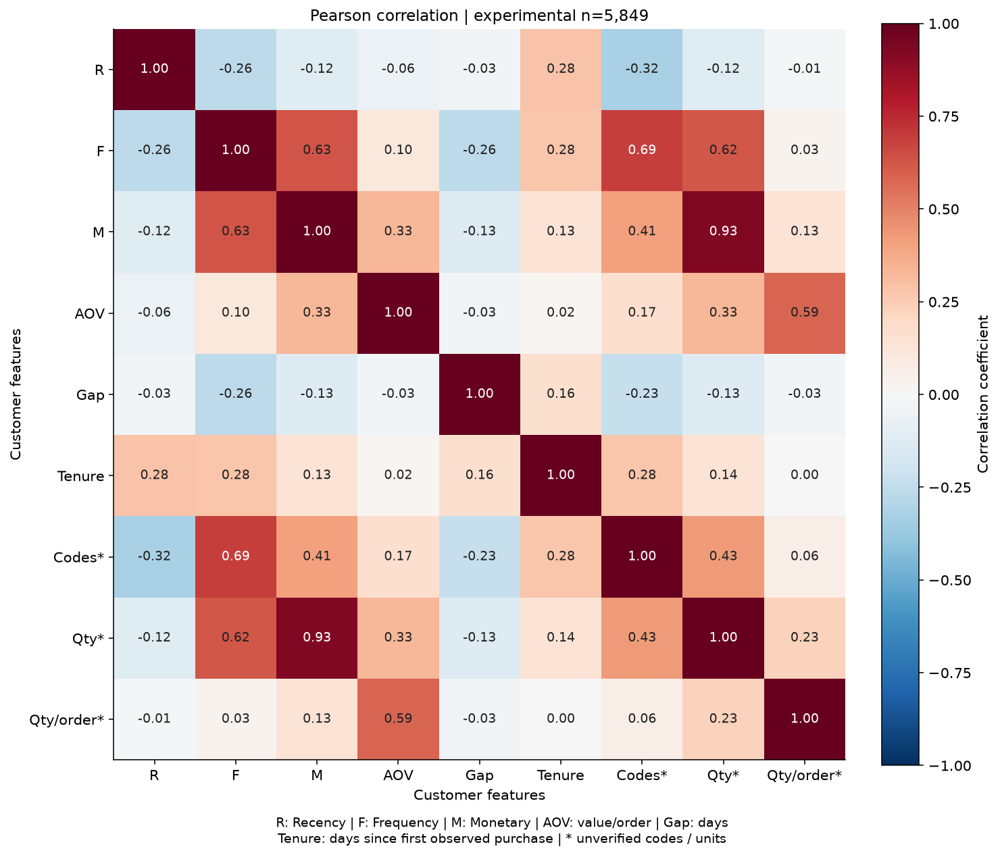

**Nhận xét.** Pearson F–M=0.6294 (n=5,849); R–M=-0.1249 (n=5,849); F–gap=-0.2595 (n=4,227). Có 4 cột thiếu toàn bộ và 1 cột không phải số bị loại trước tính; 0 cột hằng trong dữ liệu thực tế.

**Ý nghĩa đối với dự án.** Spearman xem quan hệ đơn điệu; Pearson nhạy đuôi lớn. Cân nhắc trùng thông tin với công thức M=F×AOV và Q=F×Q/đơn; không tự động loại biến chỉ vì hệ số cao.

**Giới hạn / bước tiếp theo.** Không điền NaN bằng 0. Mỗi cặp có thể dùng tập khách khác; không diễn giải tương quan như nhân quả hay bằng chứng chất lượng phân cụm. R/F/M không chứa ID, timestamp hoặc nhãn Country.

### Số khách hợp lệ theo từng cặp

| index | Recency | Frequency | Monetary | avg_order_value | avg_purchase_gap_days | observed_tenure_days | n_stock_codes_candidate | total_quantity_candidate | avg_quantity_per_order_candidate |
| --- | --- | --- | --- | --- | --- | --- | --- | --- | --- |
| Recency | 5,849 | 5,849 | 5,849 | 5,849 | 4,227 | 5,849 | 5,849 | 5,849 | 5,849 |
| Frequency | 5,849 | 5,849 | 5,849 | 5,849 | 4,227 | 5,849 | 5,849 | 5,849 | 5,849 |
| Monetary | 5,849 | 5,849 | 5,849 | 5,849 | 4,227 | 5,849 | 5,849 | 5,849 | 5,849 |
| avg_order_value | 5,849 | 5,849 | 5,849 | 5,849 | 4,227 | 5,849 | 5,849 | 5,849 | 5,849 |
| avg_purchase_gap_days | 4,227 | 4,227 | 4,227 | 4,227 | 4,227 | 4,227 | 4,227 | 4,227 | 4,227 |
| observed_tenure_days | 5,849 | 5,849 | 5,849 | 5,849 | 4,227 | 5,849 | 5,849 | 5,849 | 5,849 |
| n_stock_codes_candidate | 5,849 | 5,849 | 5,849 | 5,849 | 4,227 | 5,849 | 5,849 | 5,849 | 5,849 |
| total_quantity_candidate | 5,849 | 5,849 | 5,849 | 5,849 | 4,227 | 5,849 | 5,849 | 5,849 | 5,849 |
| avg_quantity_per_order_candidate | 5,849 | 5,849 | 5,849 | 5,849 | 4,227 | 5,849 | 5,849 | 5,849 | 5,849 |


### Số quan sát hợp lệ theo cặp

**Câu hỏi phân tích.** Mỗi hệ số có bao nhiêu khách hợp lệ?

**Dữ liệu và phạm vi.** Thử nghiệm trên 5,849 khách có ID; một dòng/khách, sau clean_data hiện tại; cửa sổ [2009-12-01, 2011-12-10). Guest được loại khỏi khảo sát khách sau pipeline.

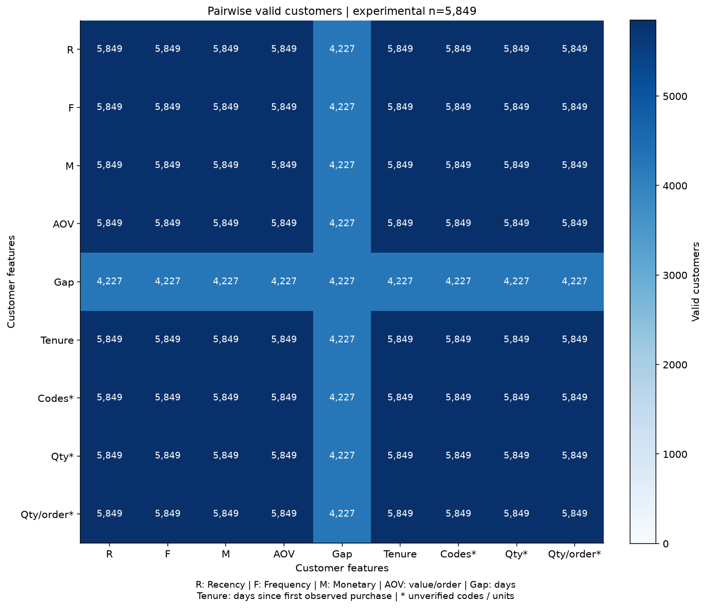

**Nhận xét.** Cặp không chứa gap có 5,849 quan sát; các cặp chứa gap có 4,227. Chênh 1,622 chính là khách một Invoice; đường chéo gap cũng 4,227.

**Ý nghĩa đối với dự án.** Đọc n cùng hệ số; các hệ số chứa gap chỉ mô tả khách mua nhiều đơn, có thể chịu sai lệch chọn mẫu.

**Giới hạn / bước tiếp theo.** Ma trận n dùng số nguyên int64 và giao hai cờ hữu hạn, không dùng len toàn bảng cho mọi cặp. NaN vẫn là chưa quan sát, không phải nhịp mua 0.

Các cặp nổi bật có hệ số/phương pháp/n ở mục 6.1 và trên scatter cùng biến. F–M hoặc F–AOV chịu liên hệ cộng dồn/công thức; gap còn phụ thuộc R, tenure và F. Không tự động loại biến chỉ vì tương quan cao: cần so độ ổn định cụm, trọng số và khả năng diễn giải sau khi nhóm chốt bộ biến.

## 9. Độ lệch và ngoại lệ

Tukey IQR 1.5 trên thang gốc chỉ gắn cờ điều tra. Đây là phép khảo sát khác với bộ lọc log-IQR k=3 hiện có của Thuận. Không xóa thêm khách hoặc winsorize trong EDA.

| population | variable | count | q1 | q3 | iqr | p95 | p99 | iqr_lower | iqr_upper | outside_iqr | outside_iqr_pct |
| --- | --- | --- | --- | --- | --- | --- | --- | --- | --- | --- | --- |
| raw_including_C | Quantity | 1,067,371 | 1 | 10 | 9 | 30 | 100 | -12.5 | 23.5 | 116,489 | 10.913637 |
| raw_including_C | Price | 1,067,371 | 1.25 | 4.15 | 2.9 | 9.95 | 18 | -3.1 | 8.5 | 68,105 | 6.380631 |
| raw_including_C | LineValue | 1,067,371 | 3.75 | 17.7 | 13.95 | 59.5 | 180 | -17.175 | 38.625 | 90,922 | 8.518313 |
| current_pipeline_including_Guest | Quantity | 1,002,995 | 1 | 12 | 11 | 32 | 106 | -15.5 | 28.5 | 52,955 | 5.279687 |
| current_pipeline_including_Guest | Price | 1,002,995 | 1.25 | 4.13 | 2.88 | 9.95 | 16.95 | -3.07 | 8.45 | 74,757 | 7.453377 |
| current_pipeline_including_Guest | LineValue | 1,002,995 | 4.13 | 17.7 | 13.57 | 59.4 | 179 | -16.225 | 38.055 | 81,705 | 8.146102 |


| variable | count | q1 | q3 | p95 | p99 | maximum | outside_iqr | outside_iqr_pct |
| --- | --- | --- | --- | --- | --- | --- | --- | --- |
| Recency | 5,849 | 25.467361 | 379.388889 | 623.457222 | 726.347889 | 738.549306 | 0 | 0 |
| Frequency | 5,849 | 1 | 7 | 20 | 46 | 373 | 423 | 7.232005 |
| Monetary | 5,849 | 335.52 | 2,232.49 | 9,035.554 | 26,295.0996 | 580,987.04 | 616 | 10.531715 |
| avg_order_value | 5,849 | 175.2 | 409.268 | 857.858261 | 1,747.40256 | 14,844.766667 | 374 | 6.394255 |
| avg_purchase_gap_days | 4,227 | 39.163472 | 130.947569 | 323.389583 | 487.195333 | 714.152083 | 307 | 7.262834 |
| observed_tenure_days | 5,849 | 311.494444 | 666.59375 | 735.497083 | 738.424667 | 738.677083 | 0 | 0 |
| n_stock_codes_candidate | 5,849 | 19 | 103 | 281 | 503.04 | 2,542 | 451 | 7.71072 |
| total_quantity_candidate | 5,849 | 189 | 1,351 | 5,342.4 | 16,383.32 | 367,066 | 600 | 10.258164 |
| avg_quantity_per_order_candidate | 5,849 | 92.166667 | 259.75 | 549.978022 | 1,274.08 | 37,847 | 356 | 6.086511 |


### Phân phối sau chính sách hiện tại

**Câu hỏi phân tích.** Sau các bộ lọc hiện tại, đuôi phân phối còn lớn không?

**Dữ liệu và phạm vi.** 1,002,995 dòng đầu ra clean_data, gồm Guest; Q/P dương, đã lọc log-IQR k=3 của pipeline.


**Nhận xét.** Quantity: median=4.00, P99=106.00, max=3,500.00, ngoài IQR1.5=52,955; Price: median=2.10, P99=16.95, max=59.57, ngoài IQR1.5=74,757; LineValue: median=10.08, P99=179.00, max=8,925.00, ngoài IQR1.5=81,705.

**Ý nghĩa đối với dự án.** Lọc cực trị ở cấp dòng của pipeline chưa làm mất toàn bộ đuôi dài ở cấp khách; cần kiểm tra độ nhạy khi phân cụm.

**Giới hạn / bước tiếp theo.** EDA chỉ gắn cờ IQR1.5 trên thang gốc, không xóa thêm dòng/khách. Pipeline đã loại log-IQR k=3 là chính sách hiện có của Thuận; đề xuất giữ/xử lý khác cần nhóm xác nhận.

### Mẫu cực trị để đối chiếu

| variable | direction | Invoice | StockCode | Quantity | Price | LineValue | InvoiceDate |
| --- | --- | --- | --- | --- | --- | --- | --- |
| Quantity | smallest | C581484 | 23843 | -80,995 | 2.08 | -168,469.6 | 2011-12-09 09:27:00 |
| Quantity | smallest | C541433 | 23166 | -74,215 | 1.04 | -77,183.6 | 2011-01-18 10:17:00 |
| Price | smallest | A506401 | B | 1 | -53,594.36 | -53,594.36 | 2010-04-29 13:36:00 |
| Price | smallest | A516228 | B | 1 | -44,031.79 | -44,031.79 | 2010-07-19 11:24:00 |
| LineValue | smallest | C581484 | 23843 | -80,995 | 2.08 | -168,469.6 | 2011-12-09 09:27:00 |
| LineValue | smallest | C541433 | 23166 | -74,215 | 1.04 | -77,183.6 | 2011-01-18 10:17:00 |
| Quantity | largest | 581483 | 23843 | 80,995 | 2.08 | 168,469.6 | 2011-12-09 09:15:00 |
| Quantity | largest | 541431 | 23166 | 74,215 | 1.04 | 77,183.6 | 2011-01-18 10:01:00 |
| Price | largest | C556445 | M | -1 | 38,970 | -38,970 | 2011-06-10 15:31:00 |
| Price | largest | C512770 | M | -1 | 25,111.09 | -25,111.09 | 2010-06-17 16:52:00 |
| LineValue | largest | 581483 | 23843 | 80,995 | 2.08 | 168,469.6 | 2011-12-09 09:15:00 |
| LineValue | largest | 541431 | 23166 | 74,215 | 1.04 | 77,183.6 | 2011-01-18 10:01:00 |

**Nhận xét / ý nghĩa.** Ví dụ đối dấu ở Invoice mua và C chỉ là ứng viên điều tra, chưa xác minh hoàn trả. Giá trị đặc biệt có thể là nghiệp vụ; khách giá trị cao có thể hợp lệ. Không có bằng chứng đủ để phân loại các cực trị này thành lỗi đã xác minh. Nhóm cần đánh giá độ nhạy với chính sách ngoại lệ, đặc biệt vì pipeline hiện tại đã bỏ một số dòng trước tổng hợp khách.

## 10. Đối chiếu tiền xử lý trước và sau

| setting | value |
| --- | --- |
| API | src.preprocessing.clean_data |
| SPECIAL_CODES | ADJUST, ADJUST2, AMAZONFEE, B, BANK CHARGES, C2, C3, CRUK, D, DOT, M, POST, S, TEST001, TEST002 |
| Pipeline outlier | log1p ['Quantity', 'Price']; k=3.0 |
| Customer EDA | Exclude Guest AFTER pipeline; same window for every feature |
| Invoice time | earliest within retained purchase rows |
| Status | experimental_current_code_not_official_policy |


| step | rows | invoices | known_customers | anonymous_rows | reason | removed_rows |
| --- | --- | --- | --- | --- | --- | --- |
| Dữ liệu thô | 1,067,371 | 53,628 | 5,942 | 243,007 | Gộp đúng 8 cột nguồn; không đưa Sheet vào khóa trùng | 0 |
| Chuẩn hóa văn bản | 1,067,371 | 53,628 | 5,942 | 243,007 | Description thiếu được điền; EIRE → Ireland | 0 |
| Sau bỏ trùng đã chuẩn hóa | 1,033,036 | 53,628 | 5,942 | 235,151 | Quy tắc mã hiện tại; không khẳng định mọi trùng là lỗi | 34,335 |
| Sau bỏ chứng từ C | 1,013,932 | 45,336 | 5,881 | 234,437 | Không ghép C với đơn gốc trong chính sách hiện tại | 19,104 |
| Sau giữ Q/P dương | 1,007,913 | 40,077 | 5,878 | 228,488 | Quantity > 0 và Price > 0 | 6,019 |
| Sau bỏ mã đặc biệt | 1,003,434 | 39,516 | 5,852 | 226,838 | Danh sách SPECIAL_CODES hiện tại; chưa phải danh mục sản phẩm | 4,479 |
| Sau lọc ngoại lệ của pipeline | 1,002,995 | 39,459 | 5,849 | 226,757 | IQR × 3 trên log1p Quantity/Price; bao gồm cả dòng thiếu ID khi fit ngưỡng | 439 |
| Đầu ra clean_data (có Guest) | 1,002,995 | 39,459 | 5,849 | 226,757 | Guest là nhãn dòng vô danh, không phải một khách thật | 0 |
| Tập khảo sát khách có ID | 776,238 | 36,547 | 5,849 | 0 | Lựa chọn EDA sau pipeline; không sửa quy tắc Guest của Thuận | 226,757 |


### Đối chiếu số dòng qua pipeline

**Câu hỏi phân tích.** Mỗi bước mã hiện tại giữ lại bao nhiêu dòng/hóa đơn/khách?

**Dữ liệu và phạm vi.** 1,067,371 dòng thô của hai sheet, giữ C, âm, trùng và ID thiếu. Chạy clean_data nguyên trạng và đối chiếu trace độc lập, không ghi processed.


**Nhận xét.** 1,067,371 dòng thô → 1,002,995 dòng đầu ra pipeline (có 226,757 dòng Guest) → 776,238 dòng khảo sát ID thật, 36,547 hóa đơn, 5,849 khách. Bước log-IQR loại 439 dòng.

**Ý nghĩa đối với dự án.** Đếm riêng khách định danh và dòng Guest; đầu ra cũ trong processed không tương đương lần chạy này.

**Giới hạn / bước tiếp theo.** Đã xác minh khớp mã hiện tại, chưa có bằng chứng chính sách được phê duyệt. Đầu ra cũ dùng chính sách khác (bỏ ID thiếu, ghép C); không ghi đè dữ liệu cũ hoặc so chênh lệch như biến động hành vi.

### Đầu ra đã lưu và lần chạy mới

| artifact | rows | customers | status |
| --- | --- | --- | --- |
| data/processed/online_retail_clean.csv.gz | 770,606 | 5,839 | historical_scope_not_equivalent_to_current_run |
| experiments/eda_rebuild/tables/customer_behavior.csv | 5,839 | 5,839 | historical_scope_not_equivalent_to_current_run |
| experiments/form2_manual_behavior_raw_survey/customer_behavior_experimental.csv | 5,878 | 5,878 | historical_scope_not_equivalent_to_current_run |

`online_retail_clean.csv.gz`, `online_retail_cancellations.csv` và log processed là đầu ra lịch sử; tên/cột còn khác API hiện tại (`CustomerID`, `LineValue` thay vì `Customer ID`, `Revenue`, `IsGuest`). Mã mới `save_processed` sẽ tạo `data_clean.csv.gz` và `cleaning_log.csv`, nhưng EDA **không gọi hàm ghi này**. `experiments/eda_rebuild/` và khảo sát Form 2 thô được giữ nguyên, không dùng làm nguồn bảng mới. Chênh lệch được giải thích bởi chính sách (Guest, chuẩn hóa/trùng, mã đặc biệt, lọc ngoại lệ, không ghép hủy), không coi hai bộ số tương đương hoặc là biến động khách theo thời gian.

| customers | invoices | rows | single_invoice_customers | multiple_timestamp_orders | multi_country_customers | exact_value_gbp | rounded_value_gbp |
| --- | --- | --- | --- | --- | --- | --- | --- |
| 5,849 | 36,547 | 776,238 | 1,622 | 64 | 12 | 16,650,337.307 | 16,650,337.29 |

**Làm tròn.** Trong tập khảo sát ID thật, Σ Q×P = 16,650,337.307 GBP; Σ Revenue đã làm tròn từng dòng = 16,650,337.290 GBP; chênh Revenue − chính xác = -0.017000 GBP. Monetary/AOV dùng giá trị chính xác thống nhất.

## 11. Đặc trưng thủ công và định hướng RFM

Mọi công thức dưới đây dùng cửa sổ **[2009-12-01, 2011-12-10)**, trên cùng tập dòng mua có ID sau clean_data hiện tại; đơn dùng earliest của các dòng còn lại. Các đặc trưng sản phẩm chưa được xác minh nên có cột ứng viên riêng.

| Biến | Công thức | Đơn vị | Giá trị thiếu | Khả năng dùng / giới hạn |
| --- | --- | --- | --- | --- |
| Recency | (2011-12-10 − last_purchase_time)/86400 giây | ngày | Không thiếu | Độ gần đây; phụ thuộc mốc tham chiếu |
| Frequency = n_orders | nunique(Invoice) trên khách | hóa đơn | Không thiếu | Hai tên cùng một phép đo; chỉ dùng một lần |
| Monetary = total_purchase_value | Σ Quantity × Price chính xác | GBP | Không thiếu | M=F×AOV; có thể gồm đơn chỉ còn một phần dòng |
| avg_order_value | Monetary / Frequency | GBP/đơn | Không thiếu | Liên hệ công thức với F/M; xem tương quan và độ lệch |
| n_stock_codes_candidate | nunique(StockCode giữ lại) | mã ứng viên | Không thiếu | Chưa phải số sản phẩm được xác minh |
| total_quantity_candidate | Σ Quantity giữ lại | đơn vị ứng viên | Không thiếu | Chưa xác minh đơn vị sản phẩm; phụ thuộc mã giữ lại |
| avg_quantity_per_order_candidate | total_quantity_candidate / Frequency | đơn vị ứng viên/đơn | Không thiếu | Quan hệ công thức Q=F×Q/đơn |
| avg_purchase_gap_days | mean(diff(thời điểm từng Invoice đã sắp xếp)) | ngày | NaN nếu 1 đơn | Với F>1: gap=(tenure−R)/(F−1); 0 có thể hợp lệ |
| observed_tenure_days | (2011-12-10 − first_purchase_time)/86400 giây | ngày | Không thiếu | Lịch sử quan sát, không phải tuổi thật khách hàng |
| n_distinct_products / avg_quantity_per_order / total_quantity | Chỉ tính với mapping product/non_product hoàn chỉnh | sản phẩm / đơn vị sản phẩm | Thiếu toàn bộ | Chưa có danh mục được phê duyệt, không thay bằng ứng viên |
| return_rate | Chưa có nguồn hoàn trả đã xác minh / ghép đơn gốc | Chưa xác định | Thiếu toàn bộ | Không suy từ C và không điền 0 |


| index | missing_customers |
| --- | --- |
| avg_purchase_gap_days | 1,622 |
| n_distinct_products | 5,849 |
| avg_quantity_per_order | 5,849 |
| total_quantity | 5,849 |
| return_rate | 5,849 |

Phân phối đầy đủ ở mục 3/9, quan hệ ở mục 6–8. Các biến chính thức thiếu toàn bộ chưa sẵn sàng làm đầu vào phân cụm; gap cần xử lý thiếu có căn cứ, mã/lượng ứng viên cần kiểm tra danh mục và đơn vị.

### Log1p và scaling thử nghiệm

Dùng `log1p` R/F/M rồi StandardScaler (phương sai ddof=0), fit trên **toàn bộ khách trong snapshot thử nghiệm này**. Tham số chính xác được giữ trong CSV và output notebook. Không có nhãn giám sát, tập test hay mô hình phân cụm được fit; khi đánh giá theo thời gian trong tương lai phải fit lại đúng cửa sổ được phép.

| feature | mean_log1p | variance_log1p | scale_log1p | fit_customers |
| --- | --- | --- | --- | --- |
| Recency | 4.44814 | 2.436945 | 1.561072 | 5,849 |
| Frequency | 1.54641 | 0.652424 | 0.807728 | 5,849 |
| Monetary | 6.797641 | 1.905713 | 1.380476 | 5,849 |

## 12. Tổng hợp phát hiện EDA

| STT | Phát hiện | Bằng chứng | Ảnh hưởng | Hướng xử lý |
| --- | --- | --- | --- | --- |
| 1 | Thiếu ID có quy mô đáng kể | Customer ID thiếu 243,007/1,067,371 dòng (22.77%); Description thiếu 4,382 dòng. Các cột còn lại không thiếu. | Không đại diện toàn bộ khách | Giữ báo cáo Guest riêng |
| 2 | Trùng/chồng lấn hai sheet | 34,335 dòng dư; xem mục 2 | Có thể làm tăng giá trị/lượng | Nhóm xác nhận ý nghĩa trùng |
| 3 | Quần thể mới khác chính sách cũ | 5,849 khách / 776,238 dòng khảo sát; mục 10 | Không trộn cũ/mới | Chốt chính sách với Thuận |
| 4 | Nhịp mua thiếu có cấu trúc | 1,622/5,849 khách (27.73%) chỉ một Invoice; 4,227 khách còn lại có gap, trung vị 72.89 ngày. Gap nhỏ nhất 0.00 ngày. | Gap không bằng 0 | Quy tắc thiếu/cờ một đơn |
| 5 | UK chiếm ưu thế | 91.94% dòng thô; mục 5 | Hồ sơ cụm dễ bị UK chi phối | Đối chiếu cụm theo địa lý |
| 6 | Quan hệ đặc trưng có phần do công thức | Spearman F–M=0.8603; n=5,849; mục 6/8 | Tránh tăng trọng số lặp | So tập biến có kiểm soát |
| 7 | Chưa có sản phẩm/hoàn trả xác minh | 4 biến thiếu toàn bộ trên 5,849 khách; mục 8/11 | Chưa đưa vào mô hình | Xác nhận mapping và nguồn hoàn trả |
| 8 | Ngoại lệ cần điều tra | M max=580,987.04 GBP, IQR gắn cờ 616 khách; mục 9 | Có thể là nhóm giá trị cao hợp lệ | Không xóa khách tự động; kiểm tra độ nhạy |

## 13. Hạn chế và vấn đề cần xác nhận

1. **Thuận/nhóm trưởng:** chính sách chính thức, khác biệt cũ/mới và phiên bản dữ liệu/mã được dùng chung. Mã hiện tại chưa tự chứng minh phê duyệt nghiệp vụ.
2. ID thiếu: Guest giữ ở tầng pipeline nhưng không là một khách; khảo sát ID thật chịu chọn mẫu.
3. Trùng trong/giữa sheet: giữ/bỏ cần xác nhận; kiểm tra ý nghĩa của cùng tám cột.
4. Danh mục sản phẩm/dịch vụ/điều chỉnh có phiên bản; regex và SPECIAL_CODES chưa đủ xác minh sản phẩm.
5. Hoàn trả: chưa có nguồn xác minh và liên kết đơn gốc; return_rate chưa thực hiện. Chính sách hiện tại không ghép hủy.
6. Khóa/thời điểm Invoice, quy tắc Country nhiều nhãn, cửa sổ và mốc RFM cần chốt; lịch sử bị cắt ở hai đầu.
7. Ngoại lệ: pipeline lọc log-IQR dòng, EDA gắn cờ IQR khách; đánh giá độ nhạy với Thuận trước thay chính sách.
8. Bộ biến, thiếu/scaling/trọng số phân cụm chưa được chọn chính thức; tương quan không tự quyết định loại biến.
9. Chưa chạy mô hình, đánh giá cụm, kiểm định nguyên nhân hoặc dự báo; các vùng trên scatter chưa là cụm chính thức.
10. Kiểm tra hiển thị: PNG được kiểm tra trực tiếp; notebook có output đã chạy. Bản HTML có thể tạo bằng nbconvert, nhưng chưa xác nhận bố cục notebook trong trình duyệt của người dùng.

## 14. Danh sách hình và hướng dẫn chạy lại

Toàn bộ EDA nằm trong một notebook: [eda_v1.ipynb](../notebooks/01_eda/eda_v1.ipynb). Luồng đọc là **cấu trúc/chất lượng → đơn biến → thời gian/quốc gia → hai/đa biến → tương quan → ngoại lệ → đối chiếu tiền xử lý → RFM/scaling → kiểm tra/xuất báo cáo**.

- Đọc workbook và chạy pipeline trong bộ nhớ một lần; dùng cùng bảng khách cho mọi phép phân tích. Mỗi hình/bảng quan trọng được trình bày tại một vị trí phù hợp, không cần chạy notebook khác hoặc trao đổi cache giữa các notebook.
- Mã tính/kiểm tra nằm trong `eda_analysis.py`, mã vẽ/nhận xét trong `eda_presentation.py`, mã báo cáo trong `eda_report.py`. Notebook gọi bằng các cell ngắn; toàn bộ công thức và mã nguồn có thể kiểm tra.
- Kết quả mới: `experiments/eda_current_policy/`; kết quả lịch sử giữ tại `experiments/eda_rebuild/` và `experiments/form2_manual_behavior_raw_survey/`.

| figure | section | title | notebook |
| --- | --- | --- | --- |
| missing_values_by_column.png | 2 | Dữ liệu thiếu theo cột | eda_v1.ipynb |
| invoices_by_c_prefix.png | 2 | Loại chứng từ C/không C | eda_v1.ipynb |
| raw_transaction_full_distributions.png | 3 | Phân phối giao dịch thô | eda_v1.ipynb |
| raw_categorical_distributions.png | 3 | Phân phối biến phân loại | eda_v1.ipynb |
| customer_behavior_distributions.png | 3 | Phân phối hành vi khách hàng | eda_v1.ipynb |
| customer_purchase_gaps.png | 3 | Khoảng cách mua và số đơn | eda_v1.ipynb |
| rfm_experimental_distributions.png | 3 | Phân phối từng biến RFM | eda_v1.ipynb |
| invoices_by_month.png | 4 | Hóa đơn theo tháng | eda_v1.ipynb |
| signed_line_value_by_month.png | 4 | Giá trị theo tháng và phạm vi chính sách | eda_v1.ipynb |
| transactions_by_weekday_hour.png | 4 | Tần suất theo thứ và giờ | eda_v1.ipynb |
| country_activity.png | 5 | Hoạt động theo quốc gia | eda_v1.ipynb |
| country_activity_excluding_uk.png | 5 | Quốc gia ngoài UK | eda_v1.ipynb |
| customer_frequency_vs_monetary.png | 6 | Num vs Num: quan hệ giữa các đặc trưng | eda_v1.ipynb |
| customer_value_by_country.png | 6 | Num vs Cat: quốc gia và nhóm số đơn | eda_v1.ipynb |
| country_vs_invoice_type.png | 6 | Cat vs Cat: quốc gia và chứng từ | eda_v1.ipynb |
| customer_order_group_by_country.png | 6 | Cat vs Cat: quốc gia và nhóm khách | eda_v1.ipynb |
| rfm_multivariate_scatter.png | 7 | RFM đồng thời | eda_v1.ipynb |
| behavior_multivariate_scatter.png | 7 | Đặc trưng thủ công đồng thời | eda_v1.ipynb |
| country_frequency_monetary.png | 7 | Frequency/Monetary theo quốc gia | eda_v1.ipynb |
| correlation_spearman_heatmap.png | 8 | Ma trận tương quan Spearman | eda_v1.ipynb |
| correlation_pearson_heatmap.png | 8 | Ma trận tương quan Pearson | eda_v1.ipynb |
| correlation_pairwise_counts.png | 8 | Số quan sát hợp lệ theo cặp | eda_v1.ipynb |
| clean_transaction_full_distributions.png | 9 | Phân phối sau chính sách hiện tại | eda_v1.ipynb |
| preprocessing_row_flow.png | 10 | Đối chiếu số dòng qua pipeline | eda_v1.ipynb |

### Hình cũ: thay thế, giữ lại và xóa

Bộ 24 PNG được giữ lại và trình bày đúng một lần trong notebook duy nhất. Kiểm kê so SHA256 với HEAD trong [figure_inventory.csv](../experiments/eda_current_policy/figure_inventory.csv). Gộp notebook không làm mất hình hoặc nội dung phân tích.

### Môi trường và cách chạy

Từ gốc repository, chọn môi trường có requirements cùng nbformat, nbclient, nbconvert, ipykernel, Pillow. Môi trường đã có tại `project/.venv-eda/`; môi trường Python mặc định có thể không đủ thư viện. Trong Jupyter chọn đúng kernel rồi Restart Kernel → Run All.

```powershell
& project/.venv-eda/Scripts/python.exe -X utf8 -m nbconvert --execute --to notebook --inplace --ExecutePreprocessor.timeout=1800 project/notebooks/01_eda/eda_v1.ipynb
```

Xuất 9 CSV kết quả cần bàn giao cùng metadata SHA256. Các bảng mô tả giao dịch/khách và mẫu cực trị được tính, kiểm tra và hiển thị trực tiếp trong notebook; không xuất thêm bản cache của chúng.

Notebook tự tìm project từ thư mục làm việc trong repository, không dùng đường dẫn máy tác giả. Mỗi notebook có kiểm tra khóa/tổng/công thức/thiếu, mọi cặp tương quan được đối chiếu scipy, và SHA256 đầu vào trước/sau. Báo cáo dùng cùng bảng/nhận xét đã tính nên khi dữ liệu/chính sách đổi, chạy lại v1 sẽ cập nhật số và diễn giải; không sửa tay kết quả. Ngày/múi giờ nguồn không bị chuyển.

### Dấu vết tái lập

| Trường | Giá trị |
| --- | --- |
| run_at | 2026-11-05T09:29:06.819379+07:00 |
| client_date | 2026-11-05 |
| timezone | Asia/Bangkok |
| git_head | fdbe1e29edc0a219bd75e93f3318ea052e144c74 |
| window_start | 2009-12-01 |
| reference_date_exclusive | 2011-12-10 |
| source_timestamp_timezone | unspecified; no timezone conversion |
| python | 3.12.15 |
| version.pandas | 3.1.0 |
| version.numpy | 2.5.4 |
| version.matplotlib | 3.11.2 |
| version.scipy | 1.18.1 |
| version.scikit-learn | 1.9.1 |
| version.openpyxl | 3.1.5 |
| version.nbformat | 5.11.1 |
| version.nbclient | 0.11.0 |


| Tệp được bảo vệ (SHA256 trước = sau) | SHA256 |
| --- | --- |
| data/raw/online_retail_II.xlsx | bcbe73b35f5b7babf197fb0cb983a11f5d9ff929078d4aa53d171b1f2df2e980 |
| data/processed/.gitkeep | e3b0c44298fc1c149afbf4c8996fb92427ae41e4649b934ca495991b7852b855 |
| data/processed/online_retail_cancellations.csv | fb5fe2e3a97a57627c0e1ac20179c5f1b74dfa242a61e32b07ebcf59fcbe7b88 |
| data/processed/online_retail_clean.csv.gz | 1e7459d9cb616fc4b2da6d35ae9a1443f606796505280980d7482e6ffdc98f68 |
| data/processed/preprocessing_log.csv | 9974acfb9e8bc6d6ada34dad3dfc2b780354bca16aee55967861a8e8670d5db0 |
| src/evaluation.py | d5cbc95869ba87f2cf50a944f6cb4a8499df5d6a5b4a51e179775bf90378bbff |
| src/excel_logger.py | c4a54e307d37e22688f59102a58289605f564786f9f2a50048f2be2c6e01a1ab |
| src/features.py | 9b65f8258129d6ca935566208fcd9812c7fdabebc203e4b5b53cb8b65bae71a3 |
| src/models.py | 97c2154e21ac60ac7b569c4167c56b74d66ed4bdcc7b3546f8f255cd8e1d2692 |
| src/preprocessing.py | 7fe6a386df109b1ad576cdd4abad48127719319a966c42bfe10b4c2687431f10 |
| src/run_experiment.py | ed8a2c44ea40c3cb1111b5045a65948762695c3723b00074c79bb1cd505f863c |
| src/visualization.py | d42dfbd6359bd5a7ac0771a9214bee2a191d43606efc01e963267d311bbcb10f |
| experiments/form2_manual_behavior_raw_survey/customer_behavior_experimental.csv | 1fa72480db778d716ad6ad82ef8c597052e76c6f7f2e082274b7abd5cf550e54 |
| experiments/form2_manual_behavior_raw_survey/c_document_audit_experimental.csv | bfcdfcc34214d23769863ed59ca225fffab90fd192e76d7ccfeb7731fd31374b |
| experiments/form2_manual_behavior_raw_survey/stock_code_audit_experimental.csv | 62c3a427ce4b8ea7912c6526c10300743844b57f9da3948566e5edd3bb47b834 |
| experiments/eda_rebuild/tables/customer_behavior.csv | 7a8071f45c98ef543e0e1b9732dae8f686ee10ce176a4bf6393002319291ef82 |
| experiments/eda_rebuild/tables/rfm.csv | c0e7ffeb9b2aa24d7529ff8881c825c5a5fffe6070dd7f20573f420fd9581f0e |
| experiments/eda_rebuild/tables/rfm_transformed.csv | b1ada4cbf0185c101d87f5c411d94949d9c90b5e2b0f12cfd0715d948ef97678 |

Checksum mã EDA, đầu vào trước/sau, ngày chạy và phiên bản cũng có ở [run_metadata.json](../experiments/eda_current_policy/run_metadata.json). HEAD là nền mã; các thay đổi EDA chưa commit. Bảng thử nghiệm không phải dữ liệu đặc trưng chính thức.

**Nguồn nội bộ đã đối chiếu:** [README](../README.md), [preprocessing.py](../src/preprocessing.py), [features.py](../src/features.py), [Form 2](form2_manual_behavior_features.md). Các mô tả tiến độ/API lịch sử trong README/Form 2 chưa phản ánh mọi thay đổi mã; căn cứ số liệu lần này là workbook và mã được hash trong lần chạy.

**Hỗ trợ AI:** Codex hỗ trợ tổ chức mã EDA, viết diễn giải theo kết quả tính, tạo hình và rà soát tái lập. Nhóm cần đọc, xác nhận chính sách và chịu trách nhiệm nội dung nộp theo quy định học phần.
