# BÁO CÁO QUÁ TRÌNH PHÂN TÍCH KHÁM PHÁ DỮ LIỆU

**Mốc chính sách của báo cáo:** các kết quả làm sạch, khảo sát khách hàng và RFM trong bản EDA này dùng chính sách tại commit `1c7ce32`. `main` đã có thay đổi tiền xử lý tại commit `d17492d`; các con số ở đây chưa đánh giá chính sách mới đó. Notebook giữ mã tái hiện chính sách cũ ngay trong một ô riêng để chạy độc lập, không sửa hoặc gọi API cũ đã bị xóa khỏi `src/preprocessing.py`. Các mô tả “hiện tại/current” trong kết quả đã lưu được hiểu tại mốc `1c7ce32`.

## 1. Thông tin chung

Báo cáo phục vụ dự án **Phân khúc khách hàng bằng RFM và hành vi mua hàng trên Online Retail II**.
Bài toán là phân cụm khách hàng từ giao dịch lịch sử. Phạm vi lần này gồm EDA,
khảo sát đặc trưng thủ công và bàn giao một góc nhìn RFM thử nghiệm nếu dữ liệu đủ điều kiện;
không phát sinh nhãn dự đoán, kết quả mô hình hay điểm đánh giá phân cụm chưa chạy.

Các kết quả số dưới đây được lấy từ cùng bộ bảng đã thực thi của hai notebook:
`eda_v1.ipynb` trình bày cấu trúc, chất lượng, thời gian, quốc gia, đối chiếu pipeline và hành vi;
`eda_v2_outlier.ipynb` tập trung phân phối, ngoại lệ, RFM và biến đổi thử nghiệm.
Mã tính toán và vẽ hình nằm trực tiếp trong các cell của `eda_v1.ipynb`.
Notebook `eda_v2_outlier.ipynb` tự đọc nguồn và tính lại phần chuyên sâu, không phụ thuộc kết quả cache.

Báo cáo này là bản chi tiết đã hoàn thành theo lần chạy ghi dưới đây. Sau đó notebook
được tinh gọn, bỏ phần dựng văn bản báo cáo. Run All tính bảng trong notebook, cập nhật 3 CSV bàn giao, hình và kết quả hiển thị,
không ghi đè nội dung báo cáo; nếu đổi dữ liệu hoặc chính sách cần cập nhật phần diễn giải
theo kết quả mới. Số liệu phân tích và bộ hình được đối chiếu khi tinh gọn.

### Dấu vết lần chạy

| Chỉ tiêu / cấu hình | Giá trị ghi nhận |
| --- | --- |
| analysis_name | eda_rebuild |
| status | experimental_analysis_not_official_features |
| run_at | 2026-11-04T22:03:47.664092+07:00 |
| client_date | 2026-11-04 |
| timezone | Asia/Bangkok |
| git_head | 1c7ce32db6df391c240ddb1c8456eaae0abcf0e1 |
| input | data/raw/online_retail_II.xlsx |
| raw_sha256_before | bcbe73b35f5b7babf197fb0cb983a11f5d9ff929078d4aa53d171b1f2df2e980 |
| raw_sha256_after | bcbe73b35f5b7babf197fb0cb983a11f5d9ff929078d4aa53d171b1f2df2e980 |
| raw_unchanged | Có |
| processed_inputs_sha256.data/processed/online_retail_clean.csv.gz | 1e7459d9cb616fc4b2da6d35ae9a1443f606796505280980d7482e6ffdc98f68 |
| processed_inputs_sha256.data/processed/online_retail_cancellations.csv | fb5fe2e3a97a57627c0e1ac20179c5f1b74dfa242a61e32b07ebcf59fcbe7b88 |
| processed_inputs_sha256.data/processed/preprocessing_log.csv | 9974acfb9e8bc6d6ada34dad3dfc2b780354bca16aee55967861a8e8670d5db0 |
| processed_inputs_unchanged | Có |
| sheets | ["Year 2009-2010", "Year 2010-2011"] |
| window_start | 2009-12-01 |
| reference_date_exclusive | 2011-12-10 |
| window_closed | left |
| source_timestamp_timezone | Unspecified in workbook; no timezone conversion applied |
| versions.python | 3.12.15 |
| versions.pandas | 3.1.0 |
| versions.numpy | 2.5.4 |
| versions.matplotlib | 3.11.2 |
| versions.scikit-learn | 1.9.1 |
| versions.openpyxl | 3.1.5 |
| code_sha256.src/preprocessing.py | d5e3dd8dd8c32c117617422b412bf1ab533733fe5d6f7e56066c9a3749eb3953 |
| code_sha256.src/features.py | 9b65f8258129d6ca935566208fcd9812c7fdabebc203e4b5b53cb8b65bae71a3 |
| notebook_source_sha256.notebooks/01_eda/eda_v1.ipynb | b66323e2119a3a51a21d94a6a7d7dd8aa5328103777bcec3a27882353858e90e |
| execution_mode | standalone_notebook |

Tệp nguồn: [`data/raw/online_retail_II.xlsx`](../data/raw/online_retail_II.xlsx).
Phiên bản dữ liệu được nhận diện bằng SHA256 trong bảng trên và
[Thông tin tái lập trong notebook](../notebooks/01_eda/eda_v1.ipynb#eda-checks), không chỉ bằng tên tệp.
Ngày thực hiện là thời điểm chạy được ghi với múi giờ Asia/Bangkok; thời gian giao dịch
trong workbook không có thông tin múi giờ, nên được giữ nguyên, không tự gán múi giờ.
Commit là nền mã của lần chạy; các tệp EDA đang sửa chưa được commit.

## 2. Mục tiêu và phạm vi EDA

**Câu hỏi.** Dữ liệu có bao nhiêu dòng, hóa đơn và khách hàng; thiếu/trùng/bất thường ở đâu;
phân bố giao dịch theo thời gian và quốc gia ra sao; biến lượng/giá/giá trị lệch đến mức nào;
hành vi nào có thể tổng hợp và vấn đề nào cản trở tạo đặc trưng phân cụm?

**Đơn vị phân tích.** Một dòng là một mã hàng hoặc bút toán trên một chứng từ.
Một Invoice có thể gồm nhiều dòng; một khách hàng có thể có nhiều Invoice.
Vì thế số dòng không thay cho số đơn và mã khách hàng không phải đại lượng số để tính trung bình.
Đếm hóa đơn dùng `nunique(Invoice)` trong đúng góc nhìn, gồm hay loại tiền tố C theo từng bảng.
Đếm khách hàng chỉ tính mã không thiếu, không gán mọi dòng thiếu ID vào một khách giả định.

**Phạm vi và điều kiện.** Giữ riêng bốn tầng: dữ liệu gốc hai sheet; đầu ra pipeline hiện có;
bảng khảo sát EDA trong `experiments/eda_rebuild/`; bảng đặc trưng chính thức do nhóm phê duyệt.
Tầng thứ tư chưa được tuyên bố hoàn thành bởi lần chạy này. Không sửa workbook hay ghi đè
các tệp `data/processed/`; không loại ngoại lệ IQR khỏi tập khách hàng.

### Quy mô quan sát và kết quả tổng hợp

| Chỉ tiêu / cấu hình | Giá trị ghi nhận |
| --- | --- |
| raw_rows | 1,067,371 |
| raw_columns | 8 |
| raw_invoices | 53,628 |
| raw_customers | 5,942 |
| raw_countries | 43 |
| raw_date_min | 2009-12-01 07:45:00 |
| raw_date_max | 2011-12-09 12:50:00 |
| raw_signed_value_gbp | 19,287,250.568 |
| missing_customer_rows | 243,007 |
| missing_customer_pct | 22.766873 |
| missing_description_rows | 4,382 |
| duplicate_excess | 34,335 |
| duplicate_within_sheets | 12,133 |
| shared_patterns | 22,202 |
| shared_second_sheet_rows | 22,523 |
| overlap_start | 2010-12-01 08:26:00 |
| overlap_end | 2010-12-09 20:01:00 |
| clean_rows | 770,606 |
| clean_invoices | 36,414 |
| clean_customers | 5,839 |
| cancellation_rows | 17,587 |
| cancellation_invoices | 7,283 |
| cancellation_customers | 2,445 |
| reversal_removed_rows | 5,990 |
| clean_rounded_value_gbp | 16,522,106.29 |
| clean_exact_value_gbp | 16,522,106.307 |
| rounding_delta_gbp | -0.017 |
| clean_rounded_zero_rows | 17 |
| single_invoice_customers | 1,613 |
| single_invoice_pct | 27.624593 |
| customer_gap_missing | 1,613 |
| country_dominant | United Kingdom |
| country_dominant_rows | 981,330 |
| country_dominant_rows_pct | 91.938979 |
| stored_outputs_equal | Có |
| customer_orders_value_spearman | 0.857994 |
| window_start | 2009-12-01 |
| reference_date_exclusive | 2011-12-10 |
| figures_count | 16 |
| all_product_features_missing | Có |
| return_rate_all_missing | Có |
| rfm_status | Experimental only; Cần nhóm xác nhận window, invoice, service, duplicate and cancellation policies |
| models_run | Không |

**Kết quả chính của lần chạy.** Nguồn có 1,067,371 dòng,
53,628 mã chứng từ và 5,942 khách có định danh.
Sau đúng pipeline đang có, góc nhìn bán còn 770,606 dòng,
36,414 hóa đơn và 5,839 khách.
1,613 khách chỉ có một hóa đơn
(27.624593% trên 5,839 khách của góc nhìn bán);
những khách này chưa có khoảng cách giữa hai lần mua quan sát được.

**Ý nghĩa và quyết định.** EDA dùng toàn bộ nguồn có sẵn để kiểm kê vấn đề, còn hành vi mua dùng
góc nhìn pipeline được mô tả ở mục 10. Kết quả hành vi và RFM là thử nghiệm có điều kiện,
chưa xác lập chính sách kinh doanh. **Cần nhóm xác nhận** quy tắc trùng, hủy, phí/dịch vụ,
khóa và thời điểm hóa đơn trước khi dùng để so sánh mô hình.

## 3. Giới thiệu bộ dữ liệu

**Nguồn.** Online Retail II của Daqing Chen, UCI Machine Learning Repository,
DOI [10.24432/C5CG6D](https://doi.org/10.24432/C5CG6D). Nguồn UCI mô tả dữ liệu
giao dịch bán lẻ trực tuyến tại Anh trong hai năm; giá tính bằng GBP và tiền tố C biểu thị hủy.
Các số đếm, sheet và mốc thời gian dưới đây được kiểm tra trực tiếp từ workbook trong repository.

**Phương pháp.** Đọc từng sheet, kiểm tra shape, dtype, dòng đầu/cuối và min/max InvoiceDate;
so khoảng thời gian để nhận diện chồng lấn. Cột `Sheet` là cột truy vết thêm, không phải cột nguồn.

| sheet | rows | columns | date_min | date_max | invoices | customers | duplicate_excess |
| --- | --- | --- | --- | --- | --- | --- | --- |
| Year 2009-2010 | 525,461 | 8 | 2009-12-01 07:45:00 | 2010-12-09 20:01:00 | 28,816 | 4,383 | 6,865 |
| Year 2010-2011 | 541,910 | 8 | 2010-12-01 08:26:00 | 2011-12-09 12:50:00 | 25,900 | 4,372 | 5,268 |

[Bảng `sheet_profile` trong EDA](../notebooks/01_eda/eda_v1.ipynb#eda-overview)

### Kiểu dữ liệu được đọc

| sheet | column | dtype | non_null | unique_non_null |
| --- | --- | --- | --- | --- |
| Year 2009-2010 | Invoice | object | 525,461 | 28,816 |
| Year 2009-2010 | StockCode | object | 525,461 | 4,632 |
| Year 2009-2010 | Description | object | 522,533 | 4,681 |
| Year 2009-2010 | Quantity | int64 | 525,461 | 825 |
| Year 2009-2010 | InvoiceDate | datetime64[us] | 525,461 | 25,296 |
| Year 2009-2010 | Price | float64 | 525,461 | 1,606 |
| Year 2009-2010 | Customer ID | float64 | 417,534 | 4,383 |
| Year 2009-2010 | Country | str | 525,461 | 40 |
| Year 2010-2011 | Invoice | object | 541,910 | 25,900 |
| Year 2010-2011 | StockCode | object | 541,910 | 4,070 |
| Year 2010-2011 | Description | object | 540,456 | 4,223 |
| Year 2010-2011 | Quantity | int64 | 541,910 | 722 |
| Year 2010-2011 | InvoiceDate | datetime64[us] | 541,910 | 23,260 |
| Year 2010-2011 | Price | float64 | 541,910 | 1,630 |
| Year 2010-2011 | Customer ID | float64 | 406,830 | 4,372 |
| Year 2010-2011 | Country | str | 541,910 | 38 |

[Bảng `schema` trong EDA](../notebooks/01_eda/eda_v1.ipynb#eda-overview)

### Dòng mẫu và vùng thời gian chồng lấn

| Invoice | StockCode | Description | Quantity | InvoiceDate | Price | Customer ID | Country | position | sheet |
| --- | --- | --- | --- | --- | --- | --- | --- | --- | --- |
| 489434 | 85048 | 15CM CHRISTMAS GLASS BALL 20 LIGHTS | 12 | 2009-12-01 07:45:00 | 6.95 | 13085 | United Kingdom | head | Year 2009-2010 |
| 489434 | 79323P | PINK CHERRY LIGHTS | 12 | 2009-12-01 07:45:00 | 6.75 | 13085 | United Kingdom | head | Year 2009-2010 |
| 489434 | 79323W |  WHITE CHERRY LIGHTS | 12 | 2009-12-01 07:45:00 | 6.75 | 13085 | United Kingdom | head | Year 2009-2010 |
| 538171 | 22751 | FELTCRAFT PRINCESS OLIVIA DOLL | 1 | 2010-12-09 20:01:00 | 3.75 | 17530 | United Kingdom | tail | Year 2009-2010 |
| 538171 | 20970 | PINK FLORAL FELTCRAFT SHOULDER BAG | 2 | 2010-12-09 20:01:00 | 3.75 | 17530 | United Kingdom | tail | Year 2009-2010 |
| 538171 | 21931 | JUMBO STORAGE BAG SUKI | 2 | 2010-12-09 20:01:00 | 1.95 | 17530 | United Kingdom | tail | Year 2009-2010 |
| 536365 | 85123A | WHITE HANGING HEART T-LIGHT HOLDER | 6 | 2010-12-01 08:26:00 | 2.55 | 17850 | United Kingdom | head | Year 2010-2011 |
| 536365 | 71053 | WHITE METAL LANTERN | 6 | 2010-12-01 08:26:00 | 3.39 | 17850 | United Kingdom | head | Year 2010-2011 |
| 536365 | 84406B | CREAM CUPID HEARTS COAT HANGER | 8 | 2010-12-01 08:26:00 | 2.75 | 17850 | United Kingdom | head | Year 2010-2011 |
| 581587 | 23255 | CHILDRENS CUTLERY CIRCUS PARADE | 4 | 2011-12-09 12:50:00 | 4.15 | 12680 | France | tail | Year 2010-2011 |
| 581587 | 22138 | BAKING SET 9 PIECE RETROSPOT  | 3 | 2011-12-09 12:50:00 | 4.95 | 12680 | France | tail | Year 2010-2011 |
| 581587 | POST | POSTAGE | 1 | 2011-12-09 12:50:00 | 18 | 12680 | France | tail | Year 2010-2011 |

[Bảng `samples` trong EDA](../notebooks/01_eda/eda_v1.ipynb#eda-overview)

| overlap_start | overlap_end | calendar_dates_inclusive | rows_in_overlap |
| --- | --- | --- | --- |
| 2010-12-01 08:26:00 | 2010-12-09 20:01:00 | 9 | 45,046 |

[Bảng `overlap` trong EDA](../notebooks/01_eda/eda_v1.ipynb#eda-overview)

| Thuộc tính nguồn | Vai trò và cách diễn giải |
| --- | --- |
| Invoice | Định danh chứng từ; gồm bán, C và điều chỉnh; không cộng như số học |
| StockCode | Định danh mã hàng/bút toán; hình thức mã không tự chứng minh là sản phẩm |
| Description | Mô tả có thể thiếu hoặc thay đổi; không phải khóa duy nhất |
| Quantity | Lượng của dòng; số âm cần đối chiếu loại chứng từ |
| InvoiceDate | Thời điểm nguồn, chưa có múi giờ; không đồng nhất với ngày khách gia nhập |
| Price | Đơn giá GBP/đơn vị; giữ kiểm kê riêng số âm và số bằng 0 |
| Customer ID | Định danh khách hàng có thể thiếu; số học trên mã không có ý nghĩa |
| Country | Nhãn quốc gia của giao dịch/khách trong nguồn; có thể cần kiểm tra nhất quán |

**Nhận xét.** Khoảng thời gian chồng lấn chỉ cho biết nguy cơ ghi lặp; cần so toàn bộ tám cột
để định lượng bản ghi trùng. Không thể suy ra hai dòng là hai lần mua chỉ vì chúng ở hai sheet khác nhau.
**Đề xuất.** Giữ tên sheet và phép đếm gốc để truy vết; chuyển sang kiểm tra trùng ở mục 5.2.

## 4. Quy trình và môi trường thực hiện

Trình tự: khảo sát repository và trạng thái Git → đọc hai sheet → kiểm kê chất lượng →
thống kê/phân tích thời gian/quốc gia → chạy lại pipeline trong bộ nhớ → tổng hợp hành vi →
khảo sát ngoại lệ → tạo RFM/biến đổi thử nghiệm → lưu bảng, hình, log → thực thi notebook và kiểm tra liên kết.
Phiên bản Python và thư viện được ghi trong output notebook. Không dùng đường dẫn tài khoản cá nhân trong notebook.

Trạng thái Git ban đầu sạch, không có thay đổi đang làm dở bị ghi đè.
Trước khi sửa, `eda_v1.ipynb` có 64 cell (34 cell code đã có output, không có lỗi lưu sẵn),
`eda_v2_outlier.ipynb` chỉ có một cell Markdown và `preprocessing_v1.ipynb` có 46 cell
(20 cell code đã có output, không có lỗi lưu sẵn). Các output cũ chỉ là bằng chứng khảo sát
trước; bộ số liệu trong báo cáo này đến từ lần chạy mới, không suy ra từ execution count cũ.

`preprocessing_v1.ipynb` được đọc để đối chiếu, không chạy các cell ghi lại dữ liệu processed.
`src/preprocessing.py` và `src/features.py` được dùng nguyên trạng với bộ chuyển tên cột
`CustomerID` → `Customer ID`. Mọi kết quả mới nằm trong phạm vi EDA và `experiments/eda_rebuild/`.
SHA256 nguồn trước/sau được kiểm tra trong output notebook. Hình cũ chỉ được xóa trong thư mục EDA
sau khi có hình thay thế và kiểm tra liên kết.

**Những mâu thuẫn tài liệu được ghi nhận.** README cũ mô tả các module là khung và notebook
ngoại lệ rỗng; báo cáo Form 2 cũ nói `preprocessing.py` chỉ có docstring và processed chỉ có `.gitkeep`.
Tại lần khảo sát này, mã preprocessing/features và dữ liệu processed đã hiện diện.
Những mô tả đó là ảnh chụp tiến độ cũ, không dùng làm căn cứ rằng pipeline hiện tại chưa tồn tại.
Bảng Form 2 khảo sát từ dữ liệu thô vẫn là thử nghiệm của thời điểm trước, không đổi tên thành
kết quả chính thức của bộ dữ liệu đã làm sạch.

## 5. Kết quả kiểm tra chất lượng dữ liệu

### 5.1. Giá trị thiếu

**Câu hỏi và điều kiện.** Cột nào thiếu, tỷ lệ thiếu khác nhau giữa hai sheet thế nào và có thể
đưa mọi giao dịch vào bảng khách hàng hay không? Kiểm tra trên tất cả dòng nguồn, chưa loại C/âm/trùng.
**Phương pháp.** `isna().sum()` theo cột và theo sheet. Tỷ lệ trong bảng lấy mẫu số là số dòng
thuộc đúng nguồn/sheet tương ứng; không lấy số khách hàng làm mẫu số.

| column | missing_rows | denominator_rows | missing_pct |
| --- | --- | --- | --- |
| Invoice | 0 | 1,067,371 | 0 |
| StockCode | 0 | 1,067,371 | 0 |
| Description | 4,382 | 1,067,371 | 0.410541 |
| Quantity | 0 | 1,067,371 | 0 |
| InvoiceDate | 0 | 1,067,371 | 0 |
| Price | 0 | 1,067,371 | 0 |
| Customer ID | 243,007 | 1,067,371 | 22.766873 |
| Country | 0 | 1,067,371 | 0 |

[Bảng `missing` trong EDA](../notebooks/01_eda/eda_v1.ipynb#eda-missing)

| sheet | column | missing_rows | denominator_rows | missing_pct |
| --- | --- | --- | --- | --- |
| Year 2009-2010 | Invoice | 0 | 525,461 | 0 |
| Year 2009-2010 | StockCode | 0 | 525,461 | 0 |
| Year 2009-2010 | Description | 2,928 | 525,461 | 0.557225 |
| Year 2009-2010 | Quantity | 0 | 525,461 | 0 |
| Year 2009-2010 | InvoiceDate | 0 | 525,461 | 0 |
| Year 2009-2010 | Price | 0 | 525,461 | 0 |
| Year 2009-2010 | Customer ID | 107,927 | 525,461 | 20.539488 |
| Year 2009-2010 | Country | 0 | 525,461 | 0 |
| Year 2010-2011 | Invoice | 0 | 541,910 | 0 |
| Year 2010-2011 | StockCode | 0 | 541,910 | 0 |
| Year 2010-2011 | Description | 1,454 | 541,910 | 0.26831 |
| Year 2010-2011 | Quantity | 0 | 541,910 | 0 |
| Year 2010-2011 | InvoiceDate | 0 | 541,910 | 0 |
| Year 2010-2011 | Price | 0 | 541,910 | 0 |
| Year 2010-2011 | Customer ID | 135,080 | 541,910 | 24.926648 |
| Year 2010-2011 | Country | 0 | 541,910 | 0 |

[Bảng `missing_by_sheet` trong EDA](../notebooks/01_eda/eda_v1.ipynb#eda-missing)

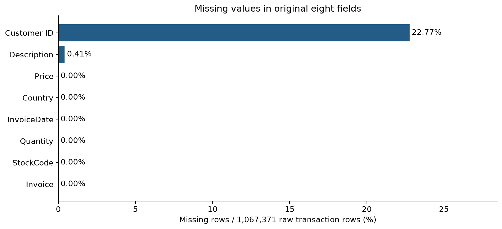

*Phạm vi: Raw rows, including C and anonymous transactions.*

Trong 1,067,371 dòng nguồn có 243,007 dòng thiếu mã khách
(22.766873% trên tổng dòng nguồn) và 4,382
dòng thiếu mô tả. Do đó không thể suy ra hành vi của toàn bộ giao dịch từ tập khách có định danh.

**Nhận xét và ý nghĩa.** Dòng thiếu Customer ID vẫn tham gia mô tả nguồn nhưng không thể
gán chắc chắn cho một khách hàng. Loại chúng khỏi bảng khách làm thay đổi quần thể quan sát,
do đó hành vi chỉ đại diện phần khách có định danh. Description thiếu không đồng nghĩa
Quantity/Price sai; cần đối chiếu loại mã và chứng từ.
**Đề xuất.** Không điền mã khách giả; giữ kiểm kê phần không gán được.
**Cần nhóm xác nhận** cách báo cáo giá trị của giao dịch thiếu khách và xử lý mô tả thiếu.

### 5.2. Dữ liệu trùng

**Câu hỏi.** Số liệu trùng khác nhau trong README và notebook preprocessing có mâu thuẫn thực chất không?
**Dữ liệu/phương pháp.** So đúng tám cột gốc, bỏ cột truy vết `Sheet`; đếm dòng trùng dư
`duplicated(keep='first')`, trùng trong từng sheet, tập mẫu nội dung chung và những bản sao
ở sheet sau trùng nội dung đã xuất hiện ở sheet trước. Các định nghĩa có mẫu số và đơn vị khác nhau.

| definition | count | denominator |
| --- | --- | --- |
| Global excess: duplicated(8 original columns, keep='first') | 34,335 | 1,067,371 |
| All rows belonging to a duplicate group: keep=False | 67,242 | 1,067,371 |
| Sum of excess duplicates separately inside each sheet | 12,133 | 1,067,371 |
| Distinct original 8-column patterns present in both sheets | 22,202 | 1,067,371 |
| Rows in second sheet matching a pattern in first (incl repeated copies) | 22,523 | 541,910 |
| Second-sheet extra copies of a shared pattern | 321 | 541,910 |

[Bảng `duplicates` trong EDA](../notebooks/01_eda/eda_v1.ipynb#eda-duplicates)

| population | rows | invoices | customers | signed_line_value_gbp | positive_line_value_gbp |
| --- | --- | --- | --- | --- | --- |
| raw_all_rows | 1,067,371 | 53,628 | 5,942 | 19,287,250.568 | 20,972,968.138 |
| raw_original_8col_deduplicated | 1,033,036 | 53,628 | 5,942 | 18,855,533.698 | 20,476,634.018 |

[Bảng `duplicate_impact` trong EDA](../notebooks/01_eda/eda_v1.ipynb#eda-duplicates)


Lần tính này ghi nhận 34,335 dòng trùng dư toàn bộ,
12,133 dòng dư khi tính riêng từng sheet,
22,202 mẫu tám cột có mặt ở cả hai sheet và
22,523 dòng của sheet sau khớp mẫu ở sheet trước.
Đồng nhất thức kiểm tra là trùng dư toàn bộ = trùng dư trong từng sheet + số mẫu chung.

**Nhận xét.** Số **mẫu nội dung** chung khác số **dòng** sheet sau khớp nội dung sheet trước
khi một mẫu xuất hiện nhiều lần. Vì vậy con số 22.202 và 22.523 trong tài liệu cũ không nên
được tuyên bố đúng/sai trước khi thống nhất định nghĩa; kết quả chạy lại và ảnh hưởng giữ/bỏ
được trình bày trong bảng trên. Dòng giống hoàn toàn là bằng chứng trùng nội dung, chưa tự
chứng minh bản sao kỹ thuật thay vì giao dịch hợp lệ lặp lại.
**Ý nghĩa/đề xuất.** Frequency đếm Invoice ít nhạy với trùng dòng hơn Monetary và tổng Quantity.
Lần này đối chiếu chính sách `drop_duplicates` hiện có để tái lập pipeline;
**Cần nhóm xác nhận** chính sách chính thức và mức thay đổi chấp nhận được.

### 5.3. Chứng từ hủy và giá trị đặc biệt

**Câu hỏi.** C, lượng âm, giá âm và giá bằng 0 có cùng nghĩa hay không?
**Phương pháp.** Kiểm tra từng điều kiện riêng trên dòng gốc, gồm lượng âm không có C;
các nhóm có thể giao nhau nên không cộng các tỷ lệ thành một tổng. Tỷ lệ mỗi nhóm dùng
tổng số dòng nguồn làm mẫu số, trừ khi bảng ghi mẫu số khác.

| category | rows | denominator_rows | pct | invoices | signed_line_value_gbp | interpretation | proposal |
| --- | --- | --- | --- | --- | --- | --- | --- |
| Invoice prefix C | 19,494 | 1,067,371 | 1.826357 | 8,292 | -1,526,667.86 | Cancellation indicator; not automatically a verified matched return. | Cần nhóm xác nhận: preserve audit; separate from selected positive purchases. |
| Quantity < 0 | 22,950 | 1,067,371 | 2.150143 | 11,684 | -1,527,041.43 | May represent cancellations, adjustments or stock movements. | Cần nhóm xác nhận: preserve audit; separate from selected positive purchases. |
| Quantity = 0 | 0 | 1,067,371 | 0 | 0 | 0 | Review; not a positive purchase. | Cần nhóm xác nhận: preserve audit; separate from selected positive purchases. |
| Price < 0 | 5 | 1,067,371 | 0.000468 | 5 | -158,676.14 | Review adjustment/accounting examples. | Cần nhóm xác nhận: preserve audit; separate from selected positive purchases. |
| Price = 0 | 6,202 | 1,067,371 | 0.581054 | 5,379 | 0 | Free items or adjustments possible; not assume error. | Cần nhóm xác nhận: preserve audit; separate from selected positive purchases. |
| Quantity < 0 without C | 3,457 | 1,067,371 | 0.32388 | 3,393 | 0 | Inventory/adjustment candidates; inspect descriptions. | Cần nhóm xác nhận: preserve audit; separate from selected positive purchases. |
| C with Quantity >= 0 | 1 | 1,067,371 | 0.000094 | 1 | 373.57 | Cancellation-sign exception; inspect separately. | Cần nhóm xác nhận: preserve audit; separate from selected positive purchases. |

[Bảng `anomalies` trong EDA](../notebooks/01_eda/eda_v1.ipynb#eda-special)

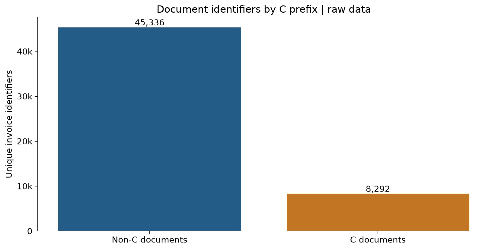

*Phạm vi: Raw unique invoice identifiers.*

**Nhận xét.** C là dấu hiệu chứng từ hủy theo tài liệu nguồn, còn Quantity âm không C cần
kiểm tra điều chỉnh kho/bút toán. Giá 0 có thể là hàng tặng hoặc bản ghi điều chỉnh;
không kết luận mọi số âm/bằng 0 là lỗi nhập liệu. Tổng `Quantity × Price` có dấu là giá trị
dòng có dấu, chưa được gọi là doanh thu thuần khi thiếu quy tắc hạch toán đã xác nhận.
**Đề xuất.** Giữ bảng hủy và kiểm kê mã riêng; không tự đặt `return_rate = 0` cho khách không thấy C.
**Cần nhóm xác nhận** ý nghĩa kinh doanh và chính sách đưa chứng từ vào Monetary.

#### Mã hàng dịch vụ, phí, điều chỉnh và chưa phân loại

Kiểm kê StockCode, số dòng và mô tả quan sát; đối chiếu danh sách SERVICE_CODES của pipeline.
Regex chỉ ghi nhận hình thức giống mã hàng, không xác nhận tất cả mã giữ lại đều là sản phẩm.

| StockCode | n_rows | example_descriptions | matches_product_code_pattern | classification | suggested_review_role |
| --- | --- | --- | --- | --- | --- |
| POST | 2,122 | POSTAGE | Không | pipeline_service_exclusion | postage |
| DOT | 1,446 | DOTCOM POSTAGE | Không | pipeline_service_exclusion | postage |
| M | 1,421 | Manual | Không | pipeline_service_exclusion | manual_adjustment |
| C2 | 282 | CARRIAGE | Không | pipeline_service_exclusion | fee |
| D | 177 | Discount | Không | pipeline_service_exclusion | discount_adjustment |
| S | 104 | SAMPLES | Không | pipeline_service_exclusion | sample |
| BANK CHARGES | 102 |  Bank Charges \| Bank Charges | Không | pipeline_service_exclusion | fee |
| ADJUST | 67 | Adjustment by john on 26/01/2010 16 \| Adjustment by john on 26/01/2010 17 \| Adjustment by Peter on 24/05/2010 1 | Không | pipeline_service_exclusion | unknown_requires_review |
| AMAZONFEE | 43 | AMAZON FEE | Không | pipeline_service_exclusion | fee |
| DCGS0058 | 31 | MISO PRETTY  GUM | Không | unknown | unknown_requires_review |
| gift_0001_20 | 29 | Dotcomgiftshop Gift Voucher £20.00 \| to push order througha s stock was  | Không | unknown | unknown_requires_review |
| gift_0001_30 | 29 | Dotcomgiftshop Gift Voucher £30.00 | Không | unknown | unknown_requires_review |
| DCGSSGIRL | 25 | update \| GIRLS PARTY BAG | Không | unknown | unknown_requires_review |
| DCGSSBOY | 23 | update \| BOYS PARTY BAG | Không | unknown | unknown_requires_review |
| PADS | 19 | PADS TO MATCH ALL CUSHIONS | Không | unknown | unknown_requires_review |
| CRUK | 16 | CRUK Commission | Không | pipeline_service_exclusion | unknown_requires_review |
| gift_0001_10 | 16 | Dotcomgiftshop Gift Voucher £10.00 | Không | unknown | unknown_requires_review |
| DCGS0076 | 15 | SUNJAR LED NIGHT NIGHT LIGHT | Không | unknown | unknown_requires_review |
| TEST001 | 15 | This is a test product. | Không | pipeline_service_exclusion | unknown_requires_review |
| DCGS0003 | 14 | BOXED GLASS ASHTRAY \| ebay | Không | unknown | unknown_requires_review |
| gift_0001_50 | 8 | Dotcomgiftshop Gift Voucher £50.00 | Không | unknown | unknown_requires_review |
| gift_0001_40 | 7 | Dotcomgiftshop Gift Voucher £40.00 | Không | unknown | unknown_requires_review |
| B | 6 | Adjust bad debt | Không | pipeline_service_exclusion | accounting_adjustment |
| DCGS0069 | 6 | OOH LA LA DOGS COLLAR \| ebay | Không | unknown | unknown_requires_review |
| m | 5 | Manual | Không | unknown | unknown_requires_review |
| DCGS0004 | 5 | HAYNES CAMPER SHOULDER BAG | Không | unknown | unknown_requires_review |
| DCGS0066N | 4 | NAVY CUDDLES DOG HOODIE | Không | unknown | unknown_requires_review |
| gift_0001_80 | 4 | Dotcomgiftshop Gift Voucher £80.00 | Không | unknown | unknown_requires_review |
| DCGS0072 | 4 | CAT CAMOUFLAGUE COLLAR | Không | unknown | unknown_requires_review |
| ADJUST2 | 3 | Adjustment by Peter on Jun 25 2010  | Không | pipeline_service_exclusion | unknown_requires_review |

Hiển thị 30/62 dòng; chạy Run All và xem biến `tables` trong notebook để kiểm tra toàn bộ.

[Bảng `special_stock_codes` trong EDA](../notebooks/01_eda/eda_v1.ipynb#eda-special)

Toàn bộ kiểm kê mã và mô tả được tính trong biến `tables["stock_audit"]` sau Run All;
xem [phần kiểm kê mã hàng trong EDA](../notebooks/01_eda/eda_v1.ipynb#eda-special).
**Ý nghĩa.** Loại một danh sách phí hữu hạn chưa tạo được bảng phân loại sản phẩm đầy đủ.
Các đặc trưng số sản phẩm/tổng lượng sản phẩm chính thức tiếp tục thiếu nếu chưa có mapping được phê duyệt.
**Cần nhóm xác nhận** danh mục `product/non_product/unknown`, dựa cả vào mô tả và nghiệp vụ.

### 5.4. Tính nhất quán dữ liệu

**Câu hỏi/phương pháp.** Đếm số mã khách và thời điểm khác nhau trên Invoice, số quốc gia trên khách,
số mô tả trên StockCode bằng `groupby().nunique()`; bảng ghi rõ số khóa chịu ảnh hưởng và mẫu số.
Khóa thiếu được theo dõi riêng; nhiều mô tả của một mã có thể là sửa mô tả, không tự suy ra hai sản phẩm.

| check | affected | denominator | denominator_unit | affected_pct | max_distinct |
| --- | --- | --- | --- | --- | --- |
| Invoice linked to >1 non-null Customer ID | 0 | 53,628 | invoices | 0 | 1 |
| Invoice linked to >1 timestamp | 83 | 53,628 | invoices | 0.15477 | 2 |
| Customer ID linked to >1 Country | 13 | 5,942 | customers | 0.218782 | 2 |
| StockCode linked to >1 exact non-null Description | 1,232 | 5,304 | stock_codes | 23.227753 | 9 |

[Bảng `consistency` trong EDA](../notebooks/01_eda/eda_v1.ipynb#eda-consistency)

**Nhận xét và ý nghĩa.** Một Invoice nhiều thời điểm ảnh hưởng khoảng cách mua và Recency;
khách nhiều quốc gia không thể gán một nhãn duy nhất nếu chưa có quy tắc.
Lần khảo sát hành vi chọn `invoice_time_policy='earliest'` công khai, lấy thời điểm sớm nhất
của các dòng còn lại trong cửa sổ, thay vì âm thầm sửa dữ liệu nguồn.
**Cần nhóm xác nhận** cách định thời hóa đơn, quy tắc quốc gia khách và khóa hóa đơn phù hợp.

## 6. Thống kê mô tả

**Câu hỏi.** Lượng, giá và giá trị dòng lệch đến đâu; chính sách pipeline làm phân phối đổi thế nào?
**Dữ liệu/phương pháp.** Tính count, mean, median, min/max, Q1/Q3, IQR, P95/P99,
độ lệch chuẩn và skewness riêng cho thô và đầu ra pipeline. `LineValue = Quantity × Price`
trên thô; phân biệt giá trị chính xác với cột đã làm tròn hai số thập phân trong processed.
Không tính hoặc diễn giải trung bình Customer ID.

| population | variable | count | mean | median | minimum | maximum | q1 | q3 | p95 | p99 | std | skewness |
| --- | --- | --- | --- | --- | --- | --- | --- | --- | --- | --- | --- | --- |
| raw_all_rows_including_C | Quantity | 1,067,371 | 9.938898 | 3 | -80,995 | 80,995 | 1 | 10 | 30 | 100 | 172.705794 | 3.996145 |
| raw_all_rows_including_C | Price | 1,067,371 | 4.649388 | 2.1 | -53,594.36 | 38,970 | 1.25 | 4.15 | 9.95 | 18 | 123.553059 | -69.164734 |
| raw_all_rows_including_C | LineValue | 1,067,371 | 18.069866 | 9.9 | -168,469.6 | 168,469.6 | 3.75 | 17.7 | 59.5 | 180 | 292.420223 | -12.441961 |
| current_pipeline_sales | Quantity | 770,606 | 13.117912 | 6 | 1 | 19,152 | 2 | 12 | 36 | 128 | 73.226744 | 95.315345 |
| current_pipeline_sales | Price | 770,606 | 2.915934 | 1.95 | 0.001 | 649.5 | 1.25 | 3.75 | 8.5 | 12.75 | 4.144901 | 32.709205 |
| current_pipeline_sales | LineValue | 770,606 | 21.440407 | 11.9 | 0 | 38,970 | 4.95 | 19.5 | 67.2 | 195.6 | 81.20544 | 167.727005 |

[Bảng `descriptive_transactions` trong EDA](../notebooks/01_eda/eda_v1.ipynb#eda-description)

**Nhận xét.** Mean cần đọc cùng median/quantile/max vì một số dòng rất lớn hoặc âm có thể
kéo trung bình; bảng thô và bảng sạch có quần thể khác nhau nên khác biệt không phải tác động nhân quả.
Thống kê cấp khách hàng ở mục 11 dùng mỗi khách đúng một dòng, không lẫn với phân phối cấp dòng.
**Đề xuất.** Giữ thống kê đầy đủ để lựa chọn biến đổi thay vì cắt đuôi theo trực giác.

## 7. Phân tích theo thời gian

**Câu hỏi.** Khối lượng chứng từ và giá trị dòng thay đổi theo tháng, thứ, giờ ra sao?
**Điều kiện.** Góc nhìn nguồn gồm mọi chứng từ, kể cả C và điều chỉnh; hóa đơn tháng là
`nunique(Invoice)` trong từng tháng, số dòng là số bản ghi, tổng giá trị là tổng Q×P có dấu.
Một mã có nhiều thời điểm có thể xuất hiện trong nhiều nhóm thời gian; không cộng các nhóm
để suy ra số Invoice toàn cục nếu chưa kiểm tra giao nhau.
**Phương pháp.** Nhóm InvoiceDate theo tháng, weekday và hour; đánh dấu tháng biên không trọn tháng.

| month | rows | invoices | customers | signed_line_value_gbp | date_min | date_max | c_invoices | non_c_invoices | calendar_coverage_partial |
| --- | --- | --- | --- | --- | --- | --- | --- | --- | --- |
| 2009-12 | 45,228 | 2,330 | 1,045 | 799,847.11 | 2009-12-01 07:45:00 | 2009-12-23 16:58:00 | 401 | 1,929 | Không |
| 2010-01 | 31,555 | 1,633 | 786 | 624,032.892 | 2010-01-04 09:24:00 | 2010-01-31 16:02:00 | 300 | 1,333 | Không |
| 2010-02 | 29,388 | 1,969 | 807 | 533,091.426 | 2010-02-01 08:13:00 | 2010-02-28 16:16:00 | 240 | 1,729 | Không |
| 2010-03 | 41,511 | 2,367 | 1,111 | 765,848.761 | 2010-03-01 08:38:00 | 2010-03-31 17:53:00 | 407 | 1,960 | Không |
| 2010-04 | 34,057 | 1,892 | 998 | 590,580.432 | 2010-04-01 07:49:00 | 2010-04-30 17:33:00 | 304 | 1,588 | Không |
| 2010-05 | 35,323 | 2,418 | 1,062 | 615,322.83 | 2010-05-02 10:22:00 | 2010-05-30 15:58:00 | 407 | 2,011 | Không |
| 2010-06 | 39,983 | 2,216 | 1,095 | 679,786.61 | 2010-06-01 09:02:00 | 2010-06-30 17:38:00 | 357 | 1,859 | Không |
| 2010-07 | 33,383 | 2,017 | 988 | 575,236.36 | 2010-07-01 08:39:00 | 2010-07-30 17:08:00 | 344 | 1,673 | Không |
| 2010-08 | 33,306 | 1,877 | 964 | 656,776.34 | 2010-08-01 10:04:00 | 2010-08-31 17:44:00 | 273 | 1,604 | Không |
| 2010-09 | 42,091 | 2,375 | 1,202 | 853,650.431 | 2010-09-01 09:22:00 | 2010-09-30 20:11:00 | 371 | 2,004 | Không |
| 2010-10 | 59,098 | 2,965 | 1,577 | 1,045,168.35 | 2010-10-01 08:19:00 | 2010-10-31 16:26:00 | 476 | 2,489 | Không |
| 2010-11 | 78,015 | 3,669 | 1,683 | 1,422,654.642 | 2010-11-01 08:56:00 | 2010-11-30 19:35:00 | 576 | 3,093 | Không |
| 2010-12 | 65,004 | 2,025 | 948 | 1,126,445.47 | 2010-12-01 08:26:00 | 2010-12-23 17:41:00 | 326 | 1,699 | Không |
| 2011-01 | 35,147 | 1,476 | 783 | 560,000.26 | 2011-01-04 10:00:00 | 2011-01-31 16:59:00 | 260 | 1,216 | Không |
| 2011-02 | 27,707 | 1,393 | 798 | 498,062.65 | 2011-02-01 08:23:00 | 2011-02-28 17:04:00 | 219 | 1,174 | Không |
| 2011-03 | 36,748 | 1,983 | 1,020 | 683,267.08 | 2011-03-01 08:30:00 | 2011-03-31 19:55:00 | 318 | 1,665 | Không |
| 2011-04 | 29,916 | 1,744 | 899 | 493,207.121 | 2011-04-01 08:22:00 | 2011-04-28 19:53:00 | 240 | 1,504 | Không |
| 2011-05 | 37,030 | 2,162 | 1,079 | 723,333.51 | 2011-05-01 10:51:00 | 2011-05-31 15:53:00 | 314 | 1,848 | Không |
| 2011-06 | 36,874 | 2,012 | 1,051 | 691,123.12 | 2011-06-01 07:37:00 | 2011-06-30 20:08:00 | 329 | 1,683 | Không |
| 2011-07 | 39,518 | 1,927 | 993 | 681,300.111 | 2011-07-01 08:16:00 | 2011-07-31 16:04:00 | 270 | 1,657 | Không |
| 2011-08 | 35,284 | 1,737 | 980 | 682,680.51 | 2011-08-01 08:30:00 | 2011-08-31 17:45:00 | 278 | 1,459 | Không |
| 2011-09 | 50,226 | 2,327 | 1,302 | 1,019,687.622 | 2011-09-01 08:25:00 | 2011-09-30 17:22:00 | 333 | 1,994 | Không |
| 2011-10 | 60,742 | 2,637 | 1,425 | 1,070,704.67 | 2011-10-02 10:32:00 | 2011-10-31 17:19:00 | 362 | 2,275 | Không |
| 2011-11 | 84,711 | 3,462 | 1,711 | 1,461,756.25 | 2011-11-01 08:16:00 | 2011-11-30 17:42:00 | 441 | 3,021 | Không |
| 2011-12 | 25,526 | 1,015 | 686 | 433,686.01 | 2011-12-01 08:12:00 | 2011-12-09 12:50:00 | 146 | 869 | Có |

[Bảng `monthly` trong EDA](../notebooks/01_eda/eda_v1.ipynb#eda-time)

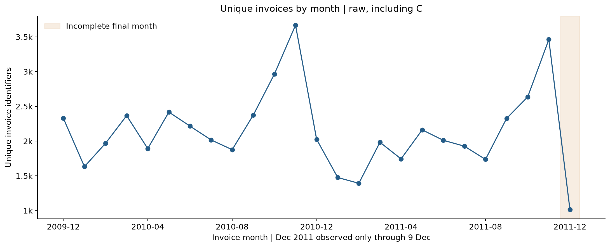

*Phạm vi: Raw transaction rows; C included; final month incomplete.*

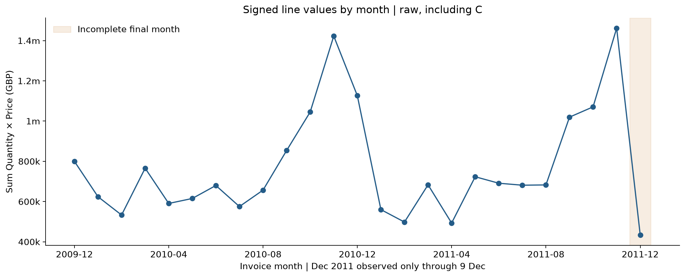

*Phạm vi: Raw transaction rows; C included; final month incomplete.*

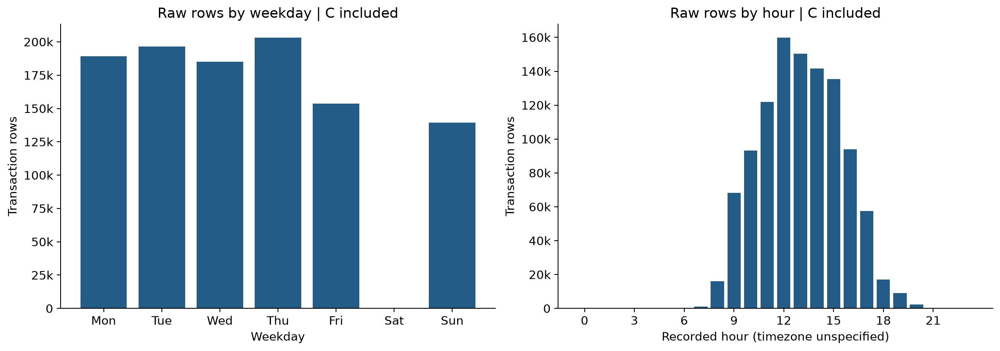

*Phạm vi: Raw rows including C, all dates.*

| weekday | hour | rows | invoices |
| --- | --- | --- | --- |
| 0 | 7 | 163 | 20 |
| 0 | 8 | 3,003 | 185 |
| 0 | 9 | 15,570 | 620 |
| 0 | 10 | 17,886 | 968 |
| 0 | 11 | 19,562 | 980 |
| 0 | 12 | 26,151 | 1,295 |
| 0 | 13 | 27,240 | 1,224 |
| 0 | 14 | 23,066 | 1,046 |
| 0 | 15 | 23,430 | 1,117 |
| 0 | 16 | 17,447 | 749 |
| 0 | 17 | 13,560 | 348 |
| 0 | 18 | 2,006 | 43 |
| 1 | 7 | 254 | 17 |
| 1 | 8 | 2,976 | 230 |
| 1 | 9 | 13,627 | 803 |
| 1 | 10 | 16,100 | 1,157 |
| 1 | 11 | 19,608 | 1,267 |
| 1 | 12 | 28,628 | 1,503 |
| 1 | 13 | 27,248 | 1,379 |
| 1 | 14 | 24,384 | 1,123 |

Hiển thị 20/86 dòng; chạy Run All và xem biến `tables` trong notebook để kiểm tra toàn bộ.

[Bảng `weekday_hour` trong EDA](../notebooks/01_eda/eda_v1.ipynb#eda-time)

Trong các tháng không bị đánh dấu thiếu độ phủ lịch, tháng 2010-11 có nhiều mã chứng từ nhất: 3,669 mã. Tháng cuối 2011-12 chỉ quan sát đến 2011-12-09 12:50:00; không so tổng tháng đó như một tháng đầy đủ.

**Nhận xét.** Tháng cuối kết thúc theo ngày cuối trong workbook, không đại diện cả tháng;
không dùng mức thấp hơn ở tháng đó để khẳng định suy giảm kinh doanh. Đỉnh theo giờ/thứ
có thể phản ánh lịch ghi nhận của nguồn; không chứng minh nguyên nhân hay mùa vụ dài hạn.
**Ý nghĩa/đề xuất.** Dùng cùng cửa sổ quan sát khi so sánh đặc trưng khách hàng;
ghi đầy đủ mốc tham chiếu và độ phủ trước khi đánh giá thay đổi theo thời gian.

## 8. Phân tích theo quốc gia

**Câu hỏi.** Quốc gia nào chiếm nhiều dòng, chứng từ, khách và giá trị dòng?
**Dữ liệu/phương pháp.** Dữ liệu nguồn có C; nhóm theo Country, tính riêng size,
Invoice.nunique, Customer ID.nunique không thiếu và tổng Q×P có dấu.
Tỷ trọng dòng dùng tổng dòng; tỷ trọng hóa đơn/khách phải đọc với mẫu số toàn cục và
khả năng một mã xuất hiện ở nhiều quốc gia. Không cộng số khách của các nước thành số khách toàn bộ.

| Country | rows | rows_pct | invoices | invoices_pct | customers | customers_pct | signed_line_value_gbp | signed_value_pct |
| --- | --- | --- | --- | --- | --- | --- | --- | --- |
| United Kingdom | 981,330 | 91.938979 | 49,108 | 91.571567 | 5,410 | 91.046786 | 16,382,583.897 | 84.939965 |
| EIRE | 17,866 | 1.673832 | 806 | 1.502946 | 5 | 0.084147 | 615,519.55 | 3.191329 |
| Germany | 17,624 | 1.65116 | 1,095 | 2.041844 | 107 | 1.80074 | 417,988.561 | 2.167175 |
| France | 14,330 | 1.342551 | 746 | 1.391064 | 95 | 1.598788 | 328,191.8 | 1.7016 |
| Netherlands | 5,140 | 0.481557 | 250 | 0.466174 | 23 | 0.387075 | 548,524.95 | 2.843977 |
| Spain | 3,811 | 0.357045 | 188 | 0.350563 | 41 | 0.690003 | 91,859.48 | 0.47627 |
| Switzerland | 3,189 | 0.298771 | 123 | 0.229358 | 22 | 0.370246 | 99,728.76 | 0.517071 |
| Belgium | 3,123 | 0.292588 | 183 | 0.34124 | 29 | 0.488051 | 63,574.49 | 0.329619 |
| Portugal | 2,620 | 0.245463 | 124 | 0.231222 | 24 | 0.403904 | 53,136.8 | 0.275502 |
| Australia | 1,913 | 0.179225 | 117 | 0.21817 | 15 | 0.25244 | 167,129.07 | 0.866526 |
| Channel Islands | 1,664 | 0.155897 | 79 | 0.147311 | 14 | 0.235611 | 41,453.61 | 0.214928 |
| Italy | 1,534 | 0.143718 | 92 | 0.171552 | 17 | 0.286099 | 30,679.35 | 0.159065 |
| Norway | 1,455 | 0.136316 | 53 | 0.098829 | 13 | 0.218782 | 39,243.03 | 0.203466 |
| Sweden | 1,364 | 0.127791 | 129 | 0.240546 | 19 | 0.319758 | 87,809.42 | 0.455272 |
| Cyprus | 1,176 | 0.110177 | 45 | 0.083911 | 11 | 0.185123 | 24,162.74 | 0.125278 |
| Finland | 1,049 | 0.098279 | 68 | 0.126799 | 15 | 0.25244 | 29,514.45 | 0.153026 |
| Austria | 938 | 0.087879 | 51 | 0.0951 | 13 | 0.218782 | 23,177.6 | 0.120171 |
| Denmark | 817 | 0.076543 | 53 | 0.098829 | 12 | 0.201952 | 65,741.09 | 0.340853 |
| Unspecified | 756 | 0.070828 | 28 | 0.052212 | 7 | 0.117805 | 9,687.32 | 0.050227 |
| Greece | 663 | 0.062115 | 21 | 0.039159 | 5 | 0.084147 | 18,995.49 | 0.098487 |

Hiển thị 20/43 dòng; chạy Run All và xem biến `tables` trong notebook để kiểm tra toàn bộ.

[Bảng `countries` trong EDA](../notebooks/01_eda/eda_v1.ipynb#eda-country)

Mẫu số các tỷ trọng toàn nguồn: dòng = 1,067,371; mã chứng từ duy nhất = 53,628; khách có định danh duy nhất = 5,942; giá trị dòng có dấu = 19,287,250.568 GBP. Tập chứng từ/khách có thể chồng lấn giữa quốc gia; tỷ trọng của chúng không phải phân hoạch bảo đảm cộng thành 100%.

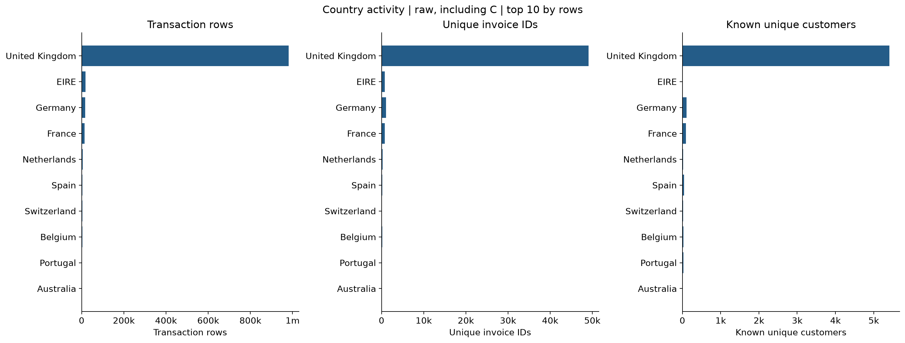

*Phạm vi: Raw rows/invoice IDs/known customers; customer country sets may overlap.*

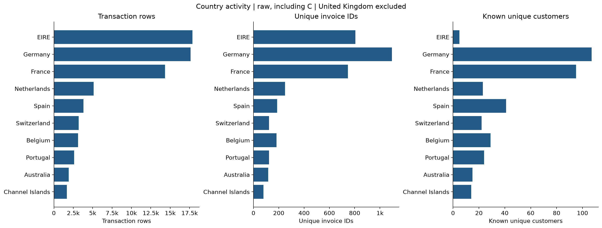

*Phạm vi: Raw rows/invoice IDs/known customers; customer country sets may overlap.*

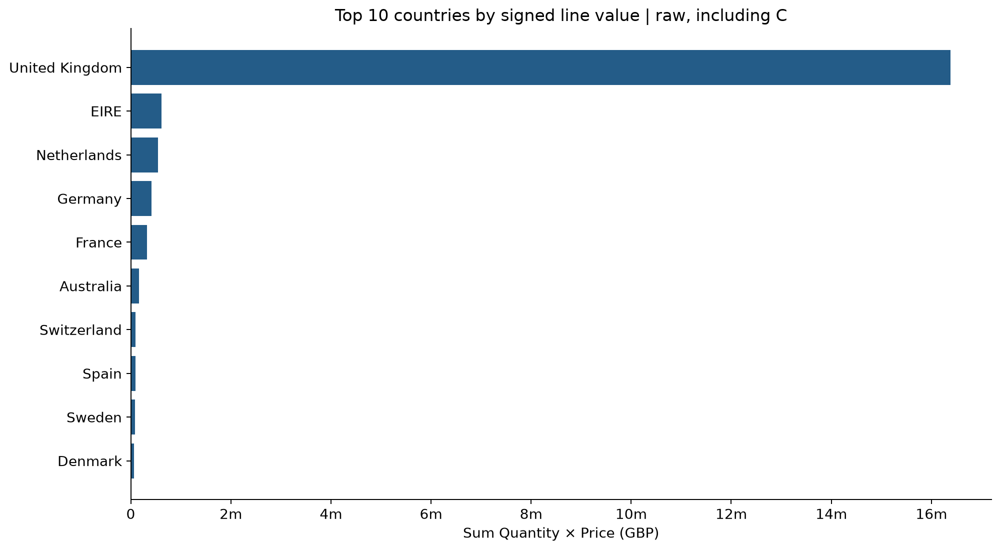

*Phạm vi: Raw signed line values including C; not asserted net revenue.*

United Kingdom đứng đầu về dòng nguồn với 981,330 dòng, chiếm 91.938979% trên 1,067,371 dòng nguồn. Đây là tỷ trọng dòng, không phải tỷ trọng khách hoặc doanh thu.

**Nhận xét.** Thị trường chiếm ưu thế cần được thể hiện cùng nhóm còn lại để tránh che mất
sự khác biệt. Nếu hình loại thị trường đứng đầu, điều kiện loại nằm ngay trong tiêu đề/phạm vi hình.
Nhãn `Unspecified` là nhãn chưa xác định trong nguồn, không mặc định là một quốc gia riêng.
Số dòng lớn không đồng nghĩa số khách lớn hoặc giá trị mua mỗi khách cao.
**Đề xuất.** Cân nhắc kiểm tra độ ổn định phân cụm theo thị trường sau khi nhóm chốt cách gán quốc gia.

## 9. Phân tích phân phối, độ lệch và ngoại lệ

**Câu hỏi.** Đuôi dài tập trung ở biến nào và ảnh hưởng thế nào tới khoảng cách dùng trong phân cụm?
**Phương pháp.** Histogram, boxplot và ngưỡng Tukey `Q1 − 1,5×IQR`, `Q3 + 1,5×IQR`;
đếm điểm ngoài ngưỡng riêng trên đúng tập dòng/khách của từng bảng. P95/P99 và max mô tả
đuôi phân phối; ngưỡng thống kê không xác nhận lỗi dữ liệu.

| population | variable | median | q1 | q3 | iqr | iqr_lower | iqr_upper | outside_iqr | denominator | outside_iqr_pct |
| --- | --- | --- | --- | --- | --- | --- | --- | --- | --- | --- |
| raw_all_rows_including_C | Quantity | 3 | 1 | 10 | 9 | -12.5 | 23.5 | 116,489 | 1,067,371 | 10.913637 |
| raw_all_rows_including_C | Price | 2.1 | 1.25 | 4.15 | 2.9 | -3.1 | 8.5 | 68,105 | 1,067,371 | 6.380631 |
| raw_all_rows_including_C | LineValue | 9.9 | 3.75 | 17.7 | 13.95 | -17.175 | 38.625 | 90,922 | 1,067,371 | 8.518313 |
| current_pipeline_sales | Quantity | 6 | 2 | 12 | 10 | -13 | 27 | 50,292 | 770,606 | 6.526292 |
| current_pipeline_sales | Price | 1.95 | 1.25 | 3.75 | 2.5 | -2.5 | 7.5 | 61,844 | 770,606 | 8.025372 |
| current_pipeline_sales | LineValue | 11.9 | 4.95 | 19.5 | 14.55 | -16.875 | 41.325 | 62,772 | 770,606 | 8.145797 |

[Bảng `outlier_transactions` trong EDA](../notebooks/01_eda/eda_v1.ipynb#eda-outliers)

| variable | median | q1 | q3 | iqr | p95 | p99 | maximum | outside_iqr | denominator | outside_iqr_pct |
| --- | --- | --- | --- | --- | --- | --- | --- | --- | --- | --- |
| n_orders | 3 | 1 | 7 | 6 | 20 | 46 | 371 | 423 | 5,839 | 7.244391 |
| total_purchase_value | 851.01 | 336.245 | 2,206.945 | 1,870.7 | 8,990.287 | 26,811.0702 | 579,128.64 | 616 | 5,839 | 10.549752 |
| avg_order_value | 274.76 | 174.52125 | 408.34631 | 233.82506 | 859.193391 | 1,838.770041 | 19,809.75 | 377 | 5,839 | 6.456585 |
| n_stock_codes_candidate | 45 | 19 | 103 | 84 | 281 | 502.62 | 2,507 | 445 | 5,839 | 7.621168 |
| total_quantity_candidate | 480 | 188 | 1,344 | 1,156 | 5,259.6 | 16,064.48 | 365,114 | 598 | 5,839 | 10.24148 |
| avg_quantity_per_order_candidate | 154 | 91.535714 | 258 | 166.464286 | 548.55 | 1,296.700141 | 87,167 | 358 | 5,839 | 6.131187 |
| avg_purchase_gap_days | 72.982535 | 39.189792 | 131.272092 | 92.0823 | 323.968403 | 487.227778 | 714.152083 | 308 | 4,226 | 7.288216 |
| observed_tenure_days | 529.459722 | 311.497917 | 666.595139 | 355.097222 | 735.516944 | 738.424736 | 738.677083 | 0 | 5,839 | 0 |

[Bảng `outlier_customers` trong EDA](../notebooks/01_eda/eda_v1.ipynb#eda-outliers)

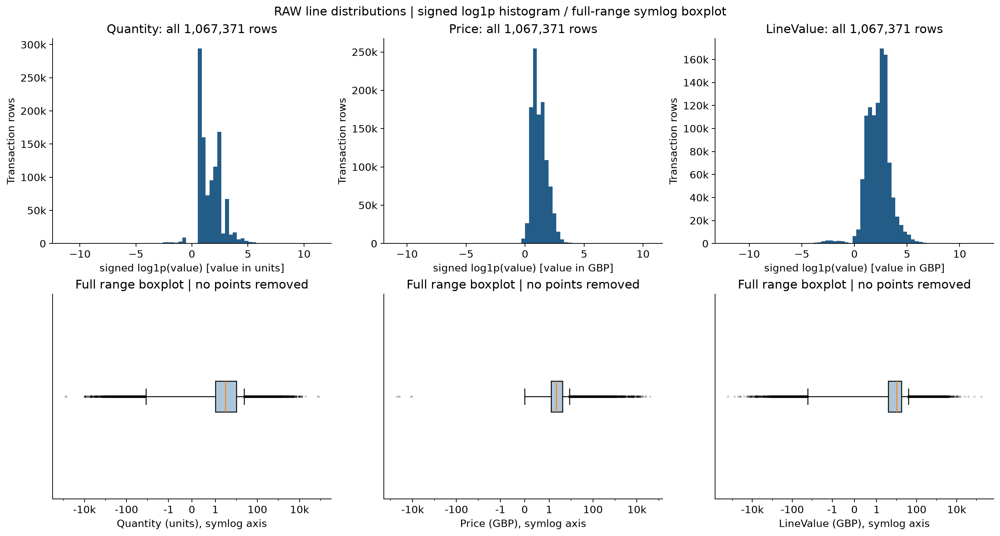

*Phạm vi: All raw transaction rows, no outlier deletion.*

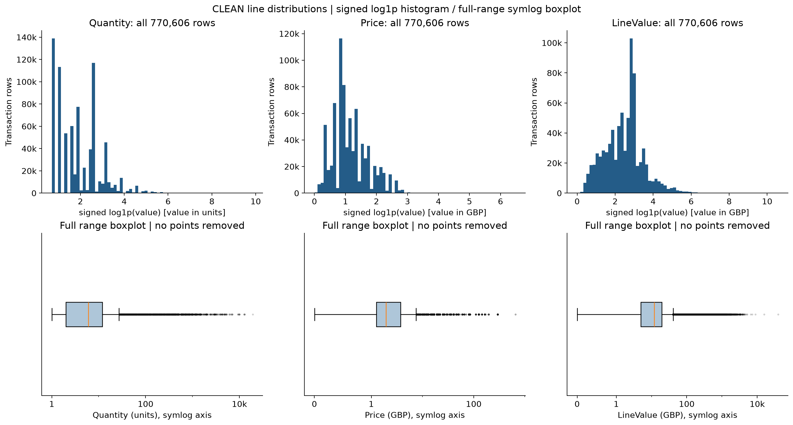

*Phạm vi: All clean transaction rows, no outlier deletion.*

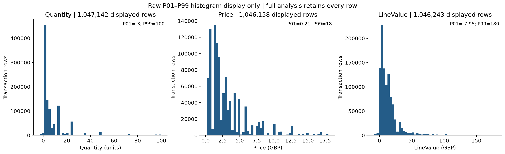

*Phạm vi: Raw rows restricted for display only, no data deletion.*

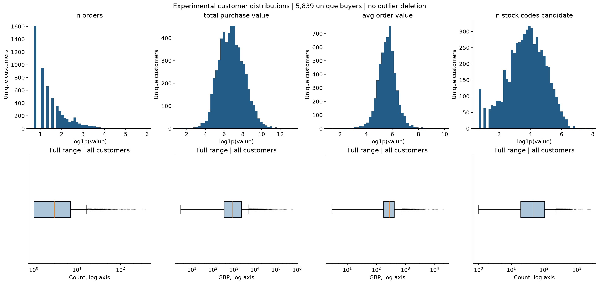

*Phạm vi: One row per current-pipeline buyer; stock counts unverified candidates.*

### Ví dụ dòng cực trị cần đối chiếu

| variable | direction | Invoice | StockCode | Description | Quantity | Price | LineValue | InvoiceDate |
| --- | --- | --- | --- | --- | --- | --- | --- | --- |
| Quantity | smallest | C581484 | 23843 | PAPER CRAFT , LITTLE BIRDIE | -80,995 | 2.08 | -168,469.6 | 2011-12-09 09:27:00 |
| Quantity | smallest | C541433 | 23166 | MEDIUM CERAMIC TOP STORAGE JAR | -74,215 | 1.04 | -77,183.6 | 2011-01-18 10:17:00 |
| Quantity | smallest | 519017 | 22759 | Chưa xác định | -9,600 | 0 | -0 | 2010-08-13 09:14:00 |
| Quantity | largest | 581483 | 23843 | PAPER CRAFT , LITTLE BIRDIE | 80,995 | 2.08 | 168,469.6 | 2011-12-09 09:15:00 |
| Quantity | largest | 541431 | 23166 | MEDIUM CERAMIC TOP STORAGE JAR | 74,215 | 1.04 | 77,183.6 | 2011-01-18 10:01:00 |
| Quantity | largest | 497946 | 37410 | BLACK AND WHITE PAISLEY FLOWER MUG | 19,152 | 0.1 | 1,915.2 | 2010-02-15 11:57:00 |
| Price | smallest | A506401 | B | Adjust bad debt | 1 | -53,594.36 | -53,594.36 | 2010-04-29 13:36:00 |
| Price | smallest | A516228 | B | Adjust bad debt | 1 | -44,031.79 | -44,031.79 | 2010-07-19 11:24:00 |
| Price | smallest | A528059 | B | Adjust bad debt | 1 | -38,925.87 | -38,925.87 | 2010-10-20 12:04:00 |
| Price | largest | C556445 | M | Manual | -1 | 38,970 | -38,970 | 2011-06-10 15:31:00 |
| Price | largest | C512770 | M | Manual | -1 | 25,111.09 | -25,111.09 | 2010-06-17 16:52:00 |
| Price | largest | 512771 | M | Manual | 1 | 25,111.09 | 25,111.09 | 2010-06-17 16:53:00 |
| LineValue | smallest | C581484 | 23843 | PAPER CRAFT , LITTLE BIRDIE | -80,995 | 2.08 | -168,469.6 | 2011-12-09 09:27:00 |
| LineValue | smallest | C541433 | 23166 | MEDIUM CERAMIC TOP STORAGE JAR | -74,215 | 1.04 | -77,183.6 | 2011-01-18 10:17:00 |
| LineValue | smallest | A506401 | B | Adjust bad debt | 1 | -53,594.36 | -53,594.36 | 2010-04-29 13:36:00 |
| LineValue | largest | 581483 | 23843 | PAPER CRAFT , LITTLE BIRDIE | 80,995 | 2.08 | 168,469.6 | 2011-12-09 09:15:00 |
| LineValue | largest | 541431 | 23166 | MEDIUM CERAMIC TOP STORAGE JAR | 74,215 | 1.04 | 77,183.6 | 2011-01-18 10:01:00 |
| LineValue | largest | 556444 | 22502 | PICNIC BASKET WICKER 60 PIECES | 60 | 649.5 | 38,970 | 2011-06-10 15:28:00 |

[Bảng `extreme_rows` trong EDA](../notebooks/01_eda/eda_v1.ipynb#eda-outliers)

**Nhận xét.** Hình giới hạn P01–P99 chỉ giới hạn phạm vi hiển thị, không xóa bản ghi khỏi
phép tính hoặc khỏi bảng bàn giao. Hình log/symlog đổi thang trục để thấy cả đuôi;
không được diễn giải khoảng cách trên hình như thang tuyến tính gốc.
Khách hàng mua nhiều có thể là khách sỉ thật; loại họ vì IQR có nguy cơ loại chính nhóm giá trị cao.
**Ý nghĩa/đề xuất.** So sánh `log1p` + StandardScaler với cách scale bền vững trong thực nghiệm tiếp theo;
ghi nhận độ nhạy và khả năng diễn giải. Lần này không cắt/winsorize hay xóa khách IQR.
**Cần nhóm xác nhận** với Thuận trước khi thay chính sách ngoại lệ chính thức.

## 10. Đối chiếu trước và sau tiền xử lý

**Câu hỏi.** Pipeline thực tế đã loại/tách gì và quy mô dòng, hóa đơn, khách thay đổi ra sao?
**Phương pháp.** Gọi mã hiện có trong bộ nhớ và tái hiện từng bước để đếm rows/Invoice/CustomerID;
so kết quả với log và các tệp processed đang có. Dữ liệu thô và processed không bị ghi đè.

| step | rows_before | rows_after | rows_changed | invoices | customers | reason | confirmation_status |
| --- | --- | --- | --- | --- | --- | --- | --- |
| Raw combined sheets | 1,067,371 | 1,067,371 | 0 | 53,628 | 5,942 | Original source; no row filters | Code replay verified; Cần nhóm xác nhận policy |
| Exact duplicates after standardization | 1,067,371 | 1,033,036 | 34,335 | 53,628 | 5,942 | 8 fields; provenance Sheet excluded | Code replay verified; Cần nhóm xác nhận policy |
| Missing customer excluded | 1,033,036 | 797,885 | 235,151 | 44,876 | 5,942 | Cannot assign anonymous rows to customer | Code replay verified; Cần nhóm xác nhận policy |
| Listed service/test codes excluded | 797,885 | 794,244 | 3,641 | 43,880 | 5,876 | Existing SERVICE_CODES set; not a verified product catalog | Code replay verified; Cần nhóm xác nhận policy |
| C documents separated | 794,244 | 776,657 | 17,587 | 36,597 | 5,853 | Negative C rows kept in separate cancellation view | Code replay verified; Cần nhóm xác nhận policy |
| Positive sale quantity and price | 776,657 | 776,596 | 61 | 36,594 | 5,852 | Current purchase policy | Code replay verified; Cần nhóm xác nhận policy |
| Exact opposite quantity match removed | 776,596 | 770,606 | 5,990 | 36,414 | 5,839 | cumcount pairs on customer/code/price/absolute quantity with cancel_time >= sale_time; heuristic | Code replay verified; Cần nhóm xác nhận policy |

[Bảng `preprocessing_trace` trong EDA](../notebooks/01_eda/eda_v1.ipynb#eda-preprocessing)

| artifact | calculated_rows | stored_rows | equal | comparison |
| --- | --- | --- | --- | --- |
| data/processed/online_retail_clean.csv.gz | 770,606 | 770,606 | Có | All rows/columns in stored order equal after identifier/date normalization; numeric atol=1e-9, rtol=1e-12. |
| data/processed/online_retail_cancellations.csv | 17,587 | 17,587 | Có | All rows/columns in stored order equal after identifier/date normalization; numeric atol=1e-9, rtol=1e-12. |
| data/processed/preprocessing_log.csv | 7 | 7 | Có | Step labels and retained counts; stored log additionally records removed counts |

[Bảng `stored_reconciliation` trong EDA](../notebooks/01_eda/eda_v1.ipynb#eda-preprocessing)

### Sai khác do làm tròn giá trị dòng

| rows | exact_value_gbp | rounded_line_value_gbp | rounded_minus_exact_gbp | positive_rows_rounded_to_zero | rows_changed_by_rounding |
| --- | --- | --- | --- | --- | --- |
| 770,606 | 16,522,106.307 | 16,522,106.29 | -0.017 | 17 | 17 |

[Bảng `rounding_audit` trong EDA](../notebooks/01_eda/eda_v1.ipynb#eda-preprocessing)

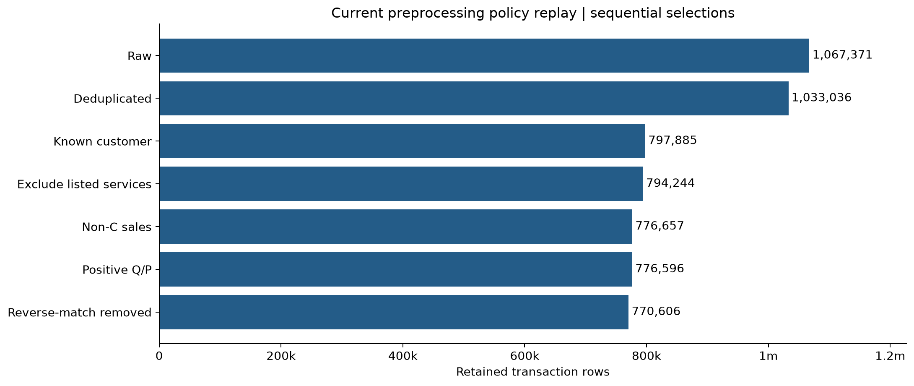

*Phạm vi: Rows retained at each sequential step; reversal is heuristic.*

Pipeline đã bỏ 5,990 dòng mua theo heuristic ghép C;
bảng C còn 17,587 dòng/7,283 chứng từ,
gắn với 2,445 khách. Trạng thái so khớp tất cả đầu ra lưu sẵn:
**Có** (đọc chi tiết từng tệp ở bảng đối chiếu).
Giá trị Q×P chính xác là 16,522,106.307 GBP, trong khi tổng cột
LineValue làm tròn là 16,522,106.29 GBP;
chênh làm tròn trừ chính xác là -0.017 GBP.
Có 17 dòng Q/P dương nhưng LineValue làm tròn thành 0.

**Quy tắc đã đọc và chạy lại.** Chuẩn hóa chuỗi; bỏ dòng giống nhau trên tám cột chuẩn hóa;
bỏ CustomerID thiếu; loại SERVICE_CODES; tách Invoice C; chọn Q>0 và P>0 cho bán;
chỉ giữ C có Q<0/P>0 trong bảng hủy; làm tròn LineValue hai chữ số; đánh dấu dòng mua khớp dòng C
theo `(CustomerID, StockCode, Price, abs(Quantity), cumcount)` rồi kiểm tra thời điểm C không trước mua.

**Giới hạn của ghép hủy.** Đây là heuristic theo khóa và thứ tự xuất hiện, không có liên kết
Invoice gốc, không ghép hoàn trả một phần và không tìm cặp khác nếu cặp ordinal sai thời gian.
Vì vậy tên bước cũ “đơn lỗi/ngoại lai” không đủ chứng minh mọi dòng bị loại là lỗi hay hoàn trả đã xác minh.
Nếu tạo snapshot trước ngày kết thúc nguồn, phải lọc cả luồng mua và hủy theo mốc trước khi ghép;
không dùng kết quả clean toàn kỳ để suy ngược snapshot sớm vì có thể nhìn thấy C tương lai.

**Tệp thực tế.** Repository chứa `online_retail_clean.csv.gz`; hàm `save_processed` hiện ghi
`online_retail_clean.csv`. Đọc đúng tệp có sẵn để đối chiếu; không coi tệp `.csv` thiếu là dữ liệu sạch không tồn tại.
Sai khác do làm tròn LineValue được kiểm kê riêng với Q×P chính xác, không che bằng làm tròn tổng.

**Ý nghĩa/đề xuất.** Tái lập pipeline xác nhận hành vi của mã và tính nhất quán tệp,
chưa xác nhận tính đúng về nghiệp vụ của từng quy tắc. **Cần nhóm xác nhận** với Thuận:
trùng dòng, SERVICE_CODES, ghép C, giá trị làm tròn và cách lưu tệp đầu ra.

## 11. Phân tích hành vi khách hàng

**Câu hỏi.** Khách mua bao nhiêu đơn, tổng giá trị bao nhiêu, đơn trung bình và khoảng cách mua ra sao?
**Điều kiện.** Chỉ dòng bán trong đầu ra pipeline được chạy lại, có mã khách, Q/P>0, không C,
đã loại danh sách dịch vụ và dòng bị heuristic ghép hủy. Không tuyên bố mã còn lại đều là sản phẩm.
Invoice là mã hóa đơn duy nhất trên khách trong cửa sổ; giá trị đơn là tổng Q×P chính xác của
các dòng đầu vào còn lại. Mỗi Customer ID phải xuất hiện đúng một dòng tổng hợp.
**Phương pháp.** Dùng các hàm hiện có trong `features.py`, `invoice_time_policy='earliest'`;
số đơn đếm hóa đơn, AOV = tổng giá trị mua/số đơn; khoảng cách là trung bình chênh thời điểm
các hóa đơn đã sắp xếp, tính theo ngày 86.400 giây. Khách một đơn có gap NaN, không thay bằng 0.

| Chỉ tiêu | Giá trị |
| --- | --- |
| customers | 5,839 |
| invoices | 36,414 |
| single_invoice_customers | 1,613 |
| single_invoice_pct | 27.624593 |
| denominator_customers | 5,839 |
| missing_purchase_gap | 1,613 |
| multi_timestamp_orders | 64 |
| orders_value_gbp | 16,522,106.307 |
| exact_purchase_value_gbp | 16,522,106.307 |
| spearman_orders_value | 0.857994 |

[Bảng `customer_summary` trong EDA](../notebooks/01_eda/eda_v1.ipynb#eda-behavior)

| variable | count | missing | mean | median | minimum | maximum | p95 | p99 | skewness |
| --- | --- | --- | --- | --- | --- | --- | --- | --- | --- |
| n_orders | 5,839 | 0 | 6.236342 | 3 | 1 | 371 | 20 | 46 | 11.975331 |
| total_purchase_value | 5,839 | 0 | 2,829.612315 | 851.01 | 2.9 | 579,128.64 | 8,990.287 | 26,811.0702 | 26.611499 |
| avg_order_value | 5,839 | 0 | 363.345212 | 274.76 | 2.9 | 19,809.75 | 859.193391 | 1,838.770041 | 16.612082 |
| n_stock_codes_candidate | 5,839 | 0 | 81.879431 | 45 | 1 | 2,507 | 281 | 502.62 | 6.179393 |
| total_quantity_candidate | 5,839 | 0 | 1,731.245419 | 480 | 1 | 365,114 | 5,259.6 | 16,064.48 | 23.157819 |
| avg_quantity_per_order_candidate | 5,839 | 0 | 240.440851 | 154 | 1 | 87,167 | 548.55 | 1,296.700141 | 55.562965 |
| avg_purchase_gap_days | 4,226 | 1,613 | 103.687467 | 72.982535 | 0 | 714.152083 | 323.968403 | 487.227778 | 2.155856 |
| observed_tenure_days | 5,839 | 0 | 474.042636 | 529.459722 | 0.488889 | 738.677083 | 735.516944 | 738.424736 | -0.614736 |

[Bảng `descriptive_customers` trong EDA](../notebooks/01_eda/eda_v1.ipynb#eda-behavior)

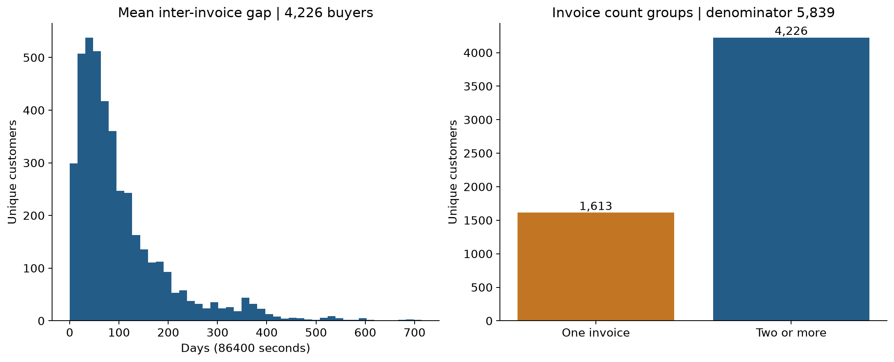

*Phạm vi: Experimental buyers; gap undefined for single-invoice buyers.*

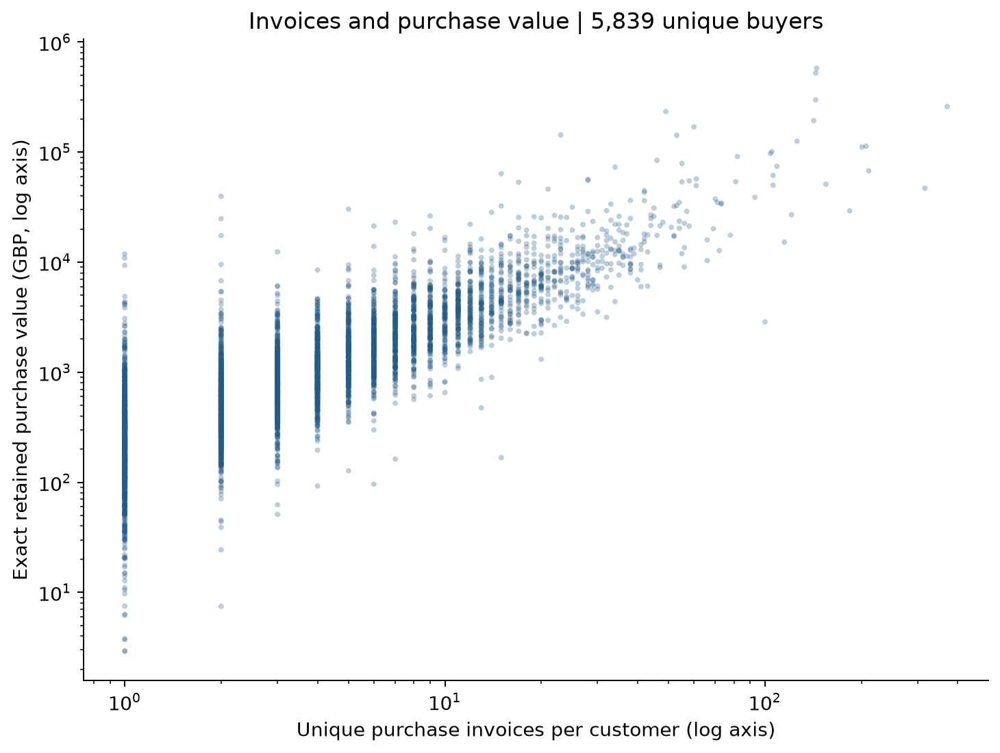

*Phạm vi: One dot per experimental buyer; correlation not causality.*

Bảng mỗi khách một dòng được lưu tại
[customer_behavior.csv](../experiments/eda_rebuild/tables/customer_behavior.csv);
không in toàn bộ định danh trong báo cáo. Các biến `n_stock_codes`/tổng Quantity ứng viên
chỉ mô tả mã và đơn vị của đầu vào đã chọn; chúng khác chỉ số sản phẩm có phân loại đã xác nhận.
Trong bảng xuất, `total_purchase_value` cộng Q×P chính xác và khớp công thức AOV/RFM;
`total_purchase_value_rounded` cộng LineValue đã làm tròn để đối chiếu processed.
Hai cột được giữ riêng để kiểm tra sai khác, không gộp chúng thành một định nghĩa giá trị.

**Nhận xét/ý nghĩa.** Mối liên hệ số đơn–tổng giá trị có phần do công thức cộng dồn;
không phải chứng cứ rằng tăng tần suất sẽ gây tăng giá trị. Khách chỉ một đơn là nhóm có hành vi
chưa đủ để ước lượng nhịp mua. Chênh lệch đuôi dài và độ phủ lịch sử cần được cân nhắc khi gom cụm.
**Đề xuất.** Giữ cờ thiếu có nghĩa; không đưa timestamp/ID hoặc giá trị thiếu điền tùy tiện vào mô hình.

## 12. Khảo sát đặc trưng thủ công

**Câu hỏi.** Các biến đã triển khai có thể tính và dùng cho phân cụm trong điều kiện nào?
**Nguồn và phương pháp.** Đối chiếu `src/features.py`, báo cáo Form 2 và khảo sát thô cũ
trong `experiments/form2_manual_behavior_raw_survey/`; tính lại trên góc nhìn bán của lần này.
Không ghi đè khảo sát cũ, không đổi kết quả khảo sát thô thành đặc trưng chính thức.

| feature | formula | unit | missing_reason | clustering_readiness | confirmation_or_limit |
| --- | --- | --- | --- | --- | --- |
| avg_order_value | mean(sum(Quantity*Price) by (Customer ID,Invoice)) | GBP/invoice | None for retained buyers | Can support clusters; skewness/redundancy with M/F | Exact multiplication; rounding differs from stored LineValue |
| n_distinct_products | nunique(StockCode classified product), only when classification complete | verified products/customer | All missing: no approved stock_code_roles supplied | Not ready | Cần nhóm xác nhận product catalog |
| avg_quantity_per_order | sum(classified product Quantity)/n_orders | product units/invoice | All missing: product mapping unavailable | Not ready | Cần nhóm xác nhận product catalog |
| avg_purchase_gap_days | mean(diff(earliest timestamp for each Invoice)) | days (86400 seconds) | One-invoice customers have no observed interval | Can use with missingness policy | Cần nhóm xác nhận earliest timestamp and single-order handling |
| total_quantity | sum(classified product Quantity) | product units/customer | All missing: product mapping unavailable | Not ready | Cần nhóm xác nhận product catalog |
| observed_tenure_days | (reference_date - first observed purchase)/1 day | days | None for retained buyers | Consider unequal observation exposure | Observed history, not true customer age |
| return_rate | Unresolved verified return denominator and linkage | undefined | All missing by design, never zero-filled | Not ready | Cần nhóm xác nhận return source and linkage |
| n_stock_codes_candidate | nunique(retained StockCode) | unverified codes/customer | None | Exploratory sensitivity only | Not n_distinct_products |
| total_quantity_candidate | sum(Quantity for retained purchase rows) | unverified units/customer | None | Exploratory sensitivity only | Not verified product units |

[Bảng `feature_definitions` trong EDA](../notebooks/01_eda/eda_v1.ipynb#eda-features)

| variable | count | missing | median | p95 | p99 | maximum | skewness | outside_iqr |
| --- | --- | --- | --- | --- | --- | --- | --- | --- |
| avg_order_value | 5,839 | 0 | 274.76 | 859.193391 | 1,838.770041 | 19,809.75 | 16.612082 | 377 |
| n_distinct_products | 0 | 5,839 | Chưa xác định | Chưa xác định | Chưa xác định | Chưa xác định | Chưa xác định | 0 |
| avg_quantity_per_order | 0 | 5,839 | Chưa xác định | Chưa xác định | Chưa xác định | Chưa xác định | Chưa xác định | 0 |
| avg_purchase_gap_days | 4,226 | 1,613 | 72.982535 | 323.968403 | 487.227778 | 714.152083 | 2.155856 | 308 |
| total_quantity | 0 | 5,839 | Chưa xác định | Chưa xác định | Chưa xác định | Chưa xác định | Chưa xác định | 0 |
| observed_tenure_days | 5,839 | 0 | 529.459722 | 735.516944 | 738.424736 | 738.677083 | -0.614736 | 0 |
| return_rate | 0 | 5,839 | Chưa xác định | Chưa xác định | Chưa xác định | Chưa xác định | Chưa xác định | 0 |
| n_stock_codes_candidate | 5,839 | 0 | 45 | 281 | 502.62 | 2,507 | 6.179393 | 445 |
| total_quantity_candidate | 5,839 | 0 | 480 | 5,259.6 | 16,064.48 | 365,114 | 23.157819 | 598 |
| n_orders | 5,839 | 0 | 3 | 20 | 46 | 371 | 11.975331 | 423 |
| total_purchase_value | 5,839 | 0 | 851.01 | 8,990.287 | 26,811.0702 | 579,128.64 | 26.611499 | 616 |
| avg_quantity_per_order_candidate | 5,839 | 0 | 154 | 548.55 | 1,296.700141 | 87,167 | 55.562965 | 358 |

[Bảng `feature_profile` trong EDA](../notebooks/01_eda/eda_v1.ipynb#eda-features)

### Đối chiếu với khảo sát Form 2 đã có

| Chỉ tiêu / điều kiện | Khảo sát Form 2 cũ từ thô | Khảo sát EDA mới từ pipeline |
| --- | --- | --- |
| Dòng mua khảo sát | 805,549 | 770,606 |
| Invoice mua | 36,969 | 36,414 |
| Khách có dòng mua | 5,878 | 5,839 |
| Khách một Invoice | 1,623 | 1,613 |
| Trùng dư còn giữ trong đầu vào khảo sát | 26,124 | Đã bỏ theo pipeline; xem trace |
| Chính sách thời điểm | earliest within selected window | earliest trong cửa sổ, lựa chọn công khai |
| Phân loại sản phẩm | provisional regex: 5 digits plus optional letter suffix | Không cấp mapping; chỉ số sản phẩm chính thức giữ NaN |
| Tình trạng | experimental_raw_survey_not_official | experimental_analysis_not_official_features |

Các số ở cột cũ được đối chiếu với [thông tin nguồn khảo sát Form 2 cũ](form2_manual_behavior_features.md#nguon-form2), không phải chạy lại pipeline mới trên nguồn thô theo bộ lọc cũ. Khảo sát cũ giữ trùng dòng, giữ dòng dịch vụ trong AOV và dùng phân loại sản phẩm tạm theo regex; khảo sát mới dùng chính sách pipeline rồi tách riêng ứng viên mã/lượng khỏi chỉ số sản phẩm đã xác minh. Do khác điều kiện, sự chênh lệch quy mô không phải thay đổi hành vi theo thời gian. Việc giữ NaN nhiều hơn cho chỉ số sản phẩm trong lần này phản ánh yêu cầu bằng chứng phân loại chặt hơn, không chứng minh chất lượng mua hàng giảm.

Toàn bộ chỉ số sản phẩm chính thức thiếu do chưa cấp mapping: **Có**.
Toàn bộ return_rate giữ thiếu do chưa có nguồn xác minh: **Có**.
Trong khi đó gap thiếu ở 1,613 khách một hóa đơn;
đây là thiếu có cấu trúc, không phải lỗi tính toán.

**Diễn giải thiếu và ngoại lệ.** `avg_purchase_gap_days` thiếu khi khách có dưới hai hóa đơn;
`n_distinct_products`, `avg_quantity_per_order`, `total_quantity` chưa xác định nếu chưa có
mapping phân loại sản phẩm đầy đủ. `return_rate` tiếp tục NaN vì chưa có nguồn hoàn trả được
xác minh, kể cả không quan sát chứng từ C. `observed_tenure_days` là tuổi quan sát từ lần mua đầu
trong cửa sổ, không phải thời gian quan hệ khách hàng thật.

**Khả năng dùng cho phân cụm.** AOV/gap/tenure và các biến ứng viên có thể được thử sau xử lý thiếu
có căn cứ, biến đổi và kiểm tra tương quan. Không đồng thời đưa quá nhiều biến đồng nhất công thức
(Monetary, Frequency, AOV; lượng tổng, lượng/đơn) mà không kiểm tra trọng số ngầm.
**Cần nhóm xác nhận** bảng phân loại mã, chính sách khách một đơn, thời điểm Invoice và bộ biến
đưa vào mô hình; số liệu khảo sát hiện tại chưa là quyết định chọn biến.

## 13. Định hướng RFM và scaling

**Câu hỏi.** Có thể bàn giao snapshot RFM tái lập để nhóm tiếp tục thực nghiệm hay chưa?
**Điều kiện.** Tạo snapshot thử nghiệm toàn kỳ với cửa sổ đóng trái/mở phải được ghi trong output notebook;
mốc tham chiếu sau ngày cuối nguồn. Không có bản ghi sau mốc tham gia phép tính.
Dữ liệu đã xử lý toàn kỳ chỉ dùng cho mốc kết thúc này; snapshot sớm phải xử lý lại theo mốc.

| Biến | Định nghĩa đề xuất cho khảo sát | Đơn vị |
| --- | --- | --- |
| Recency | `(reference_date − thời điểm mua cuối theo chính sách hóa đơn) / 1 ngày` | Ngày; có thể có phần lẻ |
| Frequency | Số Invoice mua duy nhất trong cửa sổ trên khách | Hóa đơn/khách |
| Monetary | Tổng Q×P chính xác của các dòng bán còn lại trong cửa sổ | GBP/khách |

Mỗi khách có một dòng, không có Customer ID làm biến số mô hình. Monetary trong khảo sát
là giá trị mua theo góc nhìn pipeline, không mặc định là doanh thu thuần.

| variable | count | missing | mean | median | minimum | maximum | p95 | p99 | skewness |
| --- | --- | --- | --- | --- | --- | --- | --- | --- | --- |
| Recency | 5,839 | 0 | 200.287099 | 95.363194 | 0.465278 | 738.549306 | 623.483333 | 726.351222 | 0.893874 |
| Frequency | 5,839 | 0 | 6.236342 | 3 | 1 | 371 | 20 | 46 | 11.975331 |
| Monetary | 5,839 | 0 | 2,829.612315 | 851.01 | 2.9 | 579,128.64 | 8,990.287 | 26,811.0702 | 26.611499 |

[Bảng `rfm_profile` trong EDA](../notebooks/01_eda/eda_v1.ipynb#eda-rfm)

| feature | transform | scaler | mean_log1p | variance_log1p | scale_log1p | fit_customers | window_start | reference_date_exclusive |
| --- | --- | --- | --- | --- | --- | --- | --- | --- |
| Recency | log1p | StandardScaler(ddof=0) | 4.447271 | 2.437816 | 1.561351 | 5,839 | 2009-12-01 | 2011-12-10 |
| Frequency | log1p | StandardScaler(ddof=0) | 1.545706 | 0.651113 | 0.806915 | 5,839 | 2009-12-01 | 2011-12-10 |
| Monetary | log1p | StandardScaler(ddof=0) | 6.795183 | 1.900673 | 1.378649 | 5,839 | 2009-12-01 | 2011-12-10 |

[Thông tin tái lập trong notebook](../notebooks/01_eda/eda_v1.ipynb#eda-rfm)

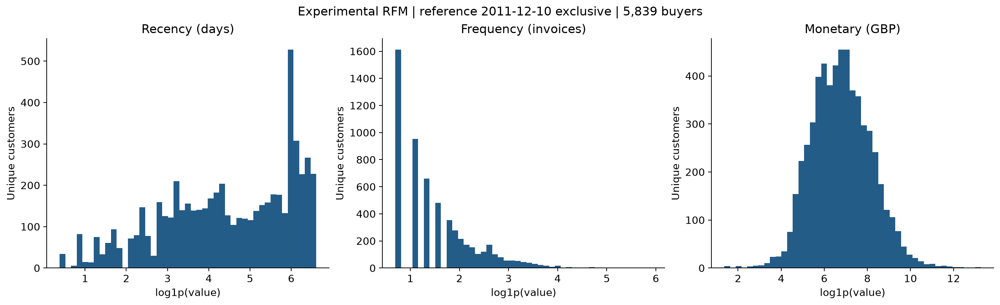

*Phạm vi: Full observation-window buyers; no official feature designation; no model fitted.*

**Biến đổi đã thử.** `log1p` cho các giá trị R/F/M không âm rồi StandardScaler trên chính
snapshot khảo sát; thông số thực tế được lưu trong bảng và output notebook. Không cắt ngoại lệ.
Đây là phép biến đổi phục vụ khám phá, chưa phải kết luận rằng StandardScaler là lựa chọn tốt nhất.
Nếu nhóm đánh giá thời gian hoặc mẫu giữ lại, chỉ fit biến đổi/scaler trên tập tương ứng, không fit cả tương lai.

Bảng RFM bàn giao: [rfm.csv](../experiments/eda_rebuild/tables/rfm.csv).
Các tệp scale và tham số được liệt kê trong output notebook; toàn bộ đều mang vai trò thử nghiệm,
không ghi vào `data/feature/` như bảng chính thức. Chưa chạy thuật toán phân cụm trong lần làm lại EDA này.

**Cần nhóm xác nhận.** Cửa sổ/mốc tham chiếu, định nghĩa Invoice hợp lệ, giữ/bỏ C và phí,
ghép hoàn trả, trùng dòng, làm tròn Monetary, xử lý thiếu và tập biến/scaler.
Thứ tự bàn giao giữ đúng: EDA → thử đặc trưng thủ công → RFM → biến đổi/scaling →
thực nghiệm, đánh giá và ghi log sau khi thật sự chạy.

## 14. Tổng hợp phát hiện và đề xuất

Các bảng chất lượng, đối chiếu pipeline và hành vi cùng trả lời ba việc: có thể tái lập thống kê
nguồn; có thể giải thích sự thay đổi quần thể sau các bộ lọc; có thể tạo snapshot ứng viên
với giả định được ghi rõ. Những vấn đề nghiệp vụ chưa được xác nhận không bị biến thành
quy tắc mới trong `src/` ở lần này.

| STT | Nội dung | Thao tác/phương pháp | Kết quả chính | Hình liên quan | Trạng thái |
| --- | --- | --- | --- | --- | --- |
| 1 | Kiểm tra dữ liệu | Đọc từng sheet, dtype, head/tail, min/max, SHA256 | 1,067,371 dòng; 53,628 chứng từ; 5,942 khách; hai sheet | Không yêu cầu hình | Hoàn thành |
| 2 | Kiểm tra thiếu | Đếm theo cột/sheet; tỷ lệ trên số dòng tương ứng | 243,007 dòng thiếu ID / 1,067,371 dòng; 4,382 dòng thiếu Description | Hình missing | Hoàn thành |
| 3 | Kiểm tra trùng | Tám cột; tách định nghĩa mẫu chung và dòng trùng dư | 34,335 dòng trùng dư; 22,202 mẫu chung; 22,523 dòng sheet sau khớp | Bảng định lượng | Hoàn thành |
| 4 | Chứng từ và nhất quán | C, Q/P; groupby nunique; kiểm kê mã | anomalies / consistency / stock_audit | Hình chứng từ nếu có | Hoàn thành |
| 5 | Thời gian và quốc gia | Nhóm tháng/thứ/giờ/quốc gia; tách grain | 25 tháng; United Kingdom: 981,330/1,067,371 dòng nguồn | Hình thời gian và quốc gia | Hoàn thành |
| 6 | Đối chiếu tiền xử lý | Chạy pipeline trong bộ nhớ; so tệp và log | 1,067,371 → 770,606 dòng bán; còn 36,414 đơn/5,839 khách; so tệp: Có | Bảng đối chiếu | Hoàn thành kiểm tra kỹ thuật; nghiệp vụ cần xác nhận |
| 7 | Phân tích ngoại lệ | Histogram/boxplot/IQR/quantile; không xóa | Quantity: 116,489/1,067,371 dòng thô ngoài IQR; Price: 68,105/1,067,371 dòng thô ngoài IQR; LineValue: 90,922/1,067,371 dòng thô ngoài IQR | Hình phân phối và ngoại lệ | Hoàn thành |
| 8 | Phân tích khách hàng | Một dòng/khách, đơn, AOV, gap, ứng viên | 5,839 dòng khách; 1,613 khách một đơn / 5,839 khách | Hình hành vi và quan hệ | Hoàn thành khảo sát có điều kiện |
| 9 | Khảo sát đặc trưng | Công thức, đơn vị, thiếu, phân phối, khả năng dùng | feature_definitions / feature_profile | Hình phân phối khách hàng | Hoàn thành khảo sát; sản phẩm/return_rate chưa xác nhận |
| 10 | RFM và scaling | Snapshot cuối kỳ; log1p và StandardScaler | 5,839 khách, 3 biến RFM; log1p + StandardScaler, tham số hiển thị trong notebook | Hình RFM nếu có | Hoàn thành khảo sát thử nghiệm |
| 11 | Mô hình phân cụm | Chưa chạy trong phạm vi EDA | Không có điểm đánh giá hoặc nhãn cụm | Không có | Chưa thực hiện; bàn giao nhóm |

**Đề xuất tiếp theo.** Thuận và nhóm trưởng chốt chính sách dữ liệu trước khi lựa chọn mô hình;
lập bảng phân loại mã có phiên bản; giữ khách giá trị cao để phân tích độ nhạy; ghi cùng
cửa sổ, đặc trưng, scaler và tham số trong nhật ký khi chạy K-Means/Hierarchical/DBSCAN.
Không có số đo mô hình giả hoặc tự tuyên bố phương án tốt nhất từ EDA.

## 15. Khó khăn, giới hạn và vấn đề cần nhóm xác nhận

### Ranh giới EDA và phần bổ sung

Kiểm tra cấu trúc/chất lượng, thống kê, thời gian/quốc gia, phân phối, ngoại lệ và khảo sát
hành vi là phần EDA. Tái hiện pipeline hiện có chỉ nhằm đối chiếu; mã và dữ liệu processed
của thành viên phụ trách không bị chỉnh sửa.

Tạo bảng RFM, log1p và fit StandardScaler đã sang bước đặc trưng/chuẩn bị dữ liệu sau EDA.
Đây là phần bổ sung được mục 10 của form ban đầu cho phép khi đủ điều kiện, được giữ nhãn
thử nghiệm và **Cần nhóm xác nhận** chính sách. Chưa chạy K-Means, Hierarchical, DBSCAN,
chọn siêu tham số, đánh giá cụm, gán nhãn cụm hoặc triển khai ứng dụng. Các tệp thuộc
`src/`, `configs/`, `app/` và notebook mô hình của thành viên khác được giữ nguyên.

Thông tin tái lập và tham số đã có trong output notebook/báo cáo nên các JSON rời được bỏ.
Run All không tạo lại JSON. Metadata khảo sát Form 2 cũ đã chuyển sang phụ lục báo cáo Form 2.


| Vấn đề | Giới hạn hiện tại / việc đã làm | Quyết định cần tiếp theo |
| --- | --- | --- |
| Thiếu Customer ID | Không gán được phần dòng nguồn cho khách; không điền ID giả | Cần nhóm xác nhận phạm vi khách có định danh và báo cáo phần bị loại |
| Dòng trùng | Phân biệt số mẫu chung, số dòng khớp và dòng dư; tái lập quy tắc hiện có | Cần nhóm xác nhận giữ/bỏ và ý nghĩa bản sao |
| Chứng từ C/âm | Có kiểm kê, nhưng ghép của pipeline là heuristic | Cần nhóm xác nhận nguồn hoàn trả, ghép một phần, mốc thời gian |
| Phí và sản phẩm | SERVICE_CODES không phải danh mục phân loại toàn bộ | Cần nhóm xác nhận mapping product/non_product/unknown |
| Một Invoice nhiều thời điểm | Khảo sát dùng earliest công khai | Cần nhóm xác nhận khóa và chính sách thời điểm |
| Giá trị dòng làm tròn | Processed có cột làm tròn; features dùng Q×P chính xác | Cần nhóm xác nhận làm tròn ở cấp dòng hay cấp tổng |
| Khách một đơn | Gap chưa xác định, giữ NaN | Cần nhóm xác nhận xử lý thiếu và cờ chỉ báo khi mô hình hóa |
| return_rate | Chưa xác minh được hoàn trả; giữ NaN cho mọi khách | Cần nhóm xác nhận tử số, mẫu số và nguồn bằng chứng |
| Tháng biên/khách mới | Không đủ lịch sử trước đầu nguồn hoặc sau cuối nguồn | Cần nhóm xác nhận cửa sổ so sánh; không gọi tenure là tuổi thật |
| RFM/scaling | Có thể tái lập snapshot ứng viên; chưa chọn bộ biến chính thức | Cần nhóm xác nhận R/F/M, log/scaler và quy trình đánh giá |
| Ngoại lệ | Chỉ gắn cờ IQR; không xóa khách giá trị cao | Cần nhóm xác nhận thí nghiệm độ nhạy với Thuận |
| Mô hình | Ngoài phạm vi làm lại EDA, không có kết quả chạy mới | Nhóm thực nghiệm thật rồi ghi log tham số/độ đo |

Những khoảng trống này không được thay bằng giả định kết quả bằng 0. Xác nhận kỹ thuật rằng
code/tệp khớp không thay cho phê duyệt nghiệp vụ.

## 16. Danh sách hình ảnh

Các hình PNG mới nằm đúng thư mục `notebooks/01_eda/figures/`. Mỗi hình có tiêu đề,
đơn vị, grain và điều kiện; bảng nguồn và notebook được ghi dưới đây để tái tạo.

| Hình | Nội dung | Đơn vị / phạm vi | Bảng nguồn | Notebook |
| --- | --- | --- | --- | --- |
| [missing_values_by_column.png](../notebooks/01_eda/figures/missing_values_by_column.png) | Missing values by original field | Raw rows, including C and anonymous transactions | missing | eda_v1.ipynb |
| [invoices_by_c_prefix.png](../notebooks/01_eda/figures/invoices_by_c_prefix.png) | Invoice identifiers by C prefix | Raw unique invoice identifiers | anomalies | eda_v1.ipynb |
| [preprocessing_row_flow.png](../notebooks/01_eda/figures/preprocessing_row_flow.png) | Current preprocessing row flow | Rows retained at each sequential step; reversal is heuristic | preprocessing_trace | eda_v1.ipynb |
| [invoices_by_month.png](../notebooks/01_eda/figures/invoices_by_month.png) | Unique invoices by month \| raw, including C | Raw transaction rows; C included; final month incomplete | monthly | eda_v1.ipynb |
| [signed_line_value_by_month.png](../notebooks/01_eda/figures/signed_line_value_by_month.png) | Signed line values by month \| raw, including C | Raw transaction rows; C included; final month incomplete | monthly | eda_v1.ipynb |
| [transactions_by_weekday_hour.png](../notebooks/01_eda/figures/transactions_by_weekday_hour.png) | Raw transaction rows by weekday and hour | Raw rows including C, all dates | weekday_hour | eda_v1.ipynb |
| [country_activity.png](../notebooks/01_eda/figures/country_activity.png) | Country activity including UK | Raw rows/invoice IDs/known customers; customer country sets may overlap | countries | eda_v1.ipynb |
| [country_activity_excluding_uk.png](../notebooks/01_eda/figures/country_activity_excluding_uk.png) | Country activity excluding UK | Raw rows/invoice IDs/known customers; customer country sets may overlap | countries | eda_v1.ipynb |
| [signed_line_value_by_country.png](../notebooks/01_eda/figures/signed_line_value_by_country.png) | Signed line value by country | Raw signed line values including C; not asserted net revenue | countries | eda_v1.ipynb |
| [customer_purchase_gaps.png](../notebooks/01_eda/figures/customer_purchase_gaps.png) | Customer purchase gaps and one-invoice share | Experimental buyers; gap undefined for single-invoice buyers | customer_summary, customer_behavior | eda_v1.ipynb |
| [customer_orders_vs_value.png](../notebooks/01_eda/figures/customer_orders_vs_value.png) | Customer invoice count versus purchase value | One dot per experimental buyer; correlation not causality | customer_summary, customer_behavior | eda_v1.ipynb |
| [raw_transaction_full_distributions.png](../notebooks/01_eda/figures/raw_transaction_full_distributions.png) | raw transaction full distributions | All raw transaction rows, no outlier deletion | outlier_transactions | eda_v1.ipynb |
| [clean_transaction_full_distributions.png](../notebooks/01_eda/figures/clean_transaction_full_distributions.png) | clean transaction full distributions | All clean transaction rows, no outlier deletion | outlier_transactions | eda_v1.ipynb |
| [raw_transaction_histograms_p01_p99.png](../notebooks/01_eda/figures/raw_transaction_histograms_p01_p99.png) | Raw P01–P99 transaction histogram display | Raw rows restricted for display only, no data deletion | outlier_transactions | eda_v1.ipynb |
| [customer_behavior_distributions.png](../notebooks/01_eda/figures/customer_behavior_distributions.png) | Customer behavior distributions | One row per current-pipeline buyer; stock counts unverified candidates | outlier_customers | eda_v1.ipynb |
| [rfm_experimental_distributions.png](../notebooks/01_eda/figures/rfm_experimental_distributions.png) | Experimental RFM distributions | Full observation-window buyers; no official feature designation; no model fitted | rfm_profile, scaling_parameters | eda_v1.ipynb |

### Kiểm kê hình cũ và kết quả xử lý

| name | status | old_sha256 | sha256 |
| --- | --- | --- | --- |
| c_prefix_share_by_country.png | Đã xóa hình cũ | 240ca2d42f79e411faf7b419f48c1d54e9cf561d4710ff6a5848df3b9105cec5 | Chưa xác định |
| clean_transaction_full_distributions.png | Tạo mới | Chưa xác định | 3f784df7d79cbe124edbe3e3819a3dc6830dfd598baf572737a6709c5346c7c5 |
| country_activity.png | Tạo mới | Chưa xác định | 9aad2d26db6e4c1b7afbf8362f8a03abb44c6a66a7087bf3d0298a0e25cee7c9 |
| country_activity_excluding_uk.png | Tạo mới | Chưa xác định | 901590f8e25c6564ad46b2ee592cd8cfd9dad281c4182c572a3c905ba04ab6ef |
| customer_behavior_distributions.png | Tạo mới | Chưa xác định | 6bc1e7e31748b498c8640d501c35114711620420c18b71f7dc311f03dd37876c |
| customer_candidate_behavior_distributions.png | Đã xóa hình cũ | b931f1ba2e89ff6b065a20dd55fdb626c27023a7e3468c503a68f551ff7bea31 | Chưa xác định |
| customer_orders_vs_value.png | Tạo mới | Chưa xác định | 815159ed0cbfe5f1b8a2b6a822c5fce8da242c250e599dcb6d822bd08a74bf22 |
| customer_purchase_gaps.png | Tạo mới | Chưa xác định | f710adb0f40cd4b311e5cdab9eafd9489943c76eea38ad4761c269c0dd1d6a26 |
| invoices_by_c_prefix.png | Tái tạo/thay thế | Chưa xác định | 7546f6686302b24ca596b88b07dd0f9352609ecf60ebdaab49e0de5898fc018d |
| invoices_by_country.png | Đã xóa hình cũ | 4ce8cd4033b2717fda890a0065f34a09ddd5c19d6727c0caf5cac64223ad9828 | Chưa xác định |
| invoices_by_country_month_heatmap.png | Đã xóa hình cũ | c833ee5a037cd686ee5325d98642e842624b1b03e1c0db1b92878e39a9c230f4 | Chưa xác định |
| invoices_by_month.png | Tái tạo/thay thế | Chưa xác định | ef3fe093ed3c2c6c90adda0b4f3220908efddf7645a775ff68878cd51fc34a17 |
| invoices_by_weekday_hour.png | Đã xóa hình cũ | 080616f5386b25ee3d9d325d2a7ddbc2595ce67c48fdfcbf6baa5b2e61be70bd | Chưa xác định |
| line_value_by_country_boxplot.png | Đã xóa hình cũ | 66aede0c1085f494202f6204c8513c6efa27cd00c426a7f418008d087790a657 | Chưa xác định |
| line_value_full_range.png | Đã xóa hình cũ | c4c60accc330b33071f5968760f222d9bd438d09d4b164eef158bb59b2e8e678 | Chưa xác định |
| missing_values_by_column.png | Tạo mới | Chưa xác định | 961c00fc2e34ab4576ee9dd96f75bdb1d5db35a085d8def7802e630f0112d7c6 |
| preprocessing_row_flow.png | Tạo mới | Chưa xác định | e6237c9ada9b26e43df577468c76ebe78ee2879d8043a36c0b4fd17e81eea5c3 |
| quantity_price_boxplots.png | Đã xóa hình cũ | c412f6cb1cbce0102228f28aa5b7fcc6e7b15c0dc7cb10ca804602d31d19471c | Chưa xác định |
| quantity_price_full_range.png | Đã xóa hình cũ | 9c5bcb7fdc00bbf5073245f5b83001276302e5525360134dee96b40fbefd031b | Chưa xác định |
| quantity_price_histogram_p01_p99.png | Đã xóa hình cũ | 7e4874bda4dec08ae1c51db9e9c53f8a4339a414234ff670ad6e8f96f7967987 | Chưa xác định |
| quantity_vs_price_hexbin.png | Đã xóa hình cũ | 61c781a7702b753154bebbf9500ac82379f84da982522603c71725ff3091c4d8 | Chưa xác định |
| raw_transaction_full_distributions.png | Tạo mới | Chưa xác định | a32fce6d2c47143633db4c46c7795e7cfac58813c02d1074c79055fffe449ef8 |
| raw_transaction_histograms_p01_p99.png | Tạo mới | Chưa xác định | 754933fac9c19a861d901e2257088e835e097e89ddc0ceff985d01fc4cdafdad |
| rfm_experimental_distributions.png | Tạo mới | Chưa xác định | 4f8df37136884ff7a0c021d5fe436600ae4bf5fd7a11866d372d86afe0549745 |
| signed_line_value_by_country.png | Tạo mới | Chưa xác định | 1bd0266fc434a3396807b989fec25628a252e0f0683d89fa0e8fafbb1e9e7481 |
| signed_line_value_by_month.png | Tái tạo/thay thế | Chưa xác định | 305c782b6529c32d1e9e756c5210164547a4e263b9c257a77cb9a68286b88537 |
| transactions_by_weekday_hour.png | Tạo mới | Chưa xác định | b89b53202bbfee5c249b10419429172a66d139a4ae59b9731f4453a3b713b19d |

Không xóa hình ngoài thư mục EDA, không xóa dữ liệu hoặc báo cáo cũ.
Đường dẫn ảnh trong báo cáo dùng đường dẫn tương đối từ `reports/` để mở được cùng repository.

## 17. Hướng dẫn chạy lại

Mỗi notebook chứa trực tiếp code và có thể chạy độc lập trong repository.
Mở notebook bằng Jupyter, chọn đúng môi trường Python rồi **Restart Kernel → Run All**.
Không cần chạy notebook khác trước và không cần script Python hỗ trợ EDA.
Các API `src/preprocessing.py` và `src/features.py` có sẵn của nhóm được giữ nguyên.

Từ thư mục gốc repository, có thể chạy riêng từng notebook bằng lệnh:

```powershell
& project/.venv-eda/Scripts/python.exe -X utf8 -m jupyter nbconvert --execute --to notebook --inplace --ExecutePreprocessor.timeout=1800 project/notebooks/01_eda/eda_v1.ipynb
& project/.venv-eda/Scripts/python.exe -X utf8 -m jupyter nbconvert --execute --to notebook --inplace --ExecutePreprocessor.timeout=1800 project/notebooks/01_eda/eda_v2_outlier.ipynb
```

Dùng Python có các thư viện trong `project/requirements.txt` và `nbformat`, `nbclient`,
`nbconvert`, `ipykernel`, `Pillow`; chọn kernel đúng môi trường. Notebook tự tìm thư mục
project, không chứa đường dẫn riêng của tác giả. Mã dữ liệu nguồn không bị ghi đè.

`eda_v1` tính 35 bảng trong notebook, chỉ xuất 3 CSV bàn giao và 16 PNG trong phạm vi EDA.
Báo cáo này được giữ riêng; Run All không tạo lại hoặc ghi đè văn bản báo cáo. Các bảng kiểm tra
trung gian đã có trong notebook nên không lưu thành CSV riêng. Tham số scaling hiển thị
đầy đủ trong bảng `scaling_parameters`, không tạo tệp tham số JSON.
`eda_v2_outlier` tự đọc workbook và chạy pipeline trong bộ nhớ; bảng và thông tin tái lập
giữ trong output notebook cùng các PNG ngoại lệ/RFM dùng chung tên. Không xuất CSV/JSON riêng.
Notebook kiểm tra SHA256 dữ liệu/module trước và sau, hiển thị phiên bản thư viện.
Notebook v2 không đọc kết quả đã xuất của notebook v1.

Xem [hướng dẫn EDA](../notebooks/01_eda/README.md). Kiểm tra các cell hoàn thành không lỗi,
nguồn trước/sau cùng checksum và đường dẫn hình tồn tại. Chưa có mô hình phân cụm mới.

### Trạng thái kiểm tra hiển thị của lần bàn giao

Hai notebook đã thực thi theo thứ tự và giữ kết quả trong tệp; toàn bộ 16 PNG đã được mở
để kiểm tra nhãn, đơn vị, phạm vi và độ rõ. Bản xuất HTML của hai notebook tạo được bằng
nbconvert. Chưa kiểm tra được bố cục notebook trong trình duyệt: Edge headless dừng do lỗi
GPU/process access của môi trường, nên không có ảnh chụp giao diện notebook để xác nhận.
Xem [Thông tin tái lập trong notebook](../notebooks/01_eda/eda_v1.ipynb#eda-checks),
[Thông tin tái lập trong notebook](../notebooks/01_eda/eda_v1.ipynb#eda-checks), và
[Thông tin tái lập trong notebook](../notebooks/01_eda/eda_v1.ipynb#eda-checks).
Người đọc có thể mở hai notebook bằng Jupyter trong môi trường thư viện đã ghi ở trên.

## 18. Tài liệu tham khảo

1. Chen, D. (2012). [Online Retail II — UCI Machine Learning Repository](https://archive.ics.uci.edu/dataset/502/online+retail+ii), DOI [10.24432/C5CG6D](https://doi.org/10.24432/C5CG6D). Nguồn mô tả biến và đơn vị GBP; số đếm của báo cáo tính từ tệp cục bộ.
2. [README của dự án](../README.md): mục tiêu, nguồn dữ liệu và phân công; các mô tả tiến độ cũ được đối chiếu với trạng thái thực tế ở mục 4.
3. [Mã tiền xử lý](../src/preprocessing.py) và [log processed đã có](../data/processed/preprocessing_log.csv): quy tắc và số liệu được kiểm tra lại.
4. [Mã đặc trưng thủ công](../src/features.py), [báo cáo Form 2](form2_manual_behavior_features.md), [khảo sát thô trước đây](../experiments/form2_manual_behavior_raw_survey/): định nghĩa hàm và phạm vi thử nghiệm trước.
5. [Notebook EDA chính](../notebooks/01_eda/eda_v1.ipynb), [notebook ngoại lệ](../notebooks/01_eda/eda_v2_outlier.ipynb), [mã tính toán](../notebooks/01_eda/eda_v1.ipynb), [Thông tin tái lập trong notebook](../notebooks/01_eda/eda_v1.ipynb#eda-checks), [Thông tin tái lập trong notebook](../notebooks/01_eda/eda_v1.ipynb#eda-checks).
