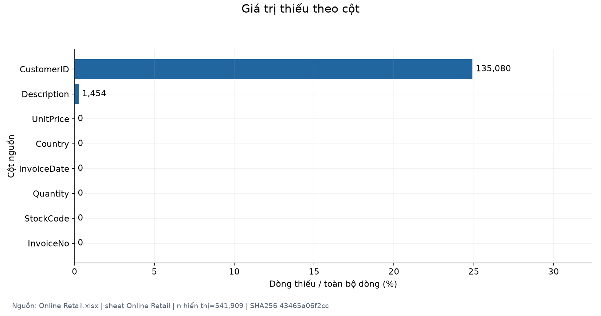
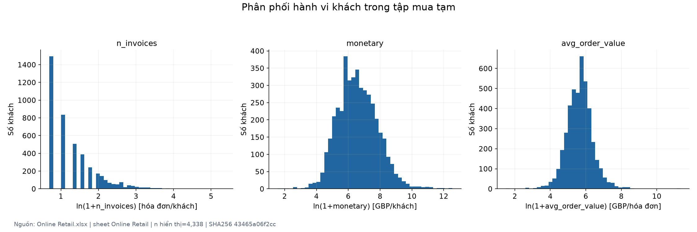
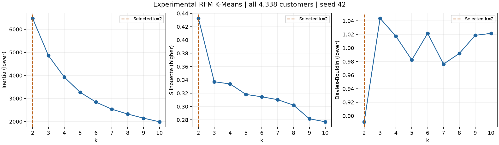
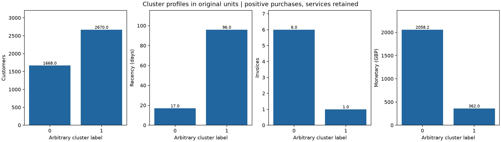
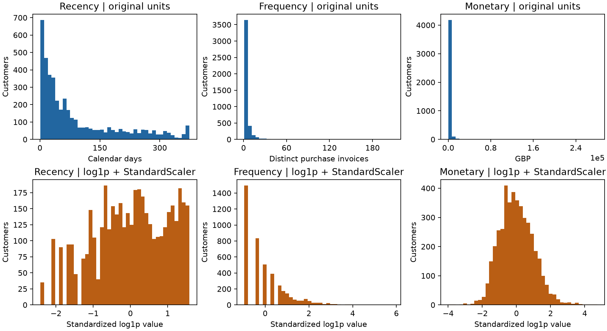

# Báo cáo tiến độ đến K-Means baseline

**Nhóm 15 – DCT124C3 · Ngày 06/11/2026 · Thử nghiệm riêng, chưa phải cấu hình chính thức của nhóm.**

## 1. Bối cảnh, phạm vi và kiểm tra ban đầu

Mục tiêu là chuyển giao dịch thành một bảng khách có khóa duy nhất, tạo RFM,
chuẩn hóa và chạy baseline phân cụm có thể tái lập. Phạm vi dừng ở K-Means; chưa
hoàn thành toàn bộ đề tài yêu cầu tối thiểu hai mô hình và so sánh. Phân cụm lịch
sử không tự chứng minh khả năng dự đoán giá trị tương lai, lợi nhuận hay giá trị vòng đời.

Trước khi sửa: nhánh `main`, HEAD `af0817e1a7101a7fb5044c2fe6d26e19cf8a8531`,
cây Git ban đầu sạch. Không commit/push trong lần bàn giao này; giữ thay đổi trong workspace.

| Hạng mục | Trạng thái thực tế trước sửa | Vấn đề | Phương án |
|---|---|---|---|
| Raw | Một workbook/sheet, có SHA trong AGENTS/EDA | Cần đối chiếu trực tiếp | Kiểm tra SHA/schema/thời gian, không sửa raw |
| EDA | `eda.ipynb`: 66 cell, 54 code có output; 21 hình và một workbook | Tài liệu/mã gọi tên notebook/báo cáo không tồn tại | Sửa tham chiếu về tên thực, chạy/kiểm chứng lại |
| Cleaning | API lịch sử, processed cũ còn giữ | Chính sách chính thức chưa chốt; schema raw khác API nội bộ; processed thiếu SHA/quy tắc được duyệt | Luồng thử nghiệm có adapter và log, tách đầu ra |
| Features | API hành vi thuần và test; Form 2 từ nguồn sai | Chưa có RFM baseline xác minh với raw này | Tái sử dụng API, bổ sung RFM và kiểm tra mẫu |
| Scaling | Mới có các phương án đề xuất | Chưa có scaler đã fit được xác minh | Thử log1p + StandardScaler và lưu tham số |
| Baseline | Hai notebook khung, runner/cấu hình TODO | Chưa có kết quả từ raw hiện tại | Một CLI raw→baseline, khảo sát k=2…10 |
| README/tài liệu | Tên `*_raw_moi` không tồn tại; môi trường cài/chạy khác nhau | Người mới khó tái lập; kiểm kê Git ghi mốc cũ | Một README chính, một báo cáo tiến độ hiện hành |
| File cũ/trùng | Form 2, processed, notebook tiền xử lý của thành viên | Không thể xóa chỉ vì không dùng trong baseline | Giữ, cảnh báo nguồn; không đổi cấu trúc phần sau baseline |

Bảng trên ghi trạng thái trước sửa. Notebook có output không tự chứng minh phiên bản hiện tại chạy đúng.

## 2. Dữ liệu và nguồn

Raw duy nhất: [Online Retail.xlsx](../data/raw/Online%20Retail.xlsx),
1 sheet `Online Retail`, 23.715.344 byte.

**SHA-256:** `43465a06f2ccf7c8b5bd2892bc7defb52f97487934fe93b16ae4c3936424676d`.

| Chỉ tiêu raw | Giá trị |
|---|---:|
| Dòng / cột | 541.909 / 8 |
| Thời điểm đầu | 2010-12-01 08:26:00 |
| Thời điểm cuối | 2011-12-09 12:50:00 |
| Chứng từ riêng biệt, gồm C | 25.900 |
| Mã khách quan sát được | 4.372 |
| Quốc gia | 38 |
| Thiếu CustomerID / Description | 135.080 / 1.454 dòng |
| Dòng trùng dư đủ 8 cột | 5.268 |
| Dòng C / Quantity âm | 9.288 / 10.624 |
| Quantity bằng 0 | 0 |
| UnitPrice bằng 0 / âm | 2.515 / 2 |

Schema: `InvoiceNo`, `StockCode`, `Description`, `Quantity`, `InvoiceDate`,
`UnitPrice`, `CustomerID`, `Country`. Mã định danh không phải biến số liên tục.
Cấp quan sát gốc là dòng hàng; hóa đơn nhóm nhiều hàng, khách nhóm nhiều hóa đơn.

[UCI Online Retail](https://archive.ics.uci.edu/dataset/352/online+retail) phù hợp
về tên biến, số dòng, khoảng thời gian và bối cảnh bán lẻ tại Anh; đơn giá GBP theo
nguồn. Trang UCI được đối chiếu lại ngày 06/11/2026, giấy phép CC BY 4.0. Nguồn
liệt kê 6 feature và 2 ID, tương ứng 8 cột vật lý trong workbook. Trang nguồn ghi
không có missing, nhưng raw local có thiếu CustomerID và
Description; dùng kiểm tra trực tiếp để đánh giá chất lượng. Sự khớp mô tả không
chứng minh đầy đủ chuỗi tải file; SHA xác định đầu vào local. Thời gian không có múi giờ.

EDA và baseline có cùng SHA raw. Tập mua khảo sát EDA giữ dòng trùng, baseline loại
bản sao; khác biệt quy mô/giá trị có chủ đích. Form 2 có metadata xác nhận dùng
`online_retail_II.xlsx`, không hợp lệ cho raw này. Processed legacy không có SHA
nguồn/quy tắc được duyệt; log có tên/số dòng của raw hiện tại nên không đủ bằng
chứng kết luận nó dùng nguồn sai. Giữ nguyên và không dùng làm đầu vào/bằng chứng
baseline hiện tại; không suy từ nhãn cảnh báo lịch sử thành kết luận provenance mới.

## 3. EDA và tác động đến phân cụm

Bằng chứng chi tiết: [báo cáo EDA](bao_cao_eda.md),
[notebook](../notebooks/01_eda/eda.ipynb),
[workbook EDA](../experiments/eda_raw_moi/ket_qua_eda.xlsx).

| Phạm vi và phát hiện | Số liệu | Ý nghĩa, giới hạn và việc tiếp theo |
|---|---|---|
| Raw: thiếu mã khách | 135.080 dòng, 24,93% | Không thể phân bổ cho một khách thật; loại khỏi baseline làm giảm độ phủ và có thể gây thiên lệch |
| Raw: trùng hoàn toàn | 5.268 bản sao dư, 1.933 chứng từ, 960 khách có mã | Có thể tăng M/lượng; loại trong thử nghiệm không chứng minh mọi bản sao là lỗi |
| Raw: C và dấu âm chồng lấn | C: 9.288 dòng; âm: 10.624 dòng, 1.336 dòng âm không C | Không cộng hai tập; mua dương chưa phản ánh giá trị sau trả hàng |
| Raw: tập trung quốc gia | UK 495.478 dòng, 91,43%; 8 khách có nhiều quốc gia | Giữ mọi quốc gia; không tùy tiện gán một Country cho khách; baseline không encoding Country |
| Tập mua khảo sát EDA, giữ trùng | 397.884 dòng, 18.532 hóa đơn, 4.338 khách | Đây không phải clean baseline; giữ dịch vụ nên chưa phải giá trị hàng hóa thuần |
| Khách khảo sát EDA: gap thiếu có cấu trúc | 1.493/4.338 khách, 34,42%, chỉ một hóa đơn | Gap không xác định, giữ NaN; không điền 0 và không đưa vào RFM baseline |
| Khách khảo sát EDA: đuôi dài | M median 674,485; p99 19.880,9957; max 280.206,02 GBP | Có thể là khách quan trọng; giữ và thử log1p + scale, không coi ngoại lệ là lỗi |
| Khách khảo sát EDA: liên hệ F–M | Pearson khoảng 0,554; Spearman khoảng 0,807 | Có phụ thuộc công thức M=F×AOV; không suy nhân quả hoặc đưa biến trùng thông tin vào baseline |
| Raw: biên thời gian | Tháng cuối kết thúc 09/12/2011 | Không so tổng tháng cuối với tháng đầy đủ như cùng thời lượng |

Các hình trên là EDA giữ trùng, không lấy quy mô này thay quy mô clean baseline.
Phân tích đơn biến, thời gian, quốc gia, hai biến/đa biến và heatmap Pearson/Spearman
có số cặp quan sát nằm trong báo cáo EDA. Tương quan không chứng minh nhân quả.

## 4. Quyết định và trạng thái phê duyệt

`AGENTS.md` và đề xuất ngày 05/11/2026 ghi chính sách chính thức còn chờ nhóm.
Ngày **06/11/2026**, người dùng cho phép **cấu hình thử nghiệm riêng** để kiểm tra
pipeline tới baseline. Đây là căn cứ chạy thử; không gọi là “nhóm đã duyệt”, không
sửa AGENTS hoặc thay processed chính thức. Cấu hình máy đọc được ở
[kmeans_k4.yaml](../configs/kmeans_k4.yaml).

| Lựa chọn thử nghiệm | Lý do | Tác động/giới hạn | Trạng thái |
|---|---|---|---|
| Loại thiếu CustomerID | Cần khóa khách thật | Mất độ phủ giao dịch vô danh | Người dùng cho phép thử; chờ nhóm chốt chính thức |
| Loại C, Quantity/UnitPrice không dương | Tạo góc nhìn mua dương rõ ràng | Không đối trừ trả/hủy; M chưa phải giá trị thuần | Như trên |
| Loại bản sao đủ 8 cột, giữ lần đầu | Tránh đếm lại dòng y hệt | Có thể bỏ dòng mua thật giống nhau | Như trên |
| Giữ dịch vụ và ngoại lệ | Không tự loại mã chưa phân loại hoặc khách giá trị cao | M có thể gồm phí; cực trị vẫn ảnh hưởng | Như trên |
| Không điền Description | RFM không cần tên hàng | Giới hạn diễn giải sản phẩm | Như trên |
| Mọi quốc gia, cửa sổ `[2010-12-01, 2011-12-10)` | Giữ toàn lịch sử raw hiện tại | Một nhà bán lẻ, chủ yếu Anh, lịch sử bị cắt | Như trên |
| RFM, ngày tham chiếu 10/12/2011 | Sau ngày cuối raw, cố định khi chạy lại | R ngày lịch khác thời lượng 24h; không dùng ngày chạy | Như trên |
| log1p + StandardScaler | Nén đuôi rồi cân thang R/F/M | Thay đổi khoảng cách; không loại ngoại lệ | Như trên |
| K-Means k=2…10, seed 42 | Theo khoảng khảo sát README/Proposal | Chưa khảo sát seed khác hay nhiều không gian đặc trưng | Như trên |

Nguyên phụ trách chính cleaning, Thuận kiểm tra chéo theo yêu cầu mới. Proposal
ghi phân công lịch sử khác; không sửa ngầm bản gốc để giả định nhóm đã duyệt phân công mới.

## 5. Cleaning có log

Luồng mới đọc đúng raw/schema, tạo bản sao, chuẩn hóa kiểu và đổi tên tường minh
khi gọi API nội bộ: `InvoiceNo→Invoice`, `UnitPrice→Price`, `CustomerID→Customer ID`.
Khóa không được đưa vào ma trận số. Dữ liệu khóa/ngày/số không hợp lệ được báo lỗi.
Không điền mô tả, cắt ngoại lệ, xóa dịch vụ, ghép trả hoặc làm tròn từng dòng.

Quy tắc `positive_purchases_v1` ghi log tuần tự như sau. “Khách” là khách có mã.

| Bước/quy tắc | Dòng trước → sau | Hóa đơn trước → sau | Khách trước → sau | Ghi chú |
|---|---:|---:|---:|---|
| Raw | 541.909 → 541.909 | 25.900 → 25.900 | 4.372 → 4.372 | Chưa lọc |
| Bỏ trùng đủ 8 cột, giữ đầu | 541.909 → 536.641 | 25.900 → 25.900 | 4.372 → 4.372 | Loại 5.268; trước chuẩn hóa |
| Chuẩn hóa kiểu | 536.641 → 536.641 | 25.900 → 25.900 | 4.372 → 4.372 | Không điền Description |
| Bỏ thiếu mã khách | 536.641 → 401.604 | 25.900 → 22.190 | 4.372 → 4.372 | Loại 135.037 sau bước bỏ trùng |
| Bỏ chứng từ C | 401.604 → 392.732 | 22.190 → 18.536 | 4.372 → 4.339 | Loại 8.872 trong phạm vi còn lại |
| Giữ Q>0 và P>0 | 392.732 → 392.692 | 18.536 → 18.532 | 4.339 → 4.338 | Loại thêm 40 |
| Giữ dịch vụ/ngoại lệ | 392.692 → 392.692 | 18.532 → 18.532 | 4.338 → 4.338 | Không áp SPECIAL_CODES/IQR legacy |

Không cộng các cờ EDA chồng lấn. Ví dụ missing raw có 135.080 dòng nhưng bước
missing sau bỏ trùng chỉ loại 135.037. Tổng số dòng giảm là 149.217, đối chiếu
541.909−392.692. Hóa đơn và khách được đếm lại từng bước, không suy từ số dòng.

Clean thử nghiệm lưu riêng `experiments/baseline/cleaned.csv.gz`; log đầy đủ ở
sheet `Cleaning_log`. Tập cuối có **392.692 dòng, 18.532 hóa đơn, 4.338 khách**.
Tổng giá trị mua dương giữ lại **8.887.208,894 GBP** trước làm tròn; không gọi là doanh thu thuần.

## 6. Đặc trưng thủ công và RFM

Mỗi khách có ít nhất một hóa đơn mua hợp lệ trong cửa sổ. P là dòng mua giữ lại,
I_c là InvoiceNo khác nhau của khách c, t_ref=2011-12-10 00:00.

| Biến | Công thức/đơn vị | Điều kiện, ý nghĩa và giới hạn |
|---|---|---|
| CustomerID | Khóa chuỗi, không scale | Duy nhất/không thiếu; không phải đầu vào K-Means |
| Recency | `date(t_ref)−date(max InvoiceDate_c)`, ngày lịch | Từ dòng mua cuối; không làm tròn thời lượng 24h; không phải churn |
| Frequency | `nunique(InvoiceNo_c)`, hóa đơn | Không đếm dòng; giữ cùng cửa sổ/quy tắc mua |
| Monetary | `Σ Quantity_l×UnitPrice_l`, l∈P_c, GBP | Không làm tròn từng dòng; gồm dịch vụ giữ lại, chưa trừ trả hàng |
| total_purchased_quantity | `Σ Quantity_l`, đơn vị mã hàng | Gồm mã dịch vụ; chưa gọi là lượng sản phẩm thuần |
| n_stock_codes | `nunique(StockCode)`, mã/khách | Chưa có danh mục vai trò nên chưa khẳng định số sản phẩm |
| avg_order_value | `Monetary/Frequency`, GBP/hóa đơn | Có phụ thuộc công thức với M/F |
| active_purchase_days | `nunique(date InvoiceDate_c)`, ngày | Ngày có mua, không phải số ngày theo dõi |
| observed_purchase_span_days | `(t_last−t_first)/86400`, ngày | Khách một đơn có span=0 có căn cứ; không phải tuổi khách thật |
| avg_purchase_gap_days | Trung bình chênh thời điểm các hóa đơn, ngày | Lấy thời điểm sớm nhất mỗi hóa đơn; dưới hai đơn → NaN |

Bộ mô hình chỉ dùng **RFM**. Các biến thủ công được xuất để kiểm tra/mô tả, chưa
so sánh bộ biến mở rộng. Không biến mã hàng chưa phân loại thành “sản phẩm thực”,
không gán 0 cho gap một đơn. `first_purchase`/`last_purchase` phục vụ diễn giải cửa sổ.

Kiểm tra mẫu tính lại từ từng dòng của khách, độc lập với groupby tạo bảng:

| CustomerID | Dòng mua | R ngày | F hóa đơn | M GBP | Đối chiếu |
|---|---:|---:|---:|---:|---|
| 12346 | 1 | 326 | 1 | 77.183,60 | Khớp |
| 12347 | 182 | 3 | 7 | 4.310,00 | Khớp |
| 12348 | 31 | 76 | 4 | 1.797,24 | Khớp |
| 12748 | 4.412 | 1 | 209 | 33.053,19 | Khớp |
| 14646 | 2.076 | 2 | 73 | 280.206,02 | Khớp |

Với khách 12347, ngày mua cuối 07/12/2011 cho R=10−7=3 ngày lịch; bảy InvoiceNo
khác nhau cho F=7; tổng Quantity×UnitPrice là 4.310 GBP. Khách 12346 có mua dương
lớn nhưng chứng từ hoàn/hủy đã bị loại, minh họa vì sao M không phải số dư sau trả.
Chi tiết thời điểm và hai vế phép tính ở sheet `RFM_checks`.

## 7. Scaling và thiết kế baseline

Các lựa chọn từ EDA gồm StandardScaler trực tiếp (nhạy đuôi), MinMaxScaler (nhạy
min/max), RobustScaler (median/IQR nhưng không đảm bảo đối xứng). Thử nghiệm chọn
`log1p` trên R/F/M không âm rồi StandardScaler. Kiểm tra R≥0, F/M>0 và hữu hạn
trước biến đổi; không cần encoding vì không dùng biến phân loại hoặc ID làm biến số.

Fit scaler trên toàn bộ 4.338 khách thuộc cửa sổ phân cụm mô tả. Sheet `Scaling`
lưu mean/variance/scale sau log1p; artifact lưu scaler và mô hình. Đánh giá trong
cùng tập đã fit và dùng chọn k, chưa phải kiểm định độc lập. Nếu có tập thời gian
độc lập sau này, chỉ fit biến đổi trên tập phát triển.

K-Means: init `k-means++`, n_init=20, max_iter=300, random_state=42, k=2…10.
Silhouette Euclidean tính trên toàn bộ khách, không lấy mẫu. Chọn k có Silhouette
lớn nhất trong khảo sát; kết hợp Elbow, Davies–Bouldin, kích thước và hồ sơ cụm để
diễn giải. Không dùng Accuracy/Precision/Recall. Tên `kmeans_k4.yaml` là lịch sử,
không phải kết luận chọn k=4.

## 8. Kết quả baseline và hồ sơ cụm

Mã chạy **`rfm_kmeans_experimental_v1`**; RFM, log1p + StandardScaler, seed 42,
4.338 khách cho mọi dòng. Nguồn số liệu: sheet `Metrics` trong
[results.xlsx](../experiments/baseline/results.xlsx).

| k | Inertia | Silhouette | Davies–Bouldin | Số khách từng cụm, thứ tự nhãn 0…k−1 | Nhận xét |
|---:|---:|---:|---:|---|---|
| **2** | **6.476,506937** | **0,432509** | **0,891265** | **1.668 / 2.670** | **Baseline được chọn** |
| 3 | 4.858,078488 | 0,337208 | 1,043655 | 1.700 / 1.876 / 762 | Phân chia chi tiết hơn, điểm thấp hơn |
| 4 | 3.925,274473 | 0,333918 | 1,017161 | 1.177 / 889 / 731 / 1.541 | Không chọn chỉ vì tên file k4 |
| 5 | 3.269,074759 | 0,318167 | 0,982312 | 960 / 1.167 / 344 / 859 / 1.008 | Inertia giảm khi tăng k |
| 6 | 2.840,653969 | 0,314590 | 1,021507 | 993 / 652 / 939 / 614 / 845 / 295 | Chưa có lợi thế theo tiêu chí chọn |
| 7 | 2.532,984679 | 0,310296 | 0,976234 | 639 / 892 / 621 / 230 / 855 / 693 / 408 | Chưa chọn |
| 8 | 2.325,075374 | 0,302062 | 0,991962 | 848 / 426 / 669 / 217 / 729 / 497 / 641 / 311 | Chưa chọn |
| 9 | 2.145,839160 | 0,281579 | 1,018582 | 295 / 465 / 657 / 623 / 394 / 212 / 663 / 582 / 447 | Silhouette giảm |
| 10 | 1.989,404851 | 0,277079 | 1,021479 | 524 / 489 / 593 / 310 / 638 / 267 / 637 / 92 / 434 / 354 | Silhouette thấp nhất khoảng thử |

Inertia giảm theo k nên không dùng riêng đường Elbow để khẳng định tối ưu.
k=2 có Silhouette cao nhất và DB thấp nhất trong cùng thử nghiệm; đây là mốc so
sánh đơn giản, không chứng minh chỉ có hai phân khúc kinh doanh đúng.

| Cụm | Khách | Tỷ lệ khách | R trung vị, ngày | F trung vị | M trung vị, GBP | Tỷ trọng M mua dương |
|---|---:|---:|---:|---:|---:|---:|
| 0 | 1.668 | 38,45% | 17 | 6 | 2.058,17 | 85,13% |
| 1 | 2.670 | 61,55% | 96 | 1 | 362,01 | 14,87% |

Cụm 0 mua gần đây hơn, thường xuyên hơn và có giá trị mua lịch sử cao hơn; 38,45%
khách tạo 85,13% M mua dương giữ lại. Có thể dùng làm nhóm ứng viên để rà soát
“giá trị cao” trong cửa sổ, chưa gán lợi nhuận/cam kết tương lai. Cụm 1 mua thưa
hơn và lâu chưa quay lại hơn; không tự gắn nhãn churn hoặc suy rằng khuyến mãi sẽ
cải thiện hành vi. Nhãn 0/1 là tên kỹ thuật, không có thứ tự giá trị cố định khi đổi lần chạy.

Fit lại cùng seed cho nhãn giống nhau, ARI=1, chênh Inertia=0 trong lần kiểm tra.
Điều này xác nhận tính xác định cùng cấu hình; chưa phải ổn định qua nhiều seed,
thay đổi chính sách hoặc cửa sổ dữ liệu.

## 9. Kiểm tra và hạn chế

| Kiểm tra nghiệm thu đã thực hiện | Kết quả |
|---|---|
| Bộ kiểm thử hiện có và bổ sung cho pipeline | 50/50 đạt; gồm Excel giả lập → clean → RFM → scaler → K-Means → lưu/nạp artifact |
| Notebook EDA chạy lại từ kernel mới | 54/54 code cell, không có output lỗi; 21 hình, 41 bảng thống kê |
| Đối chiếu EDA với phép tính độc lập đọc trực tiếp raw | 399/399 đạt, 0 thất bại; sheet `Kiem_chung_doc_lap` |
| Kiểm tra bàn giao EDA | Đạt; 87 liên kết, hash báo cáo/mã/hình và PNG nhúng trong notebook khớp; sheet `Kiem_tra_ban_giao` |
| Rà soát liên kết Markdown toàn dự án | 120 liên kết nội bộ tồn tại; không có ký tự thay thế Unicode trong tài liệu |
| Đối chiếu toàn bộ bảng RFM từ dữ liệu clean đã lưu | 4.338/4.338 khách khớp R/F/M, khóa `CustomerID` duy nhất và không thiếu |
| Nạp lại scaler/mô hình và dự đoán trên RFM đã lưu | 4.338 nhãn khớp; tính lại Silhouette/Davies–Bouldin của cấu hình chọn khớp workbook |
| Tái lập toàn bộ raw → baseline | Hai lượt đầu có metric và SHA clean/assignments giống hệt; lượt cuối đổi tên khóa xuất và định dạng hình vẫn giữ nguyên toàn bộ metric và giá trị khách hàng |
| Hash raw, processed, mã nguồn và artifact | Khớp metadata; raw và processed của nhóm không đổi; không có thay đổi Git ở `data/` |
| Rà soát hình baseline | Đã xem đủ ba hình; sửa nhãn trục Monetary chồng lấn và kiểm tra lại hình cuối |
| Vệ sinh Git | `git diff --check` đạt; không xóa/di chuyển tệp thành viên, không commit/push, cache/môi trường ảo được ignore |

SHA-256 dữ liệu clean thử nghiệm: `832f374dd3ac5f194091044c1533739966a88d15770ca0c6f6fcece6bc2db19c`.
Phiên bản thực chạy là Python 3.12.15 cùng các thư viện pin trong `requirements.txt`.
Launcher `.venv-eda/Scripts/python.exe` trên máy hiện tại bị Windows Application
Control chặn; kiểm thử/thực nghiệm dùng trực tiếp Python base 3.12 đã được phép
với thư viện EDA sẵn có. Chưa kiểm chứng một lần cài mới toàn bộ dependencies
trên máy/môi trường sạch; không coi các lệnh cài đặt là đã được chạy thử từ đầu.

Phân công Nguyên làm cleaning và Thuận kiểm tra chéo đã được ghi nhận; chưa có
bằng chứng hai thành viên trực tiếp rà soát/ký xác nhận thay đổi trong phiên này.
Kiểm thử tự động và hỗ trợ AI không thay thế sự xác nhận đó.

| Yêu cầu học phần đến baseline | Minh chứng hiện có |
|---|---|
| Bài toán và dữ liệu | Mục 1–2, schema, phạm vi, SHA và nguồn UCI |
| EDA và tiền xử lý | Mục 3–5; notebook, workbook EDA, log clean tuần tự |
| Feature engineering | Mục 6; công thức, điều kiện, đơn vị, giới hạn và kiểm tra RFM |
| Thiết kế thực nghiệm | Mục 7; cấu hình, cửa sổ, scaling, seed, metric và giới hạn đánh giá |
| Baseline thực tế | Mục 8; đủ k=2…10, hồ sơ cụm và hình, artifact có thể nạp lại |
| Tái lập và trung thực học thuật | README, YAML, metadata phiên bản/hash, kiểm thử và ghi nhận AI |

- Chính sách chính thức về thiếu, trùng, C/trả, giá 0, dịch vụ và ngoại lệ chưa
  được cả nhóm xác nhận; thử nghiệm không thay thế bước đó.
- M là mua dương sau bỏ trùng, không phải giá trị thuần sau hoàn trả. Chưa ghép
  trả với giao dịch gốc; giao dịch ngoài cửa sổ có thể không quan sát được.
- Khách vô danh bị loại, lịch sử hữu hạn và tập trung UK; không mặc định đại diện
  thị trường hoặc hoạt động hiện tại năm 2026.
- Ngoại lệ còn ảnh hưởng tâm cụm; log1p chỉ giảm độ lớn tương đối. Chưa so sánh
  scaler/bộ biến khác hoặc độ nhạy qua nhiều seed.
- Không có nhãn thật, tập độc lập hoặc chi phí; hồ sơ cụm chưa chứng minh hiệu quả
  marketing, khả năng dự đoán hoặc lợi nhuận.
- Cần nhóm chốt tiêu chí “giá trị cao”, cửa sổ/mốc chính thức, hóa đơn nhiều thời
  điểm, phân loại sản phẩm và định nghĩa tỷ lệ trả hàng.

## 10. Sản phẩm, hợp nhất tài liệu và DOCX

Một thư mục `experiments/baseline/`: `results.xlsx`, `cleaned.csv.gz`,
`assignments.csv.gz`, `artifacts.joblib`, `metrics.png`, `cluster_profiles.png`,
`feature_distributions.png`. Workbook gồm `Metadata`, `Raw_profile`, `Cleaning_log`,
`Feature_summary`, `RFM_checks`, `Scaling`, `Metrics`, `Cluster_profile`.
Cấu hình/phiên bản raw, clean, mã nguồn, thư viện, Git và artifact được ghi trong metadata.

Không xóa/di chuyển phần việc thành viên. Hướng dẫn cài/chạy trùng tập trung trong
một README; báo cáo hiện hành tổng hợp kết luận và trỏ về các nguồn có chức năng riêng.

| File | Vị trí đọc/cách xử lý | Lý do giữ |
|---|---|---|
| `README.md` | Viết lại điểm vào cài/chạy/cấu trúc | Người mới tái lập |
| `notebooks/01_eda/README.md` | Rút gọn, trỏ README chính | Không lặp hướng dẫn môi trường |
| `reports/bao_cao_tien_do.md` | Báo cáo hợp nhất hiện hành này | Gom kiểm kê, chính sách, công thức và baseline |
| `reports/bao_cao_eda.md` | Báo cáo EDA chi tiết do mã sinh | Giữ toàn bộ bằng chứng/nhận xét EDA |
| `reports/kiem_ke_eda.md` | Ghi lịch sử, sửa đường dẫn | SHA/checksum và ngữ cảnh lần kiểm kê trước |
| `reports/de_xuat_sau_eda.md` | Nguồn lựa chọn chính thức còn chờ | Đầy đủ ưu/nhược, tác động và câu hỏi |
| `reports/form2_manual_behavior_features.md` | Giữ API/lịch sử; cảnh báo nguồn sai | Không mất công thức/đóng góp; số liệu cũ không dùng |
| `reports/chuong_1_gioi_thieu_sprint1_T03.md` | Giữ bản thảo tác giả, thêm mốc phiên bản | Chức năng học phần riêng |
| `reports/Nhom15_PhanKhucKhachHang_Proposal.docx` | Đọc XML nội dung, không sửa bản gốc | Đề xuất/phân công lịch sử, không phải báo cáo kết quả |
| `AGENTS.md` | Giữ riêng, không sửa | Quy ước dữ liệu/điều phối |

DOCX đọc được qua `word/document.xml`, không có cản trở kỹ thuật trong kiểm tra
nội dung. Không sửa bố cục Word vì đây là Proposal lịch sử, trong khi lần này tạo
báo cáo tiến độ hiện hành. Tên notebook/phân công cũ trong DOCX là lịch sử; không
khẳng định đã đồng bộ hoàn toàn tài liệu Word. Notebook baseline khung vẫn giữ;
CLI là luồng baseline tương đương có thể theo dõi.

## 11. Sau baseline, nguồn và đóng góp

Nhóm cần xác nhận chính sách/tái lập chính thức, bổ sung ổn định/độ nhạy, thực hiện
ít nhất một mô hình khác để so sánh theo yêu cầu học phần; sau đó hoàn thiện demo,
báo cáo cuối kỳ và slide. Các bước này chưa thuộc lần thực hiện hiện tại.

Nguồn: [UCI Online Retail](https://archive.ics.uci.edu/dataset/352/online+retail),
DOI [10.24432/C5BW33](https://doi.org/10.24432/C5BW33),
[Pedregosa et al. (2011)](https://jmlr.org/papers/v12/pedregosa11a.html),
[K-Means](https://scikit-learn.org/stable/modules/generated/sklearn.cluster.KMeans.html),
[StandardScaler](https://scikit-learn.org/stable/modules/generated/sklearn.preprocessing.StandardScaler.html),
[Silhouette](https://scikit-learn.org/stable/modules/generated/sklearn.metrics.silhouette_score.html).

Người dùng xác định phạm vi và cho phép thử nghiệm; Codex hỗ trợ kiểm kê, sửa mã,
kiểm thử/thực nghiệm và soạn tài liệu. Nhóm chịu trách nhiệm hiểu mã, rà soát kết
quả, xác nhận nghiệp vụ và ghi nhận hỗ trợ AI theo quy định học phần. Không ghi
cá nhân/nhóm đã duyệt khi chưa có bằng chứng.
